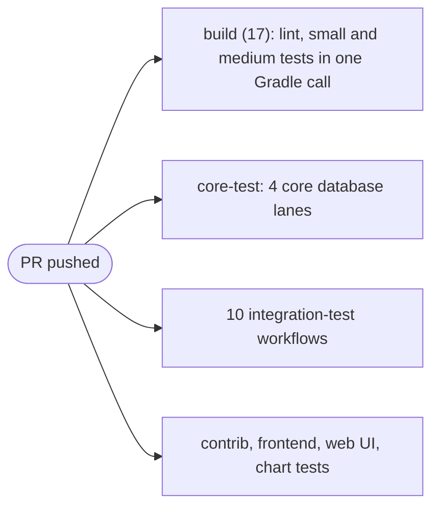
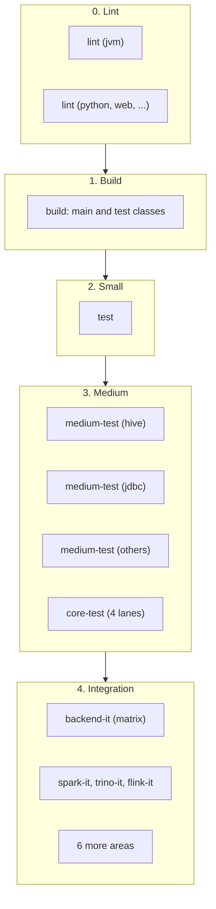

<!--
  Licensed to the Apache Software Foundation (ASF) under one
  or more contributor license agreements.  See the NOTICE file
  distributed with this work for additional information
  regarding copyright ownership.  The ASF licenses this file
  to you under the Apache License, Version 2.0 (the
  "License"); you may not use this file except in compliance
  with the License.  You may obtain a copy of the License at

   http://www.apache.org/licenses/LICENSE-2.0

  Unless required by applicable law or agreed to in writing,
  software distributed under the License is distributed on an
  "AS IS" BASIS, WITHOUT WARRANTIES OR CONDITIONS OF ANY
  KIND, either express or implied.  See the License for the
  specific language governing permissions and limitations
  under the License.
-->

# SPIP: A Staged Presubmit for Apache Gravitino

| Field     | Value                                                  |
| --------- | ------------------------------------------------------ |
| Status    | Draft                                                  |
| Author    | Nevin Zheng                                            |
| Reviewers | TBD                                                    |
| Created   | 2026-10-22                                             |
| Updated   | 2026-10-22                                             |
| Related   | Test organization ([#14092][i14092], [#14093][i14093]) |
| Decide by | `<date, two weeks after posting>`                      |

[i14092]: https://github.com/apache/gravitino/issues/14092
[i14093]: https://github.com/apache/gravitino/pull/14093

---

## Q1. What are we trying to do

**One presubmit workflow that runs the cheapest checks first and the most expensive last, with each
stage gated on the one before and fanned out in parallel inside.**

1. **Lint:** static checks that compile nothing, one parallel job per toolchain (JVM, Python, web,
   Helm, workflows, docs).
2. **Build:** compile everything and publish locally, no tests.
3. **Small tests:** unit tests that need no container.
4. **Medium tests:** unit tests that need one container, and the core database lanes.
5. **Integration tests:** one job per area (backend, Spark, Trino, Flink, ...), each only when its
   paths change.

**Why it matters:** today 15 build and test workflows start the moment a PR is pushed, and none
waits for anything. A PR with a formatting error still starts every integration test, and a red
`build (17)` can mean a lint error, a unit test or a slow container, because they share one Gradle
call.

### Today: everything starts at once

**Nothing waits for anything.** The push starts 15 build and test workflows together. A Spotless
error in one file still starts every container, and `build (17)` fails for any of three reasons that
the check name does not tell apart: a lint error, a unit test, or a container test.

### Presubmit: stages in order, fan-out inside each

**Each arrow is a gate: the next stage starts only when every job in this one is green.** Inside a
stage the jobs run in parallel, so a stage takes as long as its slowest job. The stages go from
cheapest to most expensive:

- **Lint** needs no compile, so a formatting or license error fails in minutes.
- **Build** compiles everything, main and test sources, so a compile error fails before any test.
- **Small** tests need one JVM and nothing else, so they fail fast and never flake on Docker.
- **Medium** tests need one container. Their shard list comes from Gradle (`ciShards`), so adding a
  shard is a Gradle change and the matrix follows.
- **Integration** tests start a server and several engines. Each area runs only when its paths
  change, as today.

**Gradle names each stage and shard as a task, and writes the shard list. Actions runs them in
order (`needs:`) and fans them out (a matrix from that list).**

### Who owns what

**Gradle owns what runs; GitHub Actions owns when, where and how wide.** A contributor can run any
presubmit job locally by typing the same `./gradlew <task>` the job runs.

| Concern                     | Owner   | How                                     |
| --------------------------- | ------- | --------------------------------------- |
| What a stage or shard is    | Gradle  | One task per stage or shard             |
| The shard list for a matrix | Gradle  | `ciShards` writes JSON to the job       |
| Order between stages        | Actions | `needs:`                                |
| Fan-out within a stage      | Actions | `strategy.matrix` from `fromJSON`       |
| Which areas changed         | Actions | `dorny/paths-filter`, as today          |
| Reports, coverage files     | Actions | `upload-artifact` / `download-artifact` |
| Shell scripts               | Nobody  | A Gradle task or an action instead      |

---

## Q2. Non-goals

- **Moving tests.** Which source set a test lives in is test organization's job
  ([#14093][i14093]). This SPIP only changes how CI calls today's tasks.
- **New test sizes in Gradle.** The small and medium stages reuse today's `test` task per module.
- **Faster tests.** Wall time may go up for a green PR, since stages wait for each other. The goal
  is an order that fails fast and a pipeline that test organization can slot into.
- **Remote build cache.** Sharing compiled output across jobs needs ASF Develocity onboarding; see
  Q7.

---

## Q3. Today and limits

| What                     | Today                                                                |
| ------------------------ | -------------------------------------------------------------------- |
| PR workflows             | 15 build and test, all on `pull_request`, none gated on another      |
| Lint                     | Inside `build (17)`, in the same Gradle call as the tests            |
| Unit tests               | `build -PskipITs -PskipDockerTests=false` plus `-x` exclusions       |
| Docker-tagged unit tests | Same call; 9 modules, about 64% of the job's test time               |
| Integration tests        | 10 wrapper workflows, each a `paths-filter` plus a reusable workflow |
| Arguments                | Built in bash (`gradle_args` arrays, `printf`, loops)                |

**Limit:** Gradle has no task that means "small tests" or "this shard", so a stage cannot be one
task name without some Gradle glue. The interim glue is one file, replaced by test organization.

### Gaps per stage

A scan of the code base for each stage, against main at `b748d734` (method and evidence in
[Appendix C](#appendix-c-gap-scan)). **Fixed here** means this SPIP's first PR closes it.

| Stage       | Gap                                                                  | Plan                      |
| ----------- | -------------------------------------------------------------------- | ------------------------- |
| Lint        | Script plugins under `gradle/` are not formatted by Spotless         | Fixed here                |
| Lint        | The Python client's `black` rewrites files and never fails CI        | Fixed here                |
| Lint        | No linter for the workflows                                          | Fixed here                |
| Lint        | No linter for 81 shell scripts or the Markdown docs                  | Fixed here (errors only)  |
| Build       | `build -x test` compiles no test sources (106 `compileTestJava` cut) | Fixed here                |
| Build       | `:plugins:k8s-job-executor:shadedJarTest` ran inside `build`         | Fixed here                |
| Build       | `clients/filesystem-fuse` (Rust) is in no build and no workflow      | Deprecated: no job        |
| Small       | `integration-test-common` unit tests also ran in backend-it          | Fixed here                |
| Small       | The 338 web-v2 unit tests (vitest) ran in no CI job                  | Fixed here                |
| Small       | `skipITs` is copied into 34 build files; a module can forget it      | Test org                  |
| Medium      | None: every module with Docker-tagged unit tests is in a shard       | Enforced                  |
| Integration | `clients/cli` `TableFormatOutputIT` ran in no job                    | Fixed here                |
| Integration | The CLI (about 130 commands) has one end-to-end test class           | Follow-up                 |
| Integration | `web/integration-test` (web UI v1) ran in no PR job                  | Own job; reviewers decide |
| Integration | `backend-it` is "every module minus 28 `-x`", so it accumulates      | Fixed here                |

**Decision** needs an owner's call (keep and test it, or
retire it). **Enforced** means `ciVerifyShards` fails `lint` if it regresses.

---

## Q4. What we need to implement

### Workflow

`build.yml` becomes `presubmit.yml`:

| Stage | Job                     | Command                                                              |
| ----- | ----------------------- | -------------------------------------------------------------------- |
| 0     | `lint`                  | `./gradlew ciLint`                                                   |
| 1     | `build`                 | `./gradlew publishToMavenLocal -x test`, `build testClasses -x test` |
| 2     | `test`                  | `./gradlew ciSmallTest -PskipITs -PskipDockerTests=false`            |
| 3     | `medium-test (<shard>)` | `./gradlew ciMediumTest<Shard> -PskipITs -PskipDockerTests=false`    |
| 3     | `core-test (<lane>)`    | `./gradlew :core:core<Lane>Test`, as today                           |
| 4     | `<area>-it`             | The area's existing `*-action.yml`, unchanged                        |

- The ten wrapper workflows (access control, backend, Flink, Iceberg REST + Trino, idp-basic,
  maintenance, MCP, Python, Spark, Trino) are folded into presubmit. Their path filters move into
  the `changes` job unchanged, and their matrices are kept.
- `contrib-catalog-test` and `frontend-integration-test` are called workflows too, gated on the
  unit test stages. Contrib runs one job per changed module, from one paths filter per module.
- `web-ui-tests` is gone: its checks are `lint (web)`, and its tests, now for both UIs, are
  `test (web)` in the small stage. `chart-test` (lint, unit tests and kind installs) is a called
  workflow too, on pull requests only.
- `coverage` waits for every unit test stage and merges their reports, as today.

### Lint stage

Lint is a stage, not one check. Each linter needs a different toolchain, so each is its own job,
and all of them run in parallel before `build`.

| Job                | Command                                                | Today                    | Joins |
| ------------------ | ------------------------------------------------------ | ------------------------ | ----- |
| `lint (jvm)`       | `./gradlew ciLint`                                     | Inside `build (17)`      | P1    |
| `lint (python)`    | `blackCheck`, `pylint` and the mcp-server format check | Inside the IT jobs       | P1    |
| `lint (web)`       | `lintCheck` and `prettierCheck` for both web UIs       | Inside the web workflows | P1    |
| `lint (helm)`      | `ct lint` with `dev/ci/lintconf.yaml`                  | `chart-test.yaml`        | P4    |
| `lint (workflows)` | `actionlint`, with shellcheck of `run:` at warning     | Not run                  | P1    |
| `lint (docs)`      | `rumdl check design-docs/ci`                           | Not run                  | P1    |
| `lint (shell)`     | `shellcheck --severity=error` on tracked `*.sh` files  | Not run                  | P1    |

`ciLint` is Spotless, RAT license headers, checkstyle (when a module applies it) and
`ciVerifyShards` (below). `conflict-marker-check.yml` and `asf-allowlist-check.yml` stay separate:
they guard the repository, not a build, and are already cheap.

### Build once, use many

**Yes: with `build` in front, every later job can pull `build`'s compiled output instead of
compiling again.** Today every job compiles from scratch: `test`, three `medium-test` shards, four
`core-test` lanes, and about 16 integration jobs, each of which starts with
`./gradlew compileDistribution -x test`.

Gradle already has the mechanism: the build cache (`org.gradle.caching=true` is set in
`gradle.properties`). A task whose inputs match a cache entry loads its outputs instead of running
(`FROM-CACHE`). What is missing is a cache that the jobs of one run share.

| Option                      | What is shared                          | On PRs today | Cost                        |
| --------------------------- | --------------------------------------- | ------------ | --------------------------- |
| Run-scoped build cache      | `build`'s task outputs, within one run  | Yes          | Cache size; evictions       |
| `setup-gradle` home cache   | Dependencies and `main`'s cache entries | Read-only    | Replaces `setup-java` cache |
| ASF Develocity remote cache | Task outputs across runs and laptops    | After Infra  | Onboarding                  |
| Upload `build/` directories | Raw files                               | Yes          | Not Gradle-aware; avoid     |

**Recommendation: a run-scoped build cache in P3, then Develocity.**

1. `build` runs with the local build cache on and saves it with `actions/cache/save`, keyed by the
   run (`gradle-build-cache-${{ github.run_id }}`).
2. Every later job restores that exact key with `actions/cache/restore` before its `./gradlew`
   line. Its compile tasks come `FROM-CACHE`; only its tests run.
3. Everything stays declarative: two action steps, no shell. A cache miss only means the job
   compiles, as today, so it is never wrong, only slower.

Cache keys match across jobs because every runner checks out to the same path, so absolute-path
inputs (such as `gravitino.repositoryRoot`) do not break hits within a run. Across runs and on
laptops they do, which is why Develocity needs that input made relative first. Develocity then
replaces steps 1 and 2 with one remote cache that `main` fills and every PR reads.

### Gradle

`gradle/ci-stages.gradle.kts`, applied by one line in the root `build.gradle.kts`:

- `ciSmallTest`: the `test` task of every module except the medium modules and the modules CI
  tests elsewhere (core lanes, Python client, contrib catalogs).
- `ciMediumTest<Shard>`: the `test` task of the modules with Docker-tagged unit tests, in three
  shards (`hive`, `jdbc`, `others`).
- `ciShards`: writes the shard list as JSON to `$GITHUB_OUTPUT`; the matrix reads it.
- `ciVerifyShards`: part of `ciLint`; fails when a shard list drifts from the code (below).

### Catch-all shards

**A catch-all is needed, so that nothing is ever dropped, but it must not accumulate.** `others`
(medium tests today, `backendITOthers` after test organization) holds what no named shard owns.
Left alone, every new module lands there and it becomes the slowest job. Three rules stop that:

1. **Declared, never inferred.** Every module that needs a container is listed in a shard, `others`
   included. An unlisted one still runs in the small stage with Docker on, so it is never lost,
   but `ciVerifyShards` fails `lint` and names it.
2. **A baseline for `others`.** `others` may shrink freely. Growing it past its baseline fails
   `ciVerifyShards`, so a PR that adds to it raises the baseline in the same diff, where a
   reviewer sees it.
3. **Split by size, not by name.** When a named group in `others` is large enough to be its own
   job (for example three modules sharing one container), it moves to a new shard. That is one
   entry in the shard list; the matrix picks it up from `ciShards`.

`backend-it` follows the same rules now. `ciIntegrationTestJobs` lists the modules each named
integration job owns; `ciBackendIntegrationTest` runs every other module's `test`, so a module
without a named job still runs there. `ciVerifyShards` fails on an unknown module, a module in two
jobs, or a `backend-it` past its baseline of 17 modules with integration tests.

After test organization the same rules apply to `backendITOthers`, with the shard declared in each
module (`gravitinoTests { itShard = ... }`) instead of one list.

### Guarantees

1. **No test lost.** Small, medium and skipped together are exactly today's set: a dry run lists
   the same 102 `test` tasks.
2. **Misplaced, never dropped.** A module with Docker-tagged tests missing from the medium list
   still runs in `ciSmallTest` with Docker on, and `lint` fails until it is listed.
3. **Compile errors stop at `build`.** `build` compiles main and test sources (`testClasses`), so
   no test job starts on code that does not compile.
4. **Same command locally.** Every job is one `./gradlew` line.
5. **No shell to choose what runs.** Task names and workflow expressions only.

---

## Q5. Who cares

| Persona         | Difference                                                    |
| --------------- | ------------------------------------------------------------- |
| Contributor     | A lint error fails in minutes and stops the run               |
| Reviewer        | A red check names the stage that failed                       |
| CI maintainers  | One workflow, task names in the matrix, no `gradle_args` bash |
| ASF runner pool | A broken PR uses one lint job instead of 15 workflows         |

---

## Q6. Risks

| Risk                               | Impact                      | Mitigation                      |
| ---------------------------------- | --------------------------- | ------------------------------- |
| Stages add wall time to green PRs  | Slower merge for green PRs  | Lint and build are short (1)    |
| Each job recompiles                | More runner minutes         | Run-scoped build cache (Q4, P3) |
| A Docker module is not listed      | Runs in the small stage     | `ciVerifyShards` fails `lint`   |
| `others` keeps growing             | One slow job                | Baseline in `ciVerifyShards`    |
| Fewer workflows in the Checks list | Unfamiliar check names      | Job names match the old areas   |
| Pending changes to `build.yml`     | Rebase onto `presubmit.yml` | One-time move of the change     |

1. To be measured on the first CI runs and filled in here.

---

## Q7. Timeline

| Step | Change                                                                | Revert    |
| ---- | --------------------------------------------------------------------- | --------- |
| P1   | `presubmit.yml`, `ci-stages.gradle.kts`, IT fold, no inline shell     | Revert PR |
| P2   | Other lint jobs, P2 gaps (Q3)                                         | Revert PR |
| P3   | Run-scoped build cache, `setup-gradle` (done here); Develocity later  | Revert PR |
| P4   | Contrib, frontend, web UI and chart-test join presubmit (done here)   | Revert PR |

**After test organization** ([#14093][i14093]), the jobs stay and only their commands change:

| Job           | Interim command             | After test organization                      |
| ------------- | --------------------------- | -------------------------------------------- |
| `lint`        | `ciLint`                    | `spotlessCheck rat`, shard check             |
| `build`       | `build testClasses -x test` | `build` (`check` runs no tests)              |
| `test`        | `ciSmallTest`               | `test`                                       |
| `medium-test` | `ciMediumTest<Shard>`       | `containerOnlyIT`, one job                   |
| `core-test`   | `core<Lane>Test`            | Unchanged                                    |
| `backend-it`  | `*-action.yml` inputs       | `backendITHive`, `...Lakehouse`, `...Others` |

Lint stays `spotlessCheck rat` rather than `check`, because `check` compiles (Error Prone runs in
`compileJava`). The medium stage has no suite of its own in test organization: its container-only
tests become tagged integration tests that run once, in one job.

`ci-stages.gradle.kts` is then deleted; module declarations replace its lists.

---

## Q8. Exams

- A PR with a Spotless violation fails `lint` and starts no other test job.
- A PR that changes only `docs/` text starts no Gradle job.
- A new module with Docker-tagged tests and no shard fails `lint`, naming the module.
- A PR that adds a module to `others` without raising its baseline fails `lint`.
- A PR whose test sources do not compile fails `build`, and no test job starts.
- With the run-scoped cache (P3), the `test` job's log shows its compile tasks as `FROM-CACHE`.
- Every job's command runs unchanged on a laptop.
- `grep -c 'gradle_args' .github/workflows/presubmit.yml` prints `0`.
- The executed test classes per job, summed, match the old `build (17)` and wrapper workflows.

---

## Appendix A. Options considered

- **Keep `build.yml`, add `needs:` only.** Cannot gate the integration tests, because `needs:` does
  not cross workflows.
- **`workflow_run` chains.** Results do not show on the PR as checks of one run, and each link
  re-checks out and re-filters.
- **Shard lists in YAML.** Two places to keep in sync (the matrix and the `-x` list); Gradle
  owning the list keeps one.
- **Shell scripts for sharding** (as in [#13495](https://github.com/apache/gravitino/pull/13495)).
  Logic outside Gradle cannot be run or tested like the build.

## Appendix B. References

- [Test sizes](https://testing.googleblog.com/2010/12/test-sizes.html), Google Testing Blog.
- [setup-gradle](https://community.gradle.org/github-actions/docs/setup-gradle), caching on CI.
- [Isolated Projects](https://docs.gradle.org/current/userguide/isolated_projects.html), aggregate
  tasks by path.
- [Reusing workflows](https://docs.github.com/en/actions/how-tos/reuse-automations/reuse-workflows),
  GitHub Actions.
- [ASF Gradle / Develocity](https://infra.apache.org/gradle.html), build scans and cache.
- [Apache Kafka CI overhaul](https://develocity.ai/blog/apache-kafka-ci-overhaul/), a peer project
  on Gradle and Actions.

## Appendix C. Gap scan

Each check was run on this branch (`d8663767`, based on main `b748d734`) with Gradle dry runs and
file scans. It is a snapshot; P2 turns the repeatable ones into `ciVerifyShards` checks.

**Lint.**

- Spotless covers Java and the `*.gradle.kts` files in each project directory. The script plugin
  `gradle/ci-stages.gradle.kts` was outside it; the root project now also targets
  `gradle/*.gradle.kts`, checked by introducing a violation.
- `:clients:client-python:black` runs `black ./gravitino ./tests ./scripts`, which rewrites files.
  `:mcp-server` runs `black --check`. Only the Python client can merge unformatted code.
- Tracked files with no linter in CI: 81 `*.sh`, 40 workflow `*.yml`, `docs/**/*.md`.
  `design-docs/` has a rumdl config, but no job runs it.
- Checkstyle is not applied on main yet; `ciLint` picks it up when a module applies it.

**Build.**

- `build -x test --dry-run` against `build --dry-run`: the only `build` tasks missing are the three
  the workflow excludes on purpose (`client-python`, `mcp-server`, `web-v2:web`), each built in its
  own job. But all 106 `compileTestJava` tasks and `:common:compileTestFixturesJava` were missing
  too, because `-x test` removes the test task and everything only it needed. Adding
  `testClasses` brings all 106 back.
- `shadedJarTest` is a `Test` task that `check` depends on, so `build` ran a test. The build job
  now excludes it and `ciSmallTest` runs it.
- `clients/filesystem-fuse` has a `build.gradle.kts` but is not in `settings.gradle.kts`, and no
  workflow mentions it. Its README marks it deprecated and kept for reference only, so it gets no
  job; removing it is a separate question for reviewers.

**Tests.** Each module's test classes, counted by `@Test` inside and outside `integration/test/`,
matched to the job that runs them:

| Module                                                                 | Runs in                                                             |
| ---------------------------------------------------------------------- | ------------------------------------------------------------------- |
| `catalogs/*`, `client-java`, `filesystem-hadoop3`, `lance-rest-server` | `backend-it` (catch-all)                                            |
| `authorizations/*`                                                     | `access-control-it`                                                 |
| `catalogs-contrib/*`                                                   | `contrib-catalog-test.yml`                                          |
| `flink-connector/*` (common sources compile into each version)         | `flink-it`                                                          |
| `spark-connector/v3.5`, `v4.0`                                         | `spark-it`                                                          |
| `trino-connector/integration-test`                                     | `trino-it`                                                          |
| `iceberg-rest-trino-it`                                                | `iceberg-rest-trino-it`                                             |
| `maintenance/optimizer`                                                | `maintenance-it`                                                    |
| `plugins/idp-basic`                                                    | `idp-basic-it`                                                      |
| `web-v2/integration-test`                                              | `frontend-integration-test.yml`                                     |
| `clients/cli` (1 IT class, 6 tests)                                    | `cli-it`; catalogs with `verify-on-create=false`                    |
| `web/integration-test` (4 IT classes)                                  | `FrontendITWebV1` in `frontend-integration-test.yml`                |
| `integration-test-common` (5 classes)                                  | Small stage only: plain unit tests in an `integration.test` package |

Off PRs by design: the Lance Spark bundle matrix (weekly), multi-instance consistency and Trino
multi-version (manual), and Doris multi-version (`-PdorisMultiVersionTest`, local).

The `backend-it` row is the integration catch-all. It used to run `test -PskipTests` on every
module and remove others with 28 `-x` flags, so a new module's ITs landed there without anyone
choosing, and a module removed with `-x` but given no other job was lost, which is what happened to
`clients/cli`. It now runs `ciBackendIntegrationTest`, which derives the same task set (checked with
a dry run) from `ciIntegrationTestJobs`, under the [catch-all rules](#catch-all-shards).

## Appendix D. Peer Apache projects

How other Apache projects order and share their CI work, read from their workflow files on
2026-10-22.

| Project | Order                                                        | Build once                                      | Lint                                           |
| ------- | ------------------------------------------------------------ | ----------------------------------------------- | ---------------------------------------------- |
| Kafka   | `validate` (`check -x test`) gates the `test` matrix         | `setup-gradle`, read-only off trunk, Develocity | Checkstyle, RAT inside `validate`              |
| Iceberg | Parallel jobs; `build -x test` is its own check              | `setup-gradle`, writes only from main           | Spotless separate; zizmor on workflows         |
| Spark   | `precondition` (what changed), then `precompile`, then tests | Uploads compiled `target/` dirs as an artifact  | Own `lint` job in a CI image                   |
| Airflow | `build-info` (selective checks) gates everything             | Prebuilt CI images                              | pre-commit: ruff, shellcheck, yamllint, zizmor |
| Arrow   | `lint` workflow separate from builds                         | Per-language caches                             | pre-commit, including shellcheck               |

What this SPIP takes from them:

- **Kafka's order**, the closest peer on Gradle: one validate stage before any test, and
  Develocity as the build cache, written only from trunk.
- **Spark's build-once**, but Gradle-aware: Spark ships raw `target/` directories because sbt has
  no shared cache; Gradle's build cache does the same job and knows what is stale (Q4).
- **Iceberg's `setup-gradle` settings**: cache written from `main` only. `setup-gradle` is on the
  ASF allowlist; actionlint and zizmor actions are not, so `lint (workflows)` runs actionlint with
  `go run`.
- **Airflow and Arrow's shellcheck**, for the P2 `lint (shell)` job.
