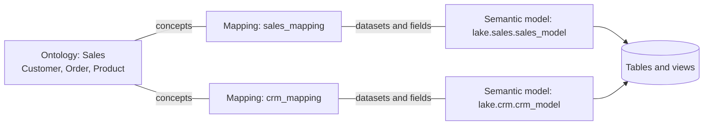

<!--
  Licensed to the Apache Software Foundation (ASF) under one
  or more contributor license agreements.  See the NOTICE file
  distributed with this work for additional information
  regarding copyright ownership.  The ASF licenses this file
  to you under the Apache License, Version 2.0 (the
  "License"); you may not use this file except in compliance
  with the License.  You may obtain a copy of the License at

   http://www.apache.org/licenses/LICENSE-2.0

  Unless required by applicable law or agreed to in writing,
  software distributed under the License is distributed on an
  "AS IS" BASIS, WITHOUT WARRANTIES OR CONDITIONS OF ANY
  KIND, either express or implied.  See the License for the
  specific language governing permissions and limitations
  under the License.
-->

# Design of Apache Ossie Ontology and Mapping Management in Gravitino

---

## Background

Gravitino manages Apache Ossie semantic models
([semantic model design](gravitino-semantic-model-design.md)). Ossie also defines ontologies and
standalone mappings, which Gravitino cannot store yet. A sales organization would use the three like
this:

| View               | Question it answers                                      | Example                                                                         | Written by                              |
| ------------------ | -------------------------------------------------------- | ------------------------------------------------------------------------------- | --------------------------------------- |
| **Semantic model** | How do we compute our numbers?                           | `sales_model` joins `CUSTOMERS` and `ORDERS` and defines `revenue`              | A model owner who knows the tables      |
| **Ontology**       | What do our business terms mean, and how do they relate? | A `Customer` is a `Party`, is identified by a customer number, and places `Order`s | A data steward, once for the company |
| **Mapping**        | Where does a term live in a given model?                 | In `sales_model`, `Customer` comes from `CUSTOMERS`, identified by `CUSTOMERS.id` | The model owner, against the ontology |



The ontology names no tables, so one ontology serves the models of every domain, each through its
own mapping. Without Gravitino support:

| User                | Wants to                                                                     | Today                                                                       |
| ------------------- | ---------------------------------------------------------------------------- | --------------------------------------------------------------------------- |
| Data steward        | Publish the vocabulary once, govern it like other metadata, and see who uses it | It lives in wikis or OWL files, outside ownership, privileges and audit  |
| Model owner         | Declare which datasets carry which business concepts                         | A semantic model has no link to any concept                                 |
| AI agent or analyst | Read what `Customer` means and how a model maps it                           | Documents sit in files, outside permission checks                           |

Changes to the vocabulary can also break mappings that other people own, leaving them pointing at
concepts or relationships that no longer exist. Gravitino must reject such a change before it takes
effect.

---

## Goals

1. **Ontology lifecycle.** Manage ontologies as metalake-wide metadata shared by every catalog.
2. **Mapping lifecycle.** Manage the mappings that bind a semantic model to an ontology.
3. **Interoperability.** Import and export both as Ossie documents in the pinned structure.
4. **Reference integrity.** Reject mappings and ontology changes that break structured references.
5. **Governance.** Govern ontologies as securable metadata, and mappings through their semantic model.
6. **Client access.** Expose the operations through REST, Java, Python and MCP.

---

## Non-Goals

1. **Query compilation and evaluation.** Ontology expressions are stored but never evaluated, so
   names inside `derived_by` and `requires`, such as `Person.earns`, are not checked when a concept
   or relationship is renamed or removed.
2. **Revision history and publication.** A later design can add them, together with how the
   reference checks treat ontology drafts. The storage already has the layout it extends (see
   [Version Behavior](#version-behavior)).
3. **OWL/RDF interop.** IRIs and prefixes are stored but never dereferenced.
4. **UI.** This design covers the server and its APIs.

---

## Proposal

### User Process

1. A data steward imports `Sales.ontology.yaml`.
2. A model owner imports `sales_mapping.mapping.yaml` under `lake.sales.sales_model`. Its concepts are
   checked against Sales.
3. An agent loads Sales to read what `Customer` means, lists the mappings of Sales, and loads
   `sales_mapping` to see which fields of `sales_model` carry it.
4. The steward lists the mappings of Sales and finds `sales_mapping`.
5. The steward renames `Customer` to `Client`. Removing `Customer` first returns `409` naming
   `sales_mapping`, so the steward adds `Client`, the model owner moves the mapping to it, and the
   steward then removes `Customer`.

### Object Model and Namespace

```text
metalake
  Ontology                       (new, metalake scope, securable)
  catalog
    schema
      SemanticModel
        OntologyMapping          (new, child of SemanticModel, not securable)
```

- **Types.**
  - `ONTOLOGY` is a new securable metadata object type.
  - A mapping is a stored entity but not a metadata object of its own. Its governance is that of its
    semantic model.
- **Identity.**
  - The entity name is the Ossie `name`.
  - Ontology names are unique per metalake. Mapping names are unique per semantic model.
  - A semantic model has at most one mapping per ontology, so a consumer never chooses between two.
    The spec leaves this open ([apache/ossie#819](https://github.com/apache/ossie/issues/819)).
  - A rename keeps the stable ID.
- **References.**
  - A mapping references its ontology by ID, and its semantic model is its parent.
  - Export writes the current names into `ontology_ref.name` and `semantic_model_ref.name`, so a
    rename never breaks a mapping.
- **Model revisions.** With
  [semantic model revisions](https://github.com/apache/gravitino/blob/main/design-docs/gravitino-semantic-model-revision-design.md),
  a mapping belongs to the model's identity, not to a revision, as tags and owners do.
  - Model saves and publications never change a mapping, and mapping saves never create a model
    revision.
  - Consumers resolve a mapping's expressions against the model revision they read, the active one
    by default.
  - A mapping can be created under a model that has never been published. Until then, mapping
    loads and lists return `404` to callers without modify rights on the model, as the model's own
    reads do.
  - A mapping is not staged with a model draft. When a model change renames or removes a field that
    a mapping uses, the owner updates the mapping right after the change is published, so the
    mapping briefly lags the active revision. Binding mappings to revisions is left to a later
    design.
- **Source of truth.** Gravitino owns both objects. The API is marked evolving, and the docs mark the
  feature experimental.

**Design choice 1: the ontology lives at metalake scope.**
- **Why.** Placement follows ownership, not references. Like Tag and Policy, an ontology is
  vocabulary governed for the whole metalake.
- **Schema scope was rejected.**
  - Reading the ontology would need use rights on its host catalog and schema, which most of its
    users have no other reason to hold.
  - The schema owner would implicitly own the ontology.
  - Dropping the schema would drop an ontology that models in other schemas depend on.
- **Cost.** Ontology names are unique per metalake.

**Design choice 2: the mapping is a child of the semantic model.**
- **Why.** A mapping exposes model internals, so it follows the model's authorization and cascades
  with schema and catalog drops. ModelVersion under Model is the precedent.
- **A child of the ontology was rejected.**
  - Reading it would still need model load rights.
  - A schema drop would have to clean up metalake-scoped objects.
- **An independent metalake object was rejected.** It would need a new securable type and new
  privileges, for an object that is meaningless without its model.
- **Cost.**
  - Finding an ontology's mappings crosses schemas, so each mapping row carries an indexed ontology
    ID.
  - Writing a mapping requires modify rights on the model.

### Ontology Data Model

```text
Ontology
  name: string                          # Ossie name
  comment?: string                      # Ossie description
  definition: OntologyDefinition
    ai_context?: AIContext
    prefixes?: map<string, string>      # prefix -> IRI
    requires?: string[]
    annotations?: map<string, json>
    ontology: Concept[1..*]
  properties: map<string, string>
  audit_info: AuditInfo

Concept
  concept: string
  type: EntityType | ValueType
  description?: string
  extends?: string[]
  identify_by?: string[]
  derived_by?: string[]
  requires?: string[]
  relationships?: Relationship[]
  iri?: string
  annotations?: map<string, json>

Relationship
  name: string
  roles?: Role[]
  multiplicity?: ManyToOne | OneToOne
  description?: string
  verbalizes: string[1..*]
  derived_by?: string[]
  requires?: string[]
  iri?: string
  annotations?: map<string, json>

Role
  concept: string
  name?: string
  annotations?: map<string, json>
```

- **Gravitino metadata.** The Ossie `version` is kept in the `ossie-version` property. Properties
  are exported in the reserved `gravitino_properties` annotation.
- **Arity.** The concept that declares a relationship plays its first role, so the arity is one plus
  the number of `roles`.
- **Not interpreted.** Expressions are never evaluated (non-goal 1), and IRIs are never
  dereferenced. Embedded `ontology_mappings` are rejected on import: each carries a whole semantic
  model rather than a reference, which names no catalog or schema to bind to, and upstream
  deprecates them. Each entry can be imported as a mapping document instead.
- **Validation.** A definition is rejected with `400 IllegalOntologyException` and the JSON path
  unless it passes the pinned schema and the rules the pinned
  [ontology spec](https://github.com/apache/ossie/blob/3719487ff2744b207d0cc9bed66f5406f410dc3d/ontology/ontology.md)
  states in prose, such as built-in concepts, `extends`, role names and `identify_by`. Gravitino
  checks them even where upstream `validate.py` does not.

### Mapping Data Model

```text
OntologyMapping
  name: string                          # Ossie name
  comment?: string                      # Ossie description
  ontology: string                      # ontology_ref.name, fixed for life
  definition: OntologyMappingDefinition
    concept_mappings: ConceptMapping[]
    nonportable_extensions?: NonportableExtension[]
  properties: map<string, string>
  audit_info: AuditInfo

ConceptMapping
  concept: string
  object_mappings?: ObjectMapping[]
  link_mappings?: LinkMapping[]

ObjectMapping
  concept?: string
  expression?: string
  referent_mappings?: ReferentMapping[]

ReferentMapping
  relationship: string
  expression?: string
  referent_mappings?: ReferentMapping[]

LinkMapping
  object_mapping: ObjectMapping
  relationship?: string
  children?: LinkMapping[]
```

- **Gravitino metadata.** The Ossie `version` is kept in the `ossie-version` property. Properties
  are exported in the reserved `GRAVITINO_PROPERTIES` entry of `nonportable_extensions`.
- **References.** `ontology` cannot change, and `semantic_model_ref` is the parent model, so neither
  is stored as text. Export writes their current names, and `iri` is dropped on import.
- **Not interpreted.** Expressions are SQL strings, stored verbatim and never validated.
- **Validation.** Beyond the pinned schema, a definition must pass the reference and arity checks
  in [Mapping save](#mapping-save).

### Ossie Compatibility

- **Pin.** Ontologies and mappings are validated against Apache Ossie `main` at
  [`3719487`](https://github.com/apache/ossie/tree/3719487ff2744b207d0cc9bed66f5406f410dc3d)
  (2026-11-20, `0.3.0.dev0`). Implementation re-pins to the latest `main` when it starts.
- **Version.** `ossie-version` records the document's `version` on import, and the pin on a native
  create. Import requires a non-empty `version` but does not compare it with the pin, so documents
  from a nearby development version still import. The property can be altered or removed like any
  other, so export writes the stored value, or the pin once it has been removed.
- **Re-pin.** Definitions are stored in Gravitino's data model, not as imported documents, and
  `ossie-version` only feeds export. A re-pin that only adds members changes the converter. One that
  changes stored members ships an upgrade that rewrites the stored rows. That upgrade can add a
  format column defaulting existing rows to 1, so none is reserved now.
- **Semantic models.** Their contract still matches `1ea545c` (2026-10-04, `0.2.0.dev0`), and
  moving it to the pin is a separate semantic model change. Mappings do not wait on it, because no
  mapping check reads the model's definition.

**Design choice: one pin on latest `main` for ontologies and mappings.**
- **Why.** Latest `main` leads to the first Apache release, and a mapping must validate together
  with the ontology it references.
- **Older `0.2.0.dev0` pins were rejected.** Upstream will never release `0.2.0`.
  - `88e0011` (2026-07-31), the semantic model design's pin, has no standalone `mapping.json`.
  - `1ea545c` (2026-10-04) has no `annotations` slot in its ontology for properties, and its
    `mapping.json` references a `main` path that no longer exists.
- **Cost.** Until the semantic model change ships, an exported model and its mappings carry
  different Ossie versions.

### API and Lifecycle

Each object gets the standard dispatcher chain: normalize, hook (owner on create), event, and
operation (validation).

#### REST API

Ontology routes are under `/api/metalakes/{m}/ontologies`. Authorization is listed in
[Authorization and Governance](#authorization-and-governance).

| Operation                    | Method   | Path                           | Request                  | Response                                    |
| ---------------------------- | -------- | ------------------------------ | ------------------------ | ------------------------------------------- |
| List ontologies              | `GET`    | (none)                         | (none)                   | `NameListResponse`, visible ontologies      |
| Create an ontology           | `POST`   | (none)                         | `OntologyCreateRequest`  | `OntologyResponse`                          |
| Import an Ossie document     | `POST`   | `/ossie`                       | Raw Ossie document       | `OntologyResponse`                          |
| Load an ontology             | `GET`    | `/{o}`                         | (none)                   | `OntologyResponse`, current version         |
| Alter an ontology            | `PUT`    | `/{o}`                         | `OntologyUpdatesRequest` | `OntologyResponse`                          |
| Drop an ontology             | `DELETE` | `/{o}`                         | (none)                   | `DropResponse`; `409` while mappings use it |
| Export as an Ossie document  | `GET`    | `/{o}/ossie?format=yaml\|json` | (none)                   | Raw Ossie document                          |
| List the ontology's mappings | `GET`    | `/{o}/mappings`                | (none)                   | `EntityListResponse`, mapping identifiers   |

Mapping routes are under
`/api/metalakes/{m}/catalogs/{c}/schemas/{s}/semantic-models/{sm}/ontology-mappings`.

| Operation                   | Method   | Path                            | Request                         | Response                                   |
| --------------------------- | -------- | ------------------------------- | ------------------------------- | ------------------------------------------ |
| List the model's mappings   | `GET`    | (none)                          | (none)                          | `EntityListResponse`                       |
| Create a mapping            | `POST`   | (none)                          | `OntologyMappingCreateRequest`  | `OntologyMappingResponse`                  |
| Import an Ossie document    | `POST`   | `/ossie`                        | Raw Ossie document              | `OntologyMappingResponse`                  |
| Load a mapping              | `GET`    | `/{om}`                         | (none)                          | `OntologyMappingResponse`, current version |
| Alter a mapping             | `PUT`    | `/{om}`                         | `OntologyMappingUpdatesRequest` | `OntologyMappingResponse`                  |
| Drop a mapping              | `DELETE` | `/{om}`                         | (none)                          | `DropResponse`                             |
| Export as an Ossie document | `GET`    | `/{om}/ossie?format=yaml\|json` | (none)                          | Raw Ossie document                         |

Create, import and `replaceDefinition` run the [Mapping save](#mapping-save) checks. Dropping a
mapping has no guard.

**Structures.** Each structure is defined once and shared by every route that uses it. JSON
bodies use the camelCase form of the data model fields, as semantic model bodies do.

`OntologyCreateRequest`:

| Field        | Type                 | Required | Description                                               |
| ------------ | -------------------- | -------- | --------------------------------------------------------- |
| `name`       | string               | yes      | Unique in the metalake. Exported as the Ossie `name`      |
| `comment`    | string               | no       | Exported as the Ossie `description`                       |
| `definition` | `OntologyDefinition` | yes      | See [Ontology Data Model](#ontology-data-model)           |
| `properties` | map<string, string>  | no       | Gravitino properties. `ossie-version` defaults to the pin |

```http
POST /api/metalakes/m/ontologies
{
  "name": "Sales",
  "comment": "Sales concepts",
  "definition": {
    "ontology": [
      {
        "concept": "CustomerId",
        "type": "ValueType",
        "extends": ["String"]
      },
      {
        "concept": "Customer",
        "type": "EntityType",
        "identifyBy": ["id"],
        "relationships": [
          {
            "name": "id",
            "roles": [{"concept": "CustomerId"}],
            "multiplicity": "OneToOne",
            "verbalizes": ["{Customer} is identified by {CustomerId}"]
          }
        ]
      }
    ]
  },
  "properties": {}
}
```

`OntologyMappingCreateRequest`:

| Field        | Type                        | Required | Description                                                                          |
| ------------ | --------------------------- | -------- | ------------------------------------------------------------------------------------ |
| `name`       | string                      | yes      | Unique in the semantic model. Exported as the Ossie `name`                           |
| `comment`    | string                      | no       | Exported as the Ossie `description`                                                  |
| `ontology`   | string                      | yes      | An ontology in the same metalake. It cannot change, so it sits beside the definition |
| `definition` | `OntologyMappingDefinition` | yes      | See [Mapping Data Model](#mapping-data-model)                                        |
| `properties` | map<string, string>         | no       | Gravitino properties. `ossie-version` defaults to the pin                            |

```http
POST /api/metalakes/m/catalogs/lake/schemas/sales/semantic-models/sales_model/ontology-mappings
{
  "name": "sales_mapping",
  "comment": "Maps Sales onto sales_model",
  "ontology": "Sales",
  "definition": {
    "conceptMappings": [
      {
        "concept": "Customer",
        "objectMappings": [
          {
            "referentMappings": [
              {"relationship": "id", "expression": "customers.customer_id"}
            ]
          }
        ]
      }
    ]
  },
  "properties": {}
}
```

`OntologyUpdatesRequest` and `OntologyMappingUpdatesRequest`:

| Field     | Type     | Required | Description                                  |
| --------- | -------- | -------- | -------------------------------------------- |
| `updates` | update[] | yes      | Applied in order, atomically, as one version |

Each update has an `@type` and the fields below. The two kinds differ only in the definition type,
so a mapping update cannot change `ontology`.

| `@type`             | Fields                              | Effect                                               |
| ------------------- | ----------------------------------- | ---------------------------------------------------- |
| `rename`            | `newName`: string                   | Renames. Exports write the new name                  |
| `updateComment`     | `newComment`: string                | Replaces the comment                                 |
| `setProperty`       | `property`: string, `value`: string | Sets a property                                      |
| `removeProperty`    | `property`: string                  | Removes a property                                   |
| `replaceDefinition` | `definition`                        | Replaces the whole definition and re-runs the checks |

```http
PUT /api/metalakes/m/ontologies/Sales
{
  "updates": [
    {"@type": "updateComment", "newComment": "Sales concepts, v2"},
    {"@type": "replaceDefinition", "definition": {"ontology": ["..."]}}
  ]
}
```

`OntologyResponse` and `OntologyMappingResponse`:

| Field                          | Type                                 | Required | Description         |
| ------------------------------ | ------------------------------------ | -------- | ------------------- |
| `code`                         | int                                  | yes      | `0` on success      |
| `ontology` / `ontologyMapping` | `OntologyDTO` / `OntologyMappingDTO` | yes      | The current version |

`OntologyDTO` and `OntologyMappingDTO`:

| Field        | Type                                               | Required     | Description                             |
| ------------ | -------------------------------------------------- | ------------ | --------------------------------------- |
| `name`       | string                                             | yes          | Current name                            |
| `comment`    | string                                             | no           | Current comment                         |
| `ontology`   | string                                             | mapping only | Current name of the referenced ontology |
| `definition` | `OntologyDefinition` / `OntologyMappingDefinition` | yes          | As stored                               |
| `properties` | map<string, string>                                | yes          | Includes `ossie-version` when set       |
| `audit`      | `AuditDTO`                                         | yes          | The existing audit structure            |

```json
{
  "code": 0,
  "ontology": {
    "name": "Sales",
    "comment": "Sales concepts",
    "definition": {"ontology": ["..."]},
    "properties": {"ossie-version": "0.3.0.dev0"},
    "audit": {"creator": "steward", "createTime": "2026-11-23T08:00:00Z"}
  }
}
```

Existing responses are reused as they are:

| Structure            | Fields                                    | Used by                                                                         |
| -------------------- | ----------------------------------------- | ------------------------------------------------------------------------------- |
| `NameListResponse`   | `code`, `names`: string[]                 | Listing ontologies, as tag listing does                                         |
| `EntityListResponse` | `code`, `identifiers`: `NameIdentifier`[] | Listing mappings. The namespace is metalake, catalog, schema and semantic model |
| `DropResponse`       | `code`, `dropped`: boolean                | Drops. `false` when nothing existed                                             |
| `ErrorResponse`      | `code`, `type`, `message`, `stack`        | Every error, see below                                                          |

```json
{
  "code": 0,
  "identifiers": [
    {"namespace": ["m", "lake", "sales", "sales_model"], "name": "sales_mapping"}
  ]
}
```

**Import and export.**
- Import takes a raw Ossie document with `Content-Type` JSON or YAML, and YAML is the default.
  Export returns one in the requested `format`.
- Import accepts documents that are valid against the pinned schema, apart from `version`. Export
  produces the pinned structure with the stored `version`.
- Cross-document references are checked by Gravitino on save, not by external tools. Exports omit
  `iri` on `ontology_ref` and `semantic_model_ref`, which the schema allows when a catalog resolves
  documents by name. The upstream CLI then skips its cross-document checks. A user who exports the
  documents to files can add `iri` to restore them.
- No external tool is promised to read an exported mapping. Upstream states that parser and
  converter support for standalone mapping documents is not available yet, and the current
  `ossie-converters` parser rejects them.

**Errors.** All status codes already exist.

| Status | Cause                                                                                                                                                                                |
| ------ | ------------------------------------------------------------------------------------------------------------------------------------------------------------------------------------ |
| `400`  | `IllegalOntologyException` or `IllegalOntologyMappingException` for an invalid document or a failed check. `IllegalArgumentException` for a bad request, such as an unknown `format` |
| `403`  | Missing authority                                                                                                                                                                    |
| `404`  | `NoSuchOntologyException`, `NoSuchOntologyMappingException` or `NoSuchSemanticModelException`                                                                                        |
| `409`  | `OntologyAlreadyExistsException`, `OntologyMappingAlreadyExistsException` or `OntologyInUseException`                                                                                |

An `OntologyInUseException` uses the existing in-use code and names the failing mappings in its
message:

```json
{
  "code": 1010,
  "type": "OntologyInUseException",
  "message": "Ontology Sales is used by lake.sales.sales_model.sales_mapping at $.conceptMappings[0].concept, and by 1 more mapping the caller cannot load"
}
```

#### Java and Python API

- `SupportsOntologies` is implemented by the metalake client, alongside tag operations.
- Mappings are reached from a loaded semantic model through `supportsOntologyMappings()`, as
  partitions are reached from a table.
- `OntologyChange` and `OntologyMappingChange` mirror `SemanticModelChange`. Import and export reuse
  `OssieDocument` and `OssieFormat`.

```text
SupportsOntologies
  listOntologies(): String[]
  loadOntology(name): Ontology
  createOntology(name, comment, definition, properties): Ontology
  importOntology(document): Ontology
  exportOntology(name, format): OssieDocument
  alterOntology(name, changes...): Ontology
  dropOntology(name): boolean
  listOntologyMappings(name): NameIdentifier[]

SupportsOntologyMappings
  listOntologyMappings(): String[]
  loadOntologyMapping(name): OntologyMapping
  createOntologyMapping(name, comment, ontology, definition, properties): OntologyMapping
  importOntologyMapping(document): OntologyMapping
  exportOntologyMapping(name, format): OssieDocument
  alterOntologyMapping(name, changes...): OntologyMapping
  dropOntologyMapping(name): boolean
```

The Java snippet follows the [User Process](#user-process):

```java
GravitinoClient client =
    GravitinoClient.builder("http://localhost:8090").withMetalake("m").build();

// 1. The steward imports the ontology.
Ontology sales =
    client.importOntology(OssieDocument.yaml(Files.readString(Path.of("Sales.ontology.yaml"))));

// 2. The model owner imports a mapping under lake.sales.sales_model.
SemanticModel model =
    client.loadCatalog("lake").asSemanticModelCatalog()
        .loadSemanticModel(NameIdentifier.of("sales", "sales_model"));
OntologyMapping mapping =
    model.supportsOntologyMappings()
        .importOntologyMapping(
            OssieDocument.yaml(Files.readString(Path.of("sales_mapping.mapping.yaml"))));

// 3 and 4. Find every mapping of Sales, across schemas.
NameIdentifier[] mappings = client.listOntologyMappings("Sales");

// 5. A replacement that breaks a mapping is rejected.
try {
  client.alterOntology("Sales", OntologyChange.replaceDefinition(withoutCustomer));
} catch (OntologyInUseException e) {
  // The message names the failing mappings the caller can load.
}

OssieDocument exported = client.exportOntology("Sales", OssieFormat.YAML);
```

Python has parity with Java, with snake_case names. Like semantic model import, Python import takes
the document text and a `document_format`:

```python
client = GravitinoClient(uri="http://localhost:8090", metalake_name="m")

sales = client.import_ontology(Path("Sales.ontology.yaml").read_text(encoding="utf-8"))

model = (
    client.load_catalog("lake")
    .as_semantic_model_catalog()
    .load_semantic_model(NameIdentifier.of("sales", "sales_model"))
)
mapping = model.supports_ontology_mappings().import_ontology_mapping(
    Path("sales_mapping.mapping.yaml").read_text(encoding="utf-8")
)

mappings = client.list_ontology_mappings("Sales")
client.alter_ontology("Sales", OntologyChange.replace_definition(without_customer))
```

#### MCP Tools

MCP adds tools tagged `ontology` for list, load, create, alter and drop of ontologies and mappings,
and for listing an ontology's mappings.
It has no import or export, because agents read the content through load.

#### Lifecycle

| Change                                                 | Behavior                                                                                       |
| ------------------------------------------------------ | ---------------------------------------------------------------------------------------------- |
| Ontology dropped while live mappings reference it      | `409 OntologyInUseException`, listed as in [Ontology save](#ontology-save-and-mapping-compatibility) |
| Ontology or semantic model renamed                     | Allowed. Exports write the new names                                                           |
| Semantic model alter changes datasets or fields        | Allowed and not checked. A wrong field surfaces only when a consumer resolves the expression        |
| Semantic model, schema or catalog dropped              | Its mappings are removed in the same transaction, following the [source lookup design](gravitino-semantic-model-source-lookup-design.md)'s cascade rules |
| Metalake dropped                                       | Ontologies and mappings are removed in the metalake cascade, and the drop guard does not apply |
| Mapping dropped                                        | The mapping and its snapshots are removed. The ontology is unaffected                          |

### Reference Integrity

A mapping names its ontology and that ontology's concepts and relationships. These names are
checked when the mapping is saved and re-checked when the ontology changes, so every live mapping
always passes checks 1, 3 and 4 below against the current ontology. SQL in `expression` is never
checked.

#### Mapping save

Create, import and `replaceDefinition` are accepted only when:

1. The ontology it names, `ontology` on create or `ontology_ref.name` on import, is live in the same
   metalake.
2. On import, `semantic_model_ref.name` equals the parent semantic model's name.
3. Every concept and relationship it names exists in the ontology, and the mapping follows the
   pinned spec's object, referent and link mapping rules, such as a referent mapping naming an
   identifying relationship. A short or qualified relationship name, such as `nr` or `CustOrder.nr`,
   resolves on the concept in scope, as upstream
   [`validate.py`](https://github.com/apache/ossie/blob/3719487ff2744b207d0cc9bed66f5406f410dc3d/validation/validate.py)
   resolves it.
4. Every link mapping's depth equals the arity of its relationship.

A failure returns `400 IllegalOntologyMappingException` with the JSON path. A second mapping of the
same ontology under one model returns `409 OntologyMappingAlreadyExistsException`. Comment, property
and rename alters skip the checks.

#### Ontology save and mapping compatibility

- **Checks.** Both fail with `409 OntologyInUseException`, which lists the failing mappings the
  caller can load and counts the rest.
  - A definition save re-runs checks 3 and 4 for every live mapping of the ontology.
  - A drop is refused while any live mapping exists.
- **Fails.**
  - removing or renaming a referenced concept or relationship;
  - changing the arity of a linked relationship;
  - removing the supertype a referenced relationship is inherited from;
  - changing `identify_by` so that a referent mapping's relationship is no longer identifying, or a
    simple identifier that an expression-only object mapping relies on becomes compound.
- **Passes.**
  - additions;
  - changes that only checking an expression would catch, such as a value type that now extends
    `Integer` instead of `String`.

#### Concurrency

- **One transaction.** A mapping save, and an ontology definition save or drop, each run in one
  store transaction: lock the ontology's identity row, read what the check needs, run the check,
  then write. An earlier check may fail fast, but only the one in the transaction decides.
- **Lock modes.** A mapping save takes a shared lock, so mapping saves of one ontology run
  concurrently. An ontology save or drop takes an exclusive lock, so it and mapping saves wait for
  each other. H2 has no shared lock and takes an exclusive one.
- **Layering.** The checks are a function of the two definitions that core passes to the store, so
  the store runs them without knowing Ossie rules.
- **No entity cache.** Neither object is cached, because a stale copy would be a wrong reference,
  not a cosmetic one. Every read, including the checks and loads on other servers, reads the
  database.
- TreeLock cannot order these writes, because they sit on different branches of the tree and
  TreeLock is local to one server.

**Design choice: check structured references only, in both directions.**
- **Why.** Concept and relationship names are exact fields, so the check needs no SQL parsing.
- **Checking SQL expressions was rejected.** It needs SQL parsing, and it would couple semantic
  model writes to mappings.
- **No cross-object checks was rejected.** Ontology changes would silently break mappings owned by
  other users.
- **Cost.** A shared row lock per mapping save, and a re-check of the ontology's mappings on each
  definition save. Semantic model writes never pay it.

### Storage and Versions

#### Relational Schema

The tables ship in the schema and upgrade scripts of the feature's release. MySQL is shown below.
H2 uses it as is, and PostgreSQL is adapted as the semantic model scripts are.

- **Mapping lookup.** `idx_onmm_oid` finds an ontology's mappings across schemas, for listing, the
  compatibility check and the drop guard.

**Design choice 1: store the whole definition in one JSON column.**
- **Why.**
  - No operation reads or writes a single top-level member. Load, export and the reference checks
    read the whole definition, and `replaceDefinition` replaces it whole.
  - The upstream ontology spec is still changing, as `annotations` was added after `1ea545c`. A new
    member then changes only the converter, not the DDL of three databases.
- **One column per top-level member, as semantic models do, was rejected.** The columns would still
  hold JSON that the database cannot index or filter, and a mapping has only one real member.
- **Cost.** Storage differs from semantic models, and a reader that needs one member reads the whole
  definition. A later per-concept query would need a derived table, not more columns.

```sql
CREATE TABLE IF NOT EXISTS `ontology_meta` (
    `ontology_id` BIGINT(20) UNSIGNED NOT NULL COMMENT 'ontology id',
    `ontology_name` VARCHAR(128) NOT NULL COMMENT 'ontology name',
    `metalake_id` BIGINT(20) UNSIGNED NOT NULL COMMENT 'metalake id',
    `audit_info` MEDIUMTEXT NOT NULL COMMENT 'ontology identity audit info',
    `current_version` INT UNSIGNED NOT NULL DEFAULT 1 COMMENT 'current version',
    `last_version` INT UNSIGNED NOT NULL DEFAULT 1 COMMENT 'last allocated version',
    `deleted_at` BIGINT(20) UNSIGNED NOT NULL DEFAULT 0 COMMENT 'ontology deleted at',
    PRIMARY KEY (`ontology_id`),
    UNIQUE KEY `uk_onm_mid_name_del` (`metalake_id`, `ontology_name`, `deleted_at`)
) ENGINE=InnoDB DEFAULT CHARSET=utf8mb4 COLLATE=utf8mb4_bin COMMENT 'ontology identity';

CREATE TABLE IF NOT EXISTS `ontology_version_info` (
    `id` BIGINT(20) UNSIGNED NOT NULL AUTO_INCREMENT COMMENT 'auto increment id',
    `metalake_id` BIGINT(20) UNSIGNED NOT NULL COMMENT 'metalake id',
    `ontology_id` BIGINT(20) UNSIGNED NOT NULL COMMENT 'ontology id',
    `version` INT UNSIGNED NOT NULL COMMENT 'version',
    `ontology_comment` TEXT DEFAULT NULL COMMENT 'comment snapshot',
    `definition` MEDIUMTEXT NOT NULL COMMENT 'normalized OntologyDefinition (JSON)',
    `properties` MEDIUMTEXT DEFAULT NULL COMMENT 'properties snapshot (JSON)',
    `audit_info` MEDIUMTEXT NOT NULL COMMENT 'version audit info',
    `deleted_at` BIGINT(20) UNSIGNED NOT NULL DEFAULT 0 COMMENT 'version deleted at',
    PRIMARY KEY (`id`),
    UNIQUE KEY `uk_onvi_oid_ver_del` (`ontology_id`, `version`, `deleted_at`),
    KEY `idx_onvi_mid` (`metalake_id`)
) ENGINE=InnoDB DEFAULT CHARSET=utf8mb4 COLLATE=utf8mb4_bin COMMENT 'ontology versions';

CREATE TABLE IF NOT EXISTS `ontology_mapping_meta` (
    `mapping_id` BIGINT(20) UNSIGNED NOT NULL COMMENT 'mapping id',
    `mapping_name` VARCHAR(128) NOT NULL COMMENT 'mapping name',
    `metalake_id` BIGINT(20) UNSIGNED NOT NULL COMMENT 'metalake id',
    `catalog_id` BIGINT(20) UNSIGNED NOT NULL COMMENT 'catalog id',
    `schema_id` BIGINT(20) UNSIGNED NOT NULL COMMENT 'schema id',
    `semantic_model_id` BIGINT(20) UNSIGNED NOT NULL COMMENT 'parent semantic model id',
    `ontology_id` BIGINT(20) UNSIGNED NOT NULL COMMENT 'referenced ontology id, fixed for life',
    `audit_info` MEDIUMTEXT NOT NULL COMMENT 'mapping identity audit info',
    `current_version` INT UNSIGNED NOT NULL DEFAULT 1 COMMENT 'current version',
    `last_version` INT UNSIGNED NOT NULL DEFAULT 1 COMMENT 'last allocated version',
    `deleted_at` BIGINT(20) UNSIGNED NOT NULL DEFAULT 0 COMMENT 'mapping deleted at',
    PRIMARY KEY (`mapping_id`),
    UNIQUE KEY `uk_onmm_smid_name_del` (`semantic_model_id`, `mapping_name`, `deleted_at`),
    UNIQUE KEY `uk_onmm_smid_oid_del` (`semantic_model_id`, `ontology_id`, `deleted_at`),
    KEY `idx_onmm_oid` (`ontology_id`, `deleted_at`),
    KEY `idx_onmm_mid` (`metalake_id`),
    KEY `idx_onmm_cid` (`catalog_id`),
    KEY `idx_onmm_sid` (`schema_id`)
) ENGINE=InnoDB DEFAULT CHARSET=utf8mb4 COLLATE=utf8mb4_bin COMMENT 'ontology mapping identity';

CREATE TABLE IF NOT EXISTS `ontology_mapping_version_info` (
    `id` BIGINT(20) UNSIGNED NOT NULL AUTO_INCREMENT COMMENT 'auto increment id',
    `metalake_id` BIGINT(20) UNSIGNED NOT NULL COMMENT 'metalake id',
    `catalog_id` BIGINT(20) UNSIGNED NOT NULL COMMENT 'catalog id',
    `schema_id` BIGINT(20) UNSIGNED NOT NULL COMMENT 'schema id',
    `mapping_id` BIGINT(20) UNSIGNED NOT NULL COMMENT 'mapping id',
    `version` INT UNSIGNED NOT NULL COMMENT 'version',
    `mapping_comment` TEXT DEFAULT NULL COMMENT 'comment snapshot',
    `definition` MEDIUMTEXT NOT NULL COMMENT 'normalized OntologyMappingDefinition (JSON)',
    `properties` MEDIUMTEXT DEFAULT NULL COMMENT 'properties snapshot (JSON)',
    `audit_info` MEDIUMTEXT NOT NULL COMMENT 'version audit info',
    `deleted_at` BIGINT(20) UNSIGNED NOT NULL DEFAULT 0 COMMENT 'version deleted at',
    PRIMARY KEY (`id`),
    UNIQUE KEY `uk_onmvi_mpid_ver_del` (`mapping_id`, `version`, `deleted_at`),
    KEY `idx_onmvi_mid` (`metalake_id`),
    KEY `idx_onmvi_cid` (`catalog_id`),
    KEY `idx_onmvi_sid` (`schema_id`)
) ENGINE=InnoDB DEFAULT CHARSET=utf8mb4 COLLATE=utf8mb4_bin COMMENT 'ontology mapping versions';
```

#### Version Behavior

- **Writes.**
  - Create and import write version 1.
  - Each alter of the definition, comment or properties writes a new snapshot. A rename writes
    none, because names live on identity rows only.
  - Concurrent alters are serialized by a compare-and-set on `current_version`. A transaction that
    loses it rolls back and returns `409` with `OPTIMISTIC_LOCK_CONFLICT_CODE`. Alters carry no
    version the caller saw, so two read-modify-write requests are last writer wins.
- **Reads.** Load and export read the latest version. Earlier snapshots are not readable
  through the API (non-goal 2).
- **Retention.** Old snapshots are collected under the existing `versionRetentionCount` cutoff.

**Design choice 2: a snapshot per save, latest-only reads, last writer wins.**
- **Why.** It keeps the first release to basic operations, and the identity and version tables
  already have the layout a later revision design extends, so that design adds columns, not tables.
- **One table without version rows was rejected.** A later revision design would have to split it
  into identity and version rows and migrate the data.
- **Storing a mapping inside the semantic model snapshot was rejected.** Every mapping edit would
  create a model version, and the model snapshot schema would change. Kept apart, neither object's
  edits version the other.
- **Cost.** Two stewards who replace the same ontology at once lose one change without an error.
  Under the default `versionRetentionCount` of 1, only the latest snapshot is kept, so history
  starts when a revision design adds its own retention.

### Authorization and Governance

For mappings, *load* and *modify* on the semantic model are the existing semantic model load and
alter rules, so `USE_CATALOG` and `USE_SCHEMA` are required as for the model itself:
- **Load.** The metalake or catalog owner, the schema owner with `USE_CATALOG`, or `USE_CATALOG`
  and `USE_SCHEMA` plus the model owner, `USE_SEMANTIC_MODEL` or `MODIFY_SEMANTIC_MODEL`.
- **Modify.** The same, with the model owner or `MODIFY_SEMANTIC_MODEL` in the last part. Dropping
  a mapping is authorized by the model's modify rule, not its owner-only drop rule.

*Load on the ontology* is the ontology's load rule in the table.

| Operation      | Ontology                                                            | Mapping                                                                                                                                         |
| -------------- | ------------------------------------------------------------------- | ----------------------------------------------------------------------------------------------------------------------------------------------- |
| Create, import | Metalake owner, or `CREATE_ONTOLOGY`                                | Modify on the semantic model, and load on the ontology                                                                                          |
| Load, export   | Metalake owner, ontology owner, `USE_ONTOLOGY` or `MODIFY_ONTOLOGY` | Load on the semantic model                                                                                                                      |
| Alter          | Metalake owner, ontology owner, or `MODIFY_ONTOLOGY`                | Modify on the semantic model. `replaceDefinition` also needs load on the ontology                                                               |
| Drop           | Metalake owner or ontology owner                                    | Modify on the semantic model                                                                                                                    |
| List           | Only the ontologies the caller can load                             | Under a model: load on the model. Of an ontology: load on the ontology, then only the mappings whose model the caller can load, without a count. A refused save or drop counts the rest, because the steward cannot proceed without knowing they exist |

- **Privileges.** `CREATE_ONTOLOGY` binds to the metalake. `USE_ONTOLOGY` and `MODIFY_ONTOLOGY`
  bind to the metalake or to one ontology. The creator becomes the owner, and the owner, tag and
  policy APIs accept `ONTOLOGY`.
- **Granularity.** Concepts and concept mappings are not securable. The ontology and the semantic
  model are the units of authorization. A mapping shows the concept and relationship names it uses
  to anyone who can load its model. Writing one requires load on the ontology, so only a caller who
  can read the ontology decides which names a model exposes.
- **Audit and events.** Every operation emits pre, success and failure events, and both objects
  record audit info.

---

## Task Breakdown

### Phase 1: Ontology

- [ ] Define the ontology API, `OntologyChange` and exceptions in `api/`
- [ ] Ossie converter for ontologies in `common/`, with contract tests against the pinned schemas
- [ ] Ontology storage: meta and version tables, upgrade scripts, snapshot retention and the
      metalake cascade
- [ ] Ontology write chain, validation, owner hook and events in `core/`
- [ ] Ontology privileges, authorization expressions, and the `ONTOLOGY` metadata object type
- [ ] Ontology REST endpoints, DTOs and OpenAPI

### Phase 2: Mapping

- [ ] Define the mapping API, `OntologyMappingChange` and exceptions in `api/`
- [ ] Ossie converter for mappings, with contract tests against the pinned schemas
- [ ] Mapping storage: meta and version tables, snapshot retention, and cascades from semantic
      model, schema, catalog and metalake drops
- [ ] Mapping write chain, reference checks, the ontology row lock, and the compatibility and drop
      guards
- [ ] Mapping authorization: write and read rules, and filtering of both mapping lists
- [ ] Mapping REST endpoints, DTOs, listing an ontology's mappings, and OpenAPI

### Phase 3: Clients and docs

- [ ] Java client (parallel)
- [ ] Python client (parallel)
- [ ] MCP ontology tools (parallel)
- [ ] User docs, plus integration tests on the upstream Flights example
