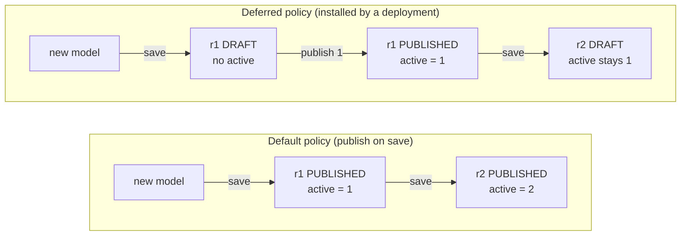
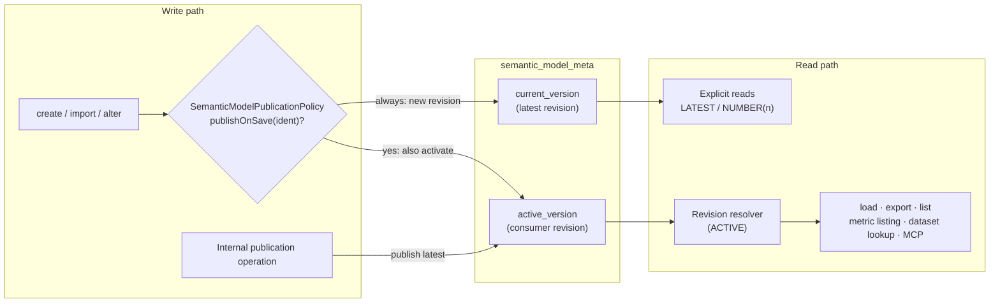

<!--
  Licensed to the Apache Software Foundation (ASF) under one
  or more contributor license agreements.  See the NOTICE file
  distributed with this work for additional information
  regarding copyright ownership.  The ASF licenses this file
  to you under the Apache License, Version 2.0 (the
  "License"); you may not use this file except in compliance
  with the License.  You may obtain a copy of the License at

   http://www.apache.org/licenses/LICENSE-2.0

  Unless required by applicable law or agreed to in writing,
  software distributed under the License is distributed on an
  "AS IS" BASIS, WITHOUT WARRANTIES OR CONDITIONS OF ANY
  KIND, either express or implied.  See the License for the
  specific language governing permissions and limitations
  under the License.
-->

# Design of Semantic Model Revision History and Publication in Gravitino

## Background

A Semantic Model defines business meaning — metrics, dimensions, and how datasets join — and BI
tools, applications, and AI agents query through it ([base design][base-model]). This makes a
Semantic Model change different from a change to a table or a view:

- **It fails silently.** An incompatible table change makes queries fail. A changed metric
  definition, for example a new filter on `revenue`, keeps every query running and changes every
  answer. Dashboards, reports, and agents drift without any error. This is semantic drift.
- **Its readers cannot tell.** The same definition serves many consumers at once. An agent in
  particular has no way to notice that the meaning behind a metric name changed.
- **Its results must be explainable.** "Which definition produced this number?" is a routine
  question, and answering it requires knowing the revision a result came from.

Today Gravitino keeps a snapshot per edit, but users cannot use that history, and every save takes
effect for every consumer immediately:

| Who                                                   | What they can do today                                                       | What is missing                                                                                                                                                                                                                                 |
| ----------------------------------------------------- | ---------------------------------------------------------------------------- | ----------------------------------------------------------------------------------------------------------------------------------------------------------------------------------------------------------------------------------------------- |
| Consumers: BI tools, applications, agents through MCP | Read the most recently saved definition.                                     | They cannot tell which revision they read, or read the one that produced an earlier result. Every save reaches them at once.                                                                                                                    |
| Authors                                               | Create, import, and alter a model, including replacing its whole definition. | They cannot list, read, or export earlier revisions, so comparing or restoring a definition depends on external copies. When two authors replace the definition from the same starting point, the later save silently discards the earlier one. |
| Platform operators                                    | Control who may read and modify a model.                                     | They cannot check a saved definition — validation, review, staged rollout — before consumers see it, short of building a separate process outside Gravitino.                                                                                    |

---

## Goals

1. **Explainable reads**: Every read reports the revision it returned, and retained revisions can
   be listed, read, and exported.
2. **Consistent consumption**: Every consumer surface sees the same revision of a model.
3. **Safe editing**: Replacing a definition never silently overwrites a change the author has not
   seen.
4. **Unchanged default**: Out of the box, every save is visible to consumers immediately, as today.
5. **Gated publication**: A deployment can register a policy that saves revisions as drafts, so that
   its own checks run first. Consumers see the same API under every policy.

## Non-Goals

1. **Publication workflow**: No public API for publishing a saved revision, and no reviewer
   assignment, approval, or UI. Publication is reachable only through the extension point.
2. **Rollback and unpublish**: Making an older revision active again, or withdrawing a publication.
   To roll back, save the old definition as a new revision.
3. **Diff and impact analysis**: Gravitino exposes revisions for comparison but does not compute
   differences, and dataset lookup by source answers which published definitions use a source, not
   which unpublished ones would.
4. **Pruning publication history**: Explicitly published revisions are kept while the model exists.
5. **Name aliases**: A renamed model is not addressable by its previous name.
6. **Upgrading development builds**: Databases created by unreleased 2.0 development builds are not
   an upgrade source.

---

## User Journeys

**1. Explain a number.** An agent answers a revenue question from model `orders`. The load response
says `revision: 7`, and the agent records it with the answer. Weeks later, an analyst questions the
number, reads revision 7 through `GET model/revisions/7`, and sees the filter that was in effect —
as long as revision 7 is still retained (see [Retention](#retention-and-garbage-collection)).

**2. Review history and roll back.** An author suspects a recent change broke a dashboard. They list
the revisions of `orders`, export revisions 6 and 7 as Ossie documents, and compare them with their
usual tools. To roll back, they load latest (revision 7), then alter with the definition of
revision 6 and `expectedRevision: 7`. Revision 8 now holds the old definition.

**3. Edit concurrently.** Two authors load revision 7. The first replaces the definition with
`expectedRevision: 7` and creates revision 8. The second submits a replacement with
`expectedRevision: 7` and gets `409`. They load latest, reapply their change, and save revision 9.
Nothing is lost.

**4. Edit through an agent.** An agent asked to add a metric loads latest through MCP, edits the
definition, and calls `alter_semantic_model` with `expected_revision` set to the revision it loaded.
On `409` it reloads and retries.

**5. Validate before publication.** A deployment registers a publication policy that saves
revisions as drafts. When an author saves revision 8, consumers keep reading revision 7. A validation job,
authorized to modify the model, reads revision 8, runs its checks, and publishes it through the
extension. Consumers then read revision 8. If a newer edit arrives first, the publication of 8
fails with `409` and the job validates the newer revision instead.

---

## Behavior Changes

What changes for each operation. The default policy publishes on save. "Deferred policy" is a
deployment that registers a [publication policy](#policy) whose `publishOnSave` returns `false`, so
saves create drafts. The [Public API](#public-api) section gives the request and response shapes.

| Operation                             | Today                                                 | After, default policy                                            | After, deferred policy                                                              |
| ------------------------------------- | ----------------------------------------------------- | ---------------------------------------------------------------- | ----------------------------------------------------------------------------------- |
| Load, Ossie export                    | Newest saved definition                               | Unchanged; response adds `revision`, `status`, and the publisher | Active revision; a never-published model returns `404`                              |
| List models                           | All models                                            | Unchanged                                                        | Only models with an active revision                                                 |
| Metric listing (both `details` modes) | Newest definitions                                    | Unchanged                                                        | Active revisions only                                                               |
| Dataset lookup by source              | Newest associations                                   | Unchanged                                                        | Active revisions only                                                               |
| `semanticModelExists`                 | `true` for any live model                             | Unchanged                                                        | `false` for a never-published model                                                 |
| Create, import                        | Creates the model, visible at once                    | Unchanged; returns revision 1, `PUBLISHED`                       | Creates revision 1 as `DRAFT`; consumers do not see the model until it is published |
| Alter: replace definition             | Last writer wins                                      | Requires `expectedRevision`; a stale value returns `409`         | Same; the new revision is a `DRAFT` and consumers keep the active one               |
| Alter: comment, properties            | Applied to the newest state                           | Unchanged; `expectedRevision` is optional and checked when given | Same; the new revision is a `DRAFT`                                                 |
| Rename                                | May be combined with other changes; writes a snapshot | Must be the only change; creates no revision                     | Same; takes effect immediately                                                      |
| List, read, export revisions          | Not available                                         | New                                                              | New; drafts need modify authority                                                   |
| Publish a revision                    | Not applicable                                        | Not applicable: every save publishes                             | Internal extension operation only                                                   |

---

## Key Concepts and Guarantees

| Term               | Meaning                                                                                        |
| ------------------ | ---------------------------------------------------------------------------------------------- |
| Revision           | The number of a saved definition, starting at 1. Unrelated to the Ossie specification version. |
| Latest             | The newest revision. Every edit applies to latest.                                             |
| Active             | The revision consumers read. A model that has never published has none.                        |
| Status             | `PUBLISHED` once a revision has been published; `DRAFT` otherwise.                             |
| Publication policy | Decides whether a save also publishes. The built-in default publishes on save.                 |



Gravitino guarantees the following under every policy. The design sections below show how each is
enforced, and the tests in [Task Breakdown](#task-breakdown) cover each one.

1. **All consumers see the same revision.** Load, export, list, metric listing, dataset lookup,
   and MCP all read the active revision, resolved in one place in the store.
2. **By default, saving is publishing.** Under the default policy, active equals latest after
   every save.
3. **Unpublished content never reaches consumers.** A model that has never been published has no
   content to read and is absent from the catalog model list; Gravitino never falls back to latest.
4. **Publishing never skips newer edits.** Only latest can be published, and only if it is still
   latest when the publication commits.
5. **A revision's status never goes back.** A `PUBLISHED` revision stays `PUBLISHED` after a newer
   one becomes active. A skipped `DRAFT` stays `DRAFT`.
6. **A replaced definition never overwrites unseen changes.** Replacing a definition must name the
   revision it was based on. Any alter or publication that names a revision fails with `409` if
   latest has moved.
7. **A model's identity is not part of a revision.** The name, ownership, and governance relations
   belong to the model, so renaming or tagging it never creates a revision, and governance views
   list it whether or not it has been published.

---

## Design Overview

Today `semantic_model_meta.current_version` points to the newest snapshot in
`semantic_model_version_info`, and each read path joins on it in its own query. This design adds a
second pointer, `active_version`, and routes every consumer read through one resolver that uses it.



Every save asks the loaded `SemanticModelPublicationPolicy`. The built-in default publishes on save.
A deferred policy keeps the new revision a draft, and a draft becomes active only through the
server-side [publication operation](#publication-operation), which is not exposed by the public
API.

| Concern                       | Default policy                                       | Deferred policy                                     |
| ----------------------------- | ---------------------------------------------------- | --------------------------------------------------- |
| Status of a new revision      | `PUBLISHED` (`PUBLISHED_ON_SAVE`)                    | `DRAFT`                                             |
| Effect on `active_version`    | Advances to the new revision in the same transaction | Unchanged                                           |
| How a revision becomes active | Saving it                                            | The [publication operation](#publication-operation) |
| Consumer reads                | Active revision                                      | Active revision                                     |
| Explicit revision reads       | Same API                                             | Same API; drafts need modify authority              |

Only the publication policy differs between deployments. Storage, the resolver, the public API, and
the retention rules are the same, so a model moved between deployments, or a deployment that
switches policy, keeps a consistent state.

---

## Storage Model

Fold these changes into the unreleased 2.0.0 create-table definitions and the 1.3.0-to-2.0.0
upgrade scripts for [MySQL][mysql], [H2][h2], and [PostgreSQL][pg]. No new column is nullable.
Following the `deleted_at = 0` convention, `0` means "none" for version pointers and times, and, as
for `tag_value`, an empty string means no principal.

```sql
-- semantic_model_meta
`active_version` INT UNSIGNED NOT NULL DEFAULT 0 COMMENT 'published revision, 0 if none',

-- semantic_model_version_info
`publication_status` VARCHAR(32) NOT NULL DEFAULT 'DRAFT' COMMENT 'DRAFT, PUBLISHED_ON_SAVE, or PUBLISHED_EXPLICITLY',
`published_by` VARCHAR(128) NOT NULL DEFAULT '' COMMENT 'publishing principal, empty for a draft',
`published_at` BIGINT(20) UNSIGNED NOT NULL DEFAULT 0 COMMENT 'publication time in epoch millis, 0 for a draft',
-- drop `semantic_model_name`: the name is identity, not revision content (guarantee 7)

-- semantic_model_source_rel
`from_version` INT UNSIGNED NOT NULL COMMENT 'first revision containing this association',
`to_version` INT UNSIGNED NOT NULL DEFAULT 0 COMMENT 'first revision without it, 0 if open',
```

PostgreSQL uses signed types and `COMMENT ON COLUMN`; H2 uses the MySQL definitions.

| `publication_status`   | Public status | Written by                            | `published_by` and `published_at`      | Retention                   |
| ---------------------- | ------------- | ------------------------------------- | -------------------------------------- | --------------------------- |
| `DRAFT`                | `DRAFT`       | A save under a deferred policy        | Empty and `0`                          | Normal retention count      |
| `PUBLISHED_ON_SAVE`    | `PUBLISHED`   | A save under a publish-on-save policy | The writer and the save time           | Normal retention count      |
| `PUBLISHED_EXPLICITLY` | `PUBLISHED`   | The publication operation             | The publisher and the publication time | Kept while the model exists |

The two published values are separate because they need different retention: under the default
policy every revision is published, so protecting all published revisions would disable retention.
An explicit publication is a deliberate decision and stays readable.

Each revision's existing `audit_info` already records who wrote it and when. The publication columns
record a different fact: who made the revision visible to consumers, and when. The two differ for an
explicit publication, where one principal saves the draft and another publishes it later. For
`PUBLISHED_ON_SAVE` they coincide, and the columns are still written, so that every published
revision answers "who published it and when" the same way. The public API returns them as
`publishedBy` and `publishedAt` (see [Public API](#public-api)), so revision history shows when each
published definition took effect.

**Design choice.** The publication columns are `NOT NULL` with explicit draft values. With `NULL`
for a draft, a condition such as `publication_status <> 'PUBLISHED_EXPLICITLY'` evaluates to unknown
for every draft, so a retention query written that way would silently never collect drafts, and
every query over drafts would need an `IS NULL` branch. Explicit values make each condition mean
what it says. The status values carry a `PUBLISHED_` prefix so that the public status of each value
is visible in the value itself.

---

## Read Resolution

### Revision selectors

Every SQL provider that joins `semantic_model_version_info` takes a revision selector instead of
hard-coding the join condition:

| Selector    | Join condition                  | Used by                                                         |
| ----------- | ------------------------------- | --------------------------------------------------------------- |
| `ACTIVE`    | `s.version = m.active_version`  | All consumer surfaces                                           |
| `LATEST`    | `s.version = m.current_version` | Explicit `latest` reads, write preflight, writes                |
| `NUMBER(n)` | `s.version = n`                 | Explicit numbered reads                                         |
| (none)      | Identity row only               | Existence checks, ID and full-name resolution, governance views |

Default load uses one indexed left join from the identity row, which distinguishes a missing model
from a missing snapshot without scanning history:

```sql
SELECT m.*, s.*
FROM semantic_model_meta m
LEFT JOIN semantic_model_version_info s
    ON s.semantic_model_id = m.semantic_model_id
    AND s.version = m.active_version
    AND s.deleted_at = 0
WHERE m.schema_id = #{schemaId}
    AND m.semantic_model_name = #{name}
    AND m.deleted_at = 0
```

No row means the model is missing (`404`). `active_version = 0` behaves as a missing model on
consumer reads. A nonzero `active_version` without a snapshot is a storage error (`500`). The join
is bound to the model ID, so a new model reusing a dropped name inherits nothing.

### Caller inventory

Every current reader of Semantic Model state, and the selector it uses after this change:

| Caller                                                   | Entry point today                                                                                            | Today reads                                    | Selector                                                                                                                         |
| -------------------------------------------------------- | ------------------------------------------------------------------------------------------------------------ | ---------------------------------------------- | -------------------------------------------------------------------------------------------------------------------------------- |
| REST, Java, Python, and MCP load                         | `ManagedSemanticModelOperations.loadSemanticModel` → `SemanticModelMetaService.getSemanticModelByIdentifier` | `current_version`                              | `ACTIVE`                                                                                                                         |
| Ossie export                                             | `SemanticModelOperationDispatcher.exportOssieDocument` → load                                                | `current_version`                              | `ACTIVE` (via load)                                                                                                              |
| List models                                              | `SemanticModelMetaService.listSemanticModelsByNamespace`                                                     | `current_version`                              | `ACTIVE`; models with `active_version = 0` are omitted                                                                           |
| Domain member enumeration                                | Direct: tag assignments; inherited: `DomainMembershipResolver` → `store.list`                                | Direct: identity; inherited: `current_version` | Identity on both paths: inherited members list Semantic Models without a selector                                                |
| Metric listing, `details=true`                           | `listMetricSnapshots`                                                                                        | `current_version`                              | `ACTIVE`                                                                                                                         |
| Metric listing, `details=false`                          | `listMetricNames`                                                                                            | Metric identities                              | `ACTIVE`; decodes names from the active snapshot, because identities also cover latest (see [Derived indexes](#derived-indexes)) |
| Dataset lookup by source                                 | `SemanticModelSourceMapper.listForSource`                                                                    | Unversioned associations                       | Ranges matched against `active_version`                                                                                          |
| Explicit revision reads                                  | New                                                                                                          | —                                              | `LATEST` or `NUMBER(n)`                                                                                                          |
| REST alter preflight for `ReplaceDefinition`             | `SemanticModelOperations` alter handler → load                                                               | `current_version`                              | `LATEST`                                                                                                                         |
| Internal existence check                                 | `MetadataObjectUtil.checkMetadataObject` → `SemanticModelDispatcher.semanticModelExists` (default: load)     | `current_version`                              | Identity: override the load-based default with an identity-row lookup                                                            |
| ID resolution                                            | `RelationalEntityStoreIdResolver`                                                                            | Identity row                                   | Identity (unchanged)                                                                                                             |
| Full-name resolution for tag, policy, and owner listings | `MetadataObjectService.getSemanticModelObjectsFullName`                                                      | Identity row                                   | Identity (unchanged)                                                                                                             |
| Alter, rename, drop                                      | `SemanticModelMetaService` update and delete                                                                 | Identity + `current_version`                   | Identity + `LATEST`                                                                                                              |

Both get variants (`getPO`, `getPOByFullName`) and both list variants (`listPOs`,
`listPOsByNSFullName`) in `SemanticModelPOStorageOps` take the selector, so the name-based and
full-name-based paths cannot diverge.

Identity paths stay independent of publication so that owner, tag, grant, policy, Domain, alter,
and drop operations work on a model that has not published anything yet. The rule is that
relations follow identity and content follows the active revision:

- A never-published model accepts every governance action, and governance views list it: Domain
  members through both the direct and the inherited path, and objects by tag, policy, or owner.
  These views carry only the object identity, so no draft content is exposed.
- Content reads and the catalog model list follow `ACTIVE`. A consumer that reaches a
  never-published model through a governance view gets `404` on load until it is published.
- Publication changes no relation, so Domain membership and tag listings are the same before and
  after it, and a newer draft on a published model changes none of them.

### Guarding new read paths

Guarantee 1 is protected in two ways:

- **Structural**: The SQL providers expose no snapshot join without a selector argument, and no
  provider writes `current_version = <snapshot>.version` directly. A unit test scans the provider
  classes for that pattern.
- **Behavioral**: A contract test registers a test policy that returns `false` and runs every
  consumer surface in the inventory against a model with a published revision and a newer draft, and against
  a model with only a draft. It fails if any surface returns draft content or the draft-only model.
  New consumer surfaces are added to this test.

### Visibility and authorization

| Read                                               | Selection               | Authorization                                                                                                                                                                    |
| -------------------------------------------------- | ----------------------- | -------------------------------------------------------------------------------------------------------------------------------------------------------------------------------- |
| Load, export, list, metric listing, dataset lookup | `ACTIVE`                | Existing read authorization                                                                                                                                                      |
| Revision read or export of a `PUBLISHED` revision  | `NUMBER(n)` or `LATEST` | Existing read authorization                                                                                                                                                      |
| Revision read or export of a `DRAFT` revision      | `NUMBER(n)` or `LATEST` | [Modify authorization][auth]                                                                                                                                                     |
| List revisions                                     | All retained revisions  | `DRAFT` entries require modify authorization; other callers see `PUBLISHED` entries only. For a model with `active_version = 0`, callers without modify authorization get `404`. |

With authorization disabled, explicit revision reads can still reach drafts — hiding a draft is
about visibility, not confidentiality — while consumer reads still require an active revision.
The public `SemanticModelCatalog.semanticModelExists` (Java and Python) defaults to calling load,
so clients see `false` for a model with `active_version = 0`, matching the list.

---

## Write Paths

### Expected revision

Each alter already runs a server-side compare-and-set: the store reads the model, applies the
changes, and commits only if `current_version` is still the value it read. This serializes
concurrent transactions, but the base it checks is the state at request time, not the state the
caller saw. For incremental changes — comment, properties, rename — that is enough, because they
apply on top of the newest state and lose nothing. A definition replacement sends the whole
definition, so one prepared from an older revision discards every change made since.

`expectedRevision` carries the revision the caller based the change on: the latest revision before
the change, not the one the change creates. The server allocates the new revision number and
returns it in the response.

- **Required** when the request contains a definition replacement. Without it the request returns
  `400 IllegalArgumentException`.
- **Optional** for every other alter. When given, it is checked the same way.
- A non-positive value returns `400`.
- The store commits only if `current_version` still equals `expectedRevision`. Otherwise it returns
  `409 OptimisticLockException` and leaves the model unchanged.
- The publication operation always names the revision the caller inspected and follows the same
  rule.

This is the precondition model of HTTP `If-Match`, Kubernetes `resourceVersion`, and Iceberg commit
requirements, applied where a lost update is possible.

Create and Ossie import require an unused model name and return `SemanticModelAlreadyExistsException`
on a duplicate, as today. Replacing the definition of an existing model goes through alter.

### Operations

| Operation                                 | Effect                                                                                                                                                                                                                                                                                                        |
| ----------------------------------------- | ------------------------------------------------------------------------------------------------------------------------------------------------------------------------------------------------------------------------------------------------------------------------------------------------------------- |
| Create or import                          | Inserts r1 and the identity row with `current_version = 1`. The policy decides the publication columns; under the default, `active_version = 1`.                                                                                                                                                              |
| Alter definition, comment, or properties  | Inserts a snapshot, applies the policy, and advances `current_version` if it is still the value read (or `expectedRevision`, when given). If the policy publishes, `active_version` advances in the same transaction; otherwise it is left as is, including a value set by a concurrent publication.          |
| Rename                                    | Updates `semantic_model_name` and `audit_info` on the identity row only, conditional on `current_version` (and `expectedRevision`, when given). Creates no revision and changes neither pointer.                                                                                                              |
| Publish revision *n* (internal)           | In one transaction: set `publication_status = 'PUBLISHED_EXPLICITLY'`, `published_by`, and `published_at` on snapshot *n*, and set `active_version = n` on the condition `current_version = n`; then reconcile metric identities. Repeating it on the published latest returns the existing record unchanged. |
| Owner, grant, tag, policy, Domain changes | Use their existing stores. Create no revision.                                                                                                                                                                                                                                                                |
| Drop                                      | Unchanged: soft-deletes the model and all revisions.                                                                                                                                                                                                                                                          |

### Rename

The name identifies the model through its stable ID and is not revision content. A rename updates
the identity row only. All reads and exports, including those of older revisions, present the
current name, and consumers using the old name get `404` as for any renamed object (Non-Goal 5).

A rename must be the only change in its request; a request that mixes it with other changes returns
`400`. The two kinds of change differ in whether they create a revision, in the storage path, and —
under a deferred policy — in when they take effect: the rename would apply immediately while the
definition stayed a draft. Keeping them apart gives every request one meaning under every policy.
Relaxing this later is compatible; tightening it after release would not be.

### Derived indexes

Forward queries read snapshots; reverse indexes track revision ranges.

- **Metric listing** in both `details` modes reads the `metrics` column of the active snapshot.
  `details=false` decodes names only. Models with `active_version = 0` are excluded by the join.
- **Metric identities** (`semantic_model_metric_meta`) are kept for metric-level relations such as
  tags; discovery no longer reads them. An identity is retired only when its name is in neither
  active nor latest, so an unpublished removal does not drop relations of a metric consumers still
  see. Reconciliation runs on every snapshot-creating write and on publication.
- **Dataset lookup by source** cannot be answered from snapshots without scanning every model, so
  `semantic_model_source_rel` stores ranges. A write that replaces sources closes the open rows
  (`to_version` = new revision) and inserts rows with `from_version` = new revision; writes that
  keep sources touch nothing. Lookup matches
  `from_version <= v AND (to_version = 0 OR to_version > v)` with `v = active_version`.

### Retention and garbage collection

- Version retention uses the [existing cutoff][retention], computed from `current_version`. A
  revision at or below the cutoff is soft-deleted only if `version <> active_version` and
  `publication_status` is not `PUBLISHED_EXPLICITLY`. Under the default policy active is latest, so
  behavior is unchanged.
- Source ranges that cover neither the active revision nor latest are soft-deleted in the same job.
- Model and parent deletion use the existing soft-delete and purge paths; all new columns live on
  existing rows.
- A collected revision returns `404 NoSuchSemanticModelRevisionException` on explicit reads.
  Deployments that rely on reading past revisions, as in [User Journey 1](#user-journeys), should
  raise `gravitino.entity.store.versionRetentionCount` accordingly.

---

## Public API

### REST

`model` denotes
`/api/metalakes/{metalake}/catalogs/{catalog}/schemas/{schema}/semantic-models/{semanticModel}`.
`{revision}` is a positive number or `latest`.

| Operation       | Endpoint                               | Change                                                                                                                                        |
| --------------- | -------------------------------------- | --------------------------------------------------------------------------------------------------------------------------------------------- |
| Load            | `GET model`                            | Returns the active revision; response gains `revision`, `status`, `publishedBy`, and `publishedAt`                                            |
| List models     | `GET .../semantic-models`              | Unchanged shape; omits models without an active revision                                                                                      |
| Export          | `GET model/ossie`                      | Exports the active revision                                                                                                                   |
| Alter           | `PUT model`                            | `SemanticModelUpdatesRequest` gains `expectedRevision`, required when the updates contain `replaceDefinition`; rename must be the sole change |
| List revisions  | `GET model/revisions`                  | New: `SemanticModelRevisionListResponse`, newest first                                                                                        |
| Get revision    | `GET model/revisions/{revision}`       | New: `SemanticModelResponse`                                                                                                                  |
| Export revision | `GET model/revisions/{revision}/ossie` | New: Ossie document                                                                                                                           |

`SemanticModelDTO` gains `revision`, `status`, `publishedBy`, and `publishedAt`. The publisher
fields are present only for a `PUBLISHED` revision: under the default policy they are the writer and
the save time; after an explicit publication they are the publisher and the publication time. Every
response carries content and metadata from a single snapshot. Create, import, and alter return the
snapshot they wrote; a rename returns latest under the new name.

```json
{
  "code": 0,
  "semanticModel": {
    "name": "orders",
    "revision": 2,
    "status": "PUBLISHED",
    "publishedBy": "ann",
    "publishedAt": "2026-01-02T00:00:00Z",
    "definition": { "...": "..." }
  }
}
```

`GET model/revisions` returns a revision summary for each retained revision: its metadata without
the definition, so the history stays small; a client reads a revision's definition with
`GET model/revisions/{revision}`. A summary carries `revision`, `status`, the publisher fields when
published, and the writer's `audit`. In this example, under a deferred policy, ann wrote revision 1
and bob published it later; revision 2 is a draft:

```json
{
  "code": 0,
  "revisions": [
    { "revision": 2, "status": "DRAFT",
      "audit": { "creator": "ann", "createTime": "2026-01-03T00:00:00Z" } },
    { "revision": 1, "status": "PUBLISHED",
      "publishedBy": "bob", "publishedAt": "2026-01-02T00:00:00Z",
      "audit": { "creator": "ann", "createTime": "2026-01-01T00:00:00Z" } }
  ]
}
```

| Condition                                                                                                                              | Response                                                           |
| -------------------------------------------------------------------------------------------------------------------------------------- | ------------------------------------------------------------------ |
| Model missing, or a consumer read of a model with `active_version = 0`                                                                 | `404 NoSuchSemanticModelException` (`NOT_FOUND_CODE`)              |
| Revision missing, collected, or a draft hidden from the caller                                                                         | `404 NoSuchSemanticModelRevisionException` (`NOT_FOUND_CODE`, new) |
| `replaceDefinition` without `expectedRevision`; non-positive `expectedRevision`; invalid `{revision}`; rename mixed with other changes | `400 IllegalArgumentException` (`ILLEGAL_ARGUMENTS_CODE`)          |
| `expectedRevision` is not latest, or a concurrent write won                                                                            | `409 OptimisticLockException` (`OPTIMISTIC_LOCK_CONFLICT_CODE`)    |
| Missing authority                                                                                                                      | `403 ForbiddenException` (`FORBIDDEN_CODE`)                        |
| Nonzero `active_version` without a snapshot                                                                                            | `500` (`INTERNAL_ERROR_CODE`)                                      |

All errors use existing codes. The Java and Python `SemanticModelErrorHandler` map the new exception
type under `NOT_FOUND_CODE`; older clients fall back to the generic not-found exception.

### Java

The revision reads mirror `ModelCatalog.getModelVersion(ident, int)` and
`getModelVersion(ident, String alias)`:

```java
public interface SemanticModel extends Auditable {
  /** The publication status of a Semantic Model revision. */
  enum Status {
    /** Saved but not published. */
    DRAFT,
    /** Published; it is or was the active revision. */
    PUBLISHED
  }

  /** Returns the revision number of this definition. */
  int revision();

  /** Returns the publication status of this revision. */
  Status status();

  /** Returns who published this revision, or null for a draft. */
  @Nullable
  String publishedBy();

  /** Returns when this revision was published, or null for a draft. */
  @Nullable
  Instant publishedAt();
}

/** Summary of a retained revision, without its definition; auditInfo() describes its writer. */
public interface SemanticModelRevision extends Auditable {
  int revision();

  SemanticModel.Status status();

  @Nullable
  String publishedBy();

  @Nullable
  Instant publishedAt();
}

public interface SemanticModelCatalog {
  /** Alias of the newest revision, accepted wherever a revision is addressed. */
  String LATEST_REVISION = "latest";

  // Existing: loadSemanticModel(ident) returns the active revision.
  // Existing: alterSemanticModel(ident, changes...) is kept; it rejects replaceDefinition.

  default SemanticModel loadSemanticModel(NameIdentifier ident, int revision) { ... }

  /** Only {@link #LATEST_REVISION} is supported. */
  default SemanticModel loadSemanticModel(NameIdentifier ident, String alias) { ... }

  default SemanticModelRevision[] listSemanticModelRevisions(NameIdentifier ident) { ... }

  default OssieDocument exportOssieDocument(
      NameIdentifier ident, int revision, OssieFormat format) { ... }

  default OssieDocument exportOssieDocument(
      NameIdentifier ident, String alias, OssieFormat format) { ... }

  /** Applies the changes only if latest is still expectedRevision. */
  default SemanticModel alterSemanticModel(
      NameIdentifier ident, int expectedRevision, SemanticModelChange... changes) { ... }
}
```

New methods default to `UnsupportedOperationException`, like the existing optional methods. The
revision list carries each revision's status, so there is no separate published-only listing.

### Python

```python
# SemanticModelCatalog
LATEST_REVISION = "latest"

def load_semantic_model(
    self, identifier: NameIdentifier, revision: Optional[Union[int, str]] = None
) -> SemanticModel: ...
def list_semantic_model_revisions(
    self, identifier: NameIdentifier
) -> list[SemanticModelRevision]: ...
def export_ossie_document(
    self, identifier: NameIdentifier, document_format: str = "yaml",
    revision: Optional[Union[int, str]] = None,
) -> str: ...
def alter_semantic_model(
    self, identifier: NameIdentifier, *changes: SemanticModelChange,
    expected_revision: Optional[int] = None,
) -> SemanticModel: ...
```

`SemanticModel` and `SemanticModelRevision` gain `revision()`, `status()`, `published_by()`, and
`published_at()`, mirroring Java.

### MCP

The [MCP tools][mcp] call the same REST endpoints with the caller's identity, so the read contract
applies unchanged.

- `load_semantic_model` gains an optional `revision` (number or `latest`).
- A new read-only `list_semantic_model_revisions` tool returns the revision summaries of
  `GET model/revisions`.
- `alter_semantic_model` gains `expected_revision`, required when `updates` contains
  `replaceDefinition`. Its description tells the agent to pass the `revision` of the model it read,
  to load `latest` when preparing an edit, and to reload and retry on a conflict.
- Create and alter results include the `revision` and `status` they wrote; load and revision
  results also include `publishedBy` and `publishedAt` for published revisions.

---

## Publication Extension

### Policy

```java
/** Decides whether saving a Semantic Model revision also publishes it. */
public interface SemanticModelPublicationPolicy {
  /** Returns true if create, import, and alter publish the revision they write. */
  boolean publishOnSave(NameIdentifier semanticModel);
}
```

Gravitino loads the policy once at startup through `ServiceLoader`, as it loads
`MapperPackageProvider`:

- **No implementation registered**: the built-in default, which returns `true`. The default is not
  registered under `META-INF/services`, so a registered implementation replaces it rather than
  conflicting with it.
- **Exactly one**: it is used, and its class name is logged.
- **More than one**: startup fails.

Every process that writes Semantic Models must load the same implementation, so that a save means
the same thing wherever it runs. A policy that returns `false` keeps every create, import, and alter
a draft and leaves `active_version` unchanged.

**Design choice.** The policy is bound to the build rather than to a configuration value. A
deployment that saves drafts ships its policy together with the entry point that publishes them, so
drafts with no way to publish cannot be configured by accident, and every server of the same build
behaves the same over the shared database. The method receives the model identifier so that a later
per-metalake or per-model decision needs no contract change.

### Publication operation

A deferred policy needs a way to publish. `SemanticModelDispatcher` gains an internal
`publishSemanticModelRevision(ident, revision, principal)` method. It is not part of
`SemanticModelCatalog`, the REST API, or the clients (Non-Goal 1).

- It applies the publication rules in [Operations](#operations): only latest, conditional on
  `current_version = revision`, idempotent on the published latest.
- It runs through the event dispatcher, emitting `PublishSemanticModelRevisionPreEvent`,
  `PublishSemanticModelRevisionEvent`, and `PublishSemanticModelRevisionFailureEvent`.
- Authorization is the caller's responsibility; the operation records the principal it is given.

Gravitino itself has no caller of this method, because the default policy never leaves a draft. A
deployment that registers a deferred policy also provides the entry point, such as a server-side
REST resource, that authorizes the request and calls this method.

### Contract for deferred deployments

- Consumers never read drafts, and a model with `active_version = 0` is invisible to them.
- A publication changes only the active revision and the published snapshot's publication columns.
- Drafts are readable only through explicit revision reads by callers with modify authorization.
- A caller publishing a revision it inspected passes the revision number from the response it read,
  so it publishes exactly that snapshot or gets `409`.

The contract is verified in-tree by the [behavioral guard](#guarding-new-read-paths), which registers
a test policy that returns `false` and exercises publication end to end.

---

## Compatibility

- **Clients on the default policy**: Load, list, and export keep their request shapes and results.
  `revision`, `status`, `publishedBy`, and `publishedAt` are additive response fields.
- **Alter contract**: Requests that replace the definition must pass `expectedRevision` through
  REST, Java, Python, or MCP. Other alters keep their current shape. A rename must be sent on its
  own. Semantic Models have not been released, so this needs no deprecation period.
- **Schema**: The 2.0.0 schemas and upgrade scripts create the tables with the new columns.
  Databases from 2.0 development builds are not an upgrade source (Non-Goal 6). This design ships in
  2.0.0 together with Semantic Models, so no released database holds revisions that need a
  backfill.
- **Installing a deferred policy**: Stored pointers and revisions are kept. Models published on
  save stay published; the next save creates a draft and active stays where it is.
- **Removing it**: The default policy applies again. The next save of each model publishes it and moves
  active to latest. Pending drafts are not published retroactively: a model with only a draft stays
  invisible until its next save, and earlier drafts stay `DRAFT` in history.

---

## Alternatives Considered

1. **Resolve the revision in each REST endpoint**: Internal callers, metric discovery, and dataset
   lookup would each have to repeat the rule, and one miss serves unpublished content. Resolving in
   the store gives every surface the same rule.
2. **Keep publication state outside the core and expose a hook per read path**: The core would have
   no notion of an active revision, so every new read path, including future ones, would need to
   remember to call the hook, and a missing call could not be detected in the core. A model moved
   to a deployment without the external state would also have no active revision. A pointer in the
   core schema makes the active revision part of every query by construction.
3. **Publication state in `properties` or inside the snapshot**: Reading it needs a history scan,
   or publishing becomes a content edit that allocates a revision. An indexed `active_version` plus
   `publication_status` keeps both cheap.
4. **A separate publication table**: Reading active needs a `MAX` subquery per model, and inserting
   a row cannot be made conditional on the identity row the way a rename is. A pointer on the
   identity row does both in one indexed write.
5. **A public publication API**: It would commit the project to one publication workflow and
   change what every client must handle. A policy plus an internal operation provides the plumbing
   without that commitment (Non-Goal 1).
6. **A server configuration entry such as `publishOnSave = false`**: It can be set without any
   publication entry point, leaving drafts that never become active and are not reported. An
   operator could also flip it back and bypass the deployment's checks, upgraded installations keep
   their existing configuration files, and servers that disagree over a shared database would
   publish the same save differently. Binding the policy to the build avoids all four.
7. **`expectedRevision` optional everywhere**: Callers that omit it on a definition replacement
   keep the silent lost update this design removes.
8. **`expectedRevision` required on every alter**: Incremental changes and renames cannot lose
   updates, so requiring it there only forces a load before every property or comment change.
9. **Allow rename with other changes**: See [Rename](#rename).

## Prior Art

- **Unity Catalog / MLflow registered models**: Versions are immutable; consumers address a chosen
  version through a movable alias that survives model renames.
- **Looker**: Development-mode edits are invisible to production users until deployed.
- **GitHub Releases**: A draft release is published by updating it with `draft: false`.
- **HTTP, Kubernetes, Iceberg**: `If-Match`, `resourceVersion`, and commit requirements reject a
  write prepared from a stale state.
- **Delta Lake / Iceberg**: History is addressed by the table's current name after a rename.

---

## Task Breakdown

- [ ] Extend the 2.0.0 schemas and 1.3.0-to-2.0.0 upgrade scripts for MySQL, H2, and PostgreSQL with
      `active_version`, publication columns, and source ranges; drop the snapshot name column
- [ ] Add revision selectors to the Semantic Model SQL providers and `SemanticModelPOStorageOps`;
      switch every read in the caller inventory to its listed selector, including inherited Domain
      members to identity
- [ ] Override the internal `semanticModelExists` with an identity-row lookup; switch the REST alter
      preflight to `LATEST`
- [ ] Add `expectedRevision` to alter in the store and REST, required for definition replacement;
      split rename from snapshot writes and reject mixed requests
- [ ] Add `SemanticModelPublicationPolicy`, its `ServiceLoader` loading with the built-in default,
      and apply it in create, import, and alter
- [ ] Add `publishSemanticModelRevision` to the dispatcher chain and store, with events
- [ ] Switch metric listing to the active snapshot and make identity retirement cover active and
      latest
- [ ] Add source ranges, the range-based lookup, and range cleanup in GC; protect active and
      explicitly published revisions in retention
- [ ] Add `Status`, `revision()`, `publishedBy()`, `publishedAt()`, `SemanticModelRevision`, the
      catalog methods, and `NoSuchSemanticModelRevisionException` in `api`; DTOs and requests in
      `common`
- [ ] Add the REST endpoints and error mapping in `server`
- [ ] Update `docs/open-api/semantic-models.yaml` and validate with `./gradlew :docs:build`
- [ ] Add the structural guard test and the contract test with a test policy that returns `false`
- [ ] Implement the Java client (parallel)
- [ ] Implement the Python client (parallel)
- [ ] Extend the MCP tools (parallel)
- [ ] Update the user guide for revision reads and `expectedRevision`
- [ ] Add integration tests on H2, MySQL, and PostgreSQL covering the acceptance criteria

### Acceptance criteria: default policy

| Scenario                                                  | Expected result                                                                                                                                                                                                             |
| --------------------------------------------------------- | --------------------------------------------------------------------------------------------------------------------------------------------------------------------------------------------------------------------------- |
| Create, then alter                                        | Both return `PUBLISHED` with the new revision, and `publishedBy` and `publishedAt` are the writer and the save time. Load, export, list, metrics in both modes, and dataset lookup reflect the newest revision immediately. |
| List and read revisions                                   | Retained revisions are listed newest first with `revision`, `status`, the publisher fields, and writer audit. Numbered and `latest` reads and exports return the selected snapshot.                                         |
| Replace the definition without `expectedRevision`         | `400`; nothing changes.                                                                                                                                                                                                     |
| Alter with a non-positive or stale `expectedRevision`     | Non-positive returns `400`; stale returns `409`. Neither changes the model or creates a revision. A matching value commits.                                                                                                 |
| Two authors replace the definition from the same revision | The first commits; the second gets `409` and loses nothing (User Journey 3).                                                                                                                                                |
| Set a property or comment without `expectedRevision`      | Commits on top of latest, as today.                                                                                                                                                                                         |
| Import with an existing model name                        | `SemanticModelAlreadyExistsException`; the model and its history are unchanged.                                                                                                                                             |
| Rename alone                                              | No revision is created; all reads use the new name; the old name returns `404`.                                                                                                                                             |
| Rename combined with other changes                        | `400`; nothing changes.                                                                                                                                                                                                     |
| Sources change A → B → A                                  | Ranges record A, B, and A at their revisions; lookup returns the dataset for the active revision only.                                                                                                                      |
| More saves than the retention count                       | Older revisions are collected and return `404` on explicit reads; active (latest) survives.                                                                                                                                 |
| Existing read clients                                     | Load, list, and export work with their original request shapes.                                                                                                                                                             |

### Acceptance criteria: extension contract (test policy)

| Scenario                                 | Expected result                                                                                                                                      |
| ---------------------------------------- | ---------------------------------------------------------------------------------------------------------------------------------------------------- |
| Create under a deferred policy           | r1 is `DRAFT`; every consumer surface omits the model (`404` on load and export, absent from list, metrics, and lookup).                             |
| Draft-only model and identity operations | The internal existence check succeeds; tag, owner, grant, policy, Domain, alter, and drop work.                                                      |
| Draft-only model in a Domain             | Tagged directly or through its schema, it is a Domain member on both paths; membership and tag listings are unchanged when it is published.          |
| Tags on a model with a newer draft       | Tags and Domain membership stay on the model; saving or publishing the draft changes neither.                                                        |
| Editor prepares the next draft           | Default load returns `404` even for the editor; the editor loads `latest` and uses its revision as `expectedRevision`.                               |
| Draft visibility                         | A caller with modify authority reads and lists drafts; a caller with read authority gets `404` for a draft and sees only `PUBLISHED` entries.        |
| Publish latest                           | The revision becomes `PUBLISHED` and active, with the publisher and publication time; consumers see it; publish events are emitted (User Journey 5). |
| Publish a stale or non-latest revision   | `409`; nothing changes. Repeating a publication of the published latest keeps the original principal and time.                                       |
| A draft removes a published metric       | Discovery still shows the metric and its identity is kept; publishing a revision without it retires the identity.                                    |
| Retention under a deferred policy        | Active and explicitly published revisions survive; drafts follow the count. A missing active snapshot returns `500`.                                 |
| Install and remove the policy            | Pointers are kept; behavior follows [Compatibility](#compatibility).                                                                                 |
| Guard tests                              | Adding a consumer query that joins snapshots on `current_version` fails the structural test.                                                         |

[base-model]: gravitino-semantic-model-design.md#version-and-lifecycle-behavior
[metrics]: gravitino-schema-metrics-discovery-design.md
[sources]: gravitino-semantic-model-source-lookup-design.md
[mcp]: ../mcp-server/mcp_server/tools/semantic_model.py
[auth]: ../server-common/src/main/java/org/apache/gravitino/server/authorization/expression/AuthorizationExpressionConstants.java
[retention]: ../core/src/main/java/org/apache/gravitino/Configs.java
[mysql]: ../scripts/mysql/schema-2.0.0-mysql.sql
[h2]: ../scripts/h2/schema-2.0.0-h2.sql
[pg]: ../scripts/postgresql/schema-2.0.0-postgresql.sql
