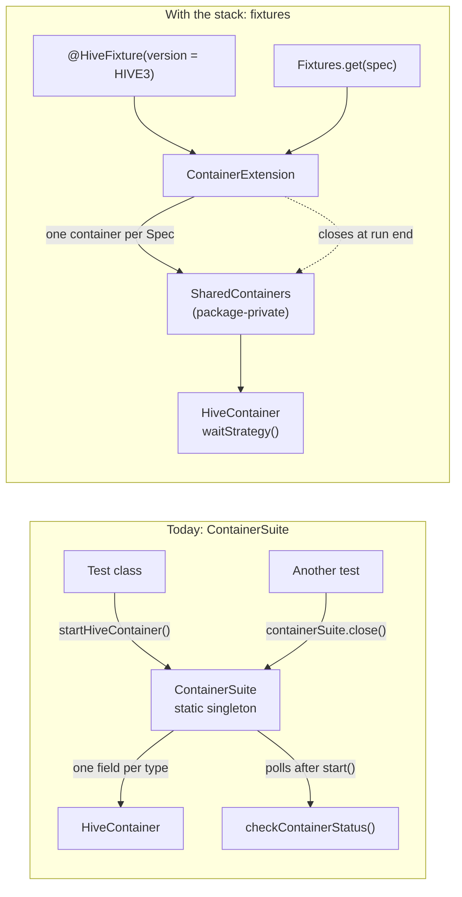
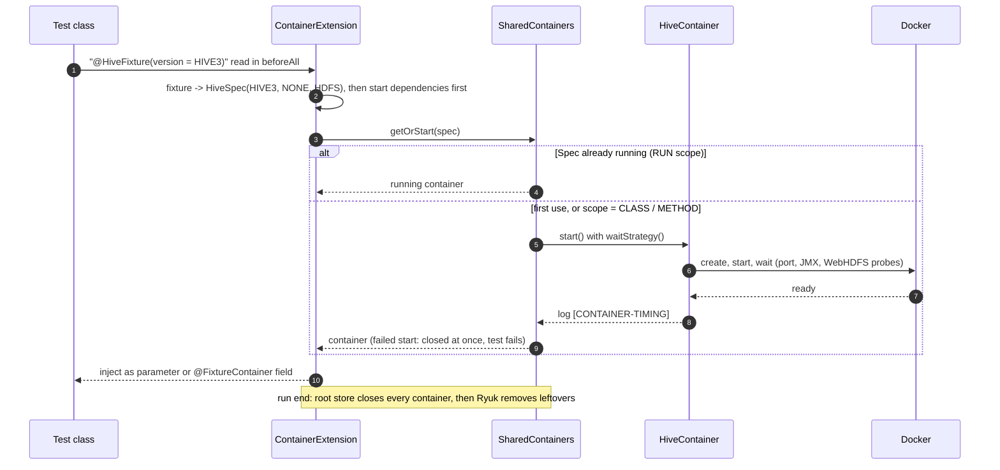
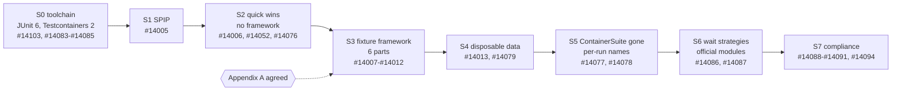
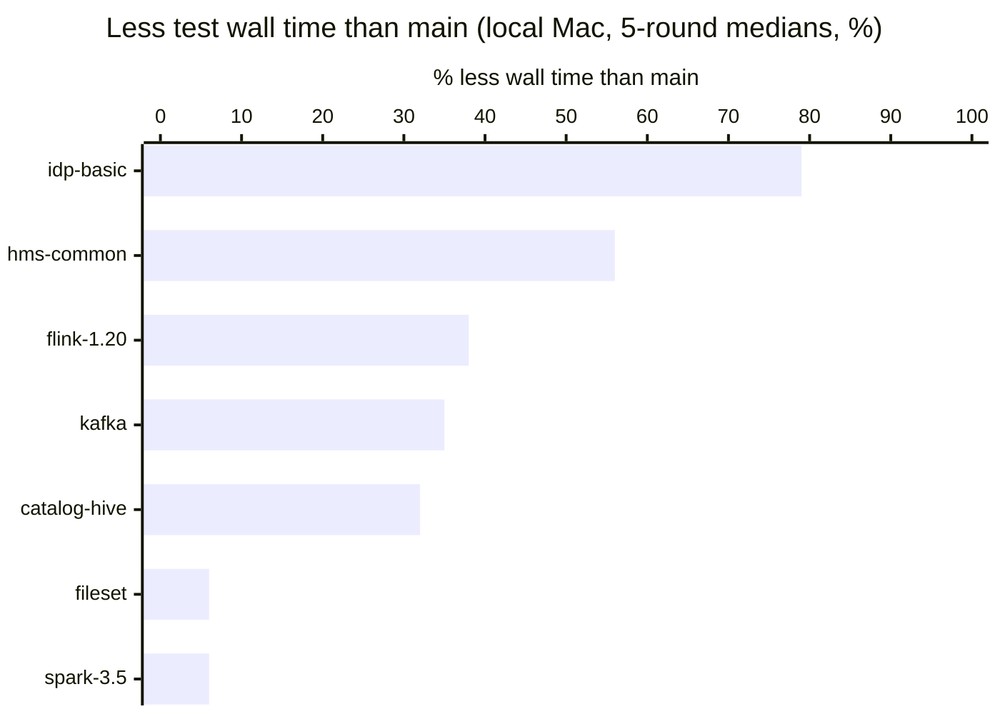
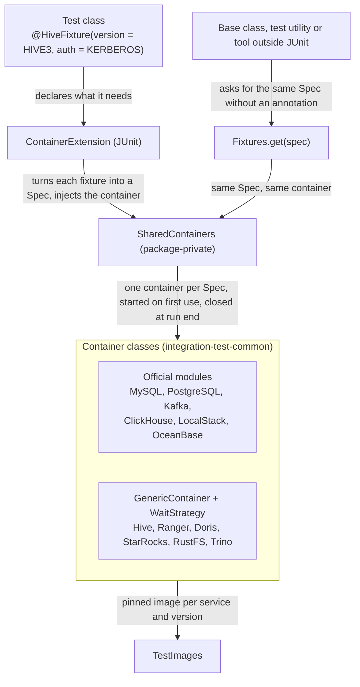
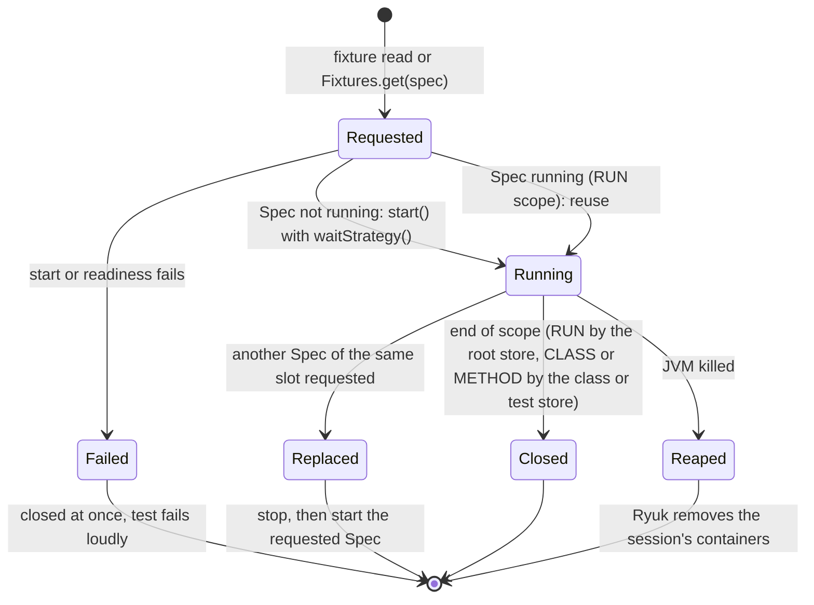

<!--
  Licensed to the Apache Software Foundation (ASF) under one
  or more contributor license agreements.  See the NOTICE file
  distributed with this work for additional information
  regarding copyright ownership.  The ASF licenses this file
  to you under the Apache License, Version 2.0 (the
  "License"); you may not use this file except in compliance
  with the License.  You may obtain a copy of the License at

   http://www.apache.org/licenses/LICENSE-2.0

  Unless required by applicable law or agreed to in writing,
  software distributed under the License is distributed on an
  "AS IS" BASIS, WITHOUT WARRANTIES OR CONDITIONS OF ANY
  KIND, either express or implied.  See the License for the
  specific language governing permissions and limitations
  under the License.
-->

# SPIP: Test Container Framework for Apache Gravitino

| Field | Value |
| --- | --- |
| Status | Draft for discussion; S0–S7 built and green locally, CI running on the draft PRs |
| Author | Nevin Zheng |
| Issue | [#13900](https://github.com/apache/gravitino/issues/13900) (epic; children #14000–#14003, #14049) |
| Stack | #14103 → #14083–#14085 → #14005 → #14006 → #14052 → #14076 → #14007–#14012 → #14013 → #14079 → #14077 → #14078 → #14086–#14091 → #14094 |
| Scope | `integration-test-common/src/test/java/org/apache/gravitino/integration/test/container/` and the integration tests that use it |

## Highlights

Gravitino's Docker-backed integration tests get one fixture framework for every container. On one
local Mac the container-heavy modules finish 32–79 % faster, no container outlives a killed test
JVM, and 14 defects on `main` are fixed along the way. The table lists each key result: its
target, the value on `main`, the value with the stack, and where the evidence is.

| # | Key result | Target | `main` | With the stack | Status | Evidence |
| --- | --- | --- | --- | --- | --- | --- |
| 1 | No leaked containers | 0 left after a killed test JVM | Leaks (Ryuk off) | 0; gone within 15 s | Met | #14006, Appendix F |
| 2 | Faster local integration tests | Container-heavy modules faster, no module slower | idp-basic 488 s; catalog-hive 578 s | idp-basic 102 s (−79 %); catalog-hive 395 s (−32 %), then 380 s to 235 s with #14052; no measured module slower | Met locally | Results at a glance, Appendix H |
| 3 | One way to get a container | 0 direct `ContainerSuite` calls | 478 in 117 test files | 0 | Met | #14077 |
| 4 | One readiness pattern | 1 | 9 hand-written styles | 1 (`WaitStrategy`) | Met | #14086, Appendix C |
| 5 | No commands run inside containers | 0 on test paths | 65 | 0; the last two (`kadmin.local` in one test) move into the container's own start | Met | #14076, #14091, #14094, Appendix D |
| 6 | Every container start measured | One timing line per start | None | Every start, failed starts included | Met | #14006, Appendix H |
| 7 | Runs isolated from each other | 0 host-wide fixed names | 3 | 0 | Met | #14078, Appendix F |
| 8 | Defects on `main` fixed | Each one found gets a fix | — | 14 found and fixed | Met | Appendix M |
| 9 | Apache CI time | No module slower on CI | To be measured | To be measured | Open | Final timing campaign (Q7) |

Why each result matters, and where it is explained:

1. **No leaked containers.** A killed or crashed test JVM used to leave its containers running,
   holding ports, memory and disk until someone pruned them; on a shared CI host or a laptop that
   breaks the next run. Ryuk removes them (Appendix F; finding M-4 in Appendix M).
2. **Faster local integration tests.** Contributors wait for Docker tests before every push;
   shorter runs mean more of them get run locally instead of being left to CI. The gain comes
   from fewer starts and shorter waits, not from skipping tests (Appendices B, C, D, E; Results
   at a glance).
3. **One way to get a container.** 478 hand-written calls each chose when to start and close a
   shared container, which is how containers got closed mid-run under other tests. One fixture
   per test makes that impossible and makes tests read the same (Appendix A; finding M-5).
4. **One readiness pattern.** Nine hand-written poll loops had nine budgets and bugs (a first poll
   that always waited, a retry that never did). One Testcontainers `WaitStrategy` is reviewed
   once and fixed once (Appendix C; findings M-2, M-8).
5. **No commands run inside containers.** Each `hive -e` or `hadoop fs` boots a JVM inside the
   container, costing seconds per call, and its errors were easy to ignore. In-process clients are
   faster and fail loudly (Appendix D; findings M-9, M-10).
6. **Every container start measured.** Nothing above was visible before; a slow start or a
   restart loop was guessed, not seen. One `[CONTAINER-TIMING]` line per start makes a regression
   show up in the log of the PR that causes it (Appendix H).
7. **Runs isolated from each other.** Fixed names let only one run per Docker host; a second run
   broke the first. Per-run names let two runs share a host (Appendix F; finding M-14).
8. **Defects on `main` fixed.** Each is a real bug in the current library, found by measuring or
   by migrating; together they are the case for S2 on its own (Appendix M).
9. **Apache CI time.** CI is what every PR waits on. Local numbers are labelled local until the CI
   job times are measured on `main` and on the stack (Q7, Appendix H).

## Summary

We set out to make Gravitino's Docker-backed integration tests cheaper, leak-free and uniform.
On one local Mac (5-round medians, same tests and pass counts), idp-basic went from 488 s to
102 s (−79 %), hive-metastore-common from 394 s to 175 s (−56 %) and catalog-hive from 578 s to
395 s (−32 %); a further step took catalog-hive from 380 s to 235 s (−38 %, 3-round medians) by
running Hive SQL over JDBC instead of `hive -e` inside the container. Measuring and reading the
library found 14 defects on `main`, all fixed in the stack, among them containers that outlived
a killed JVM and a test setup that had been failing silently (Appendix M). Evidence: the
[results comment on #13900](https://github.com/apache/gravitino/issues/13900#issuecomment-6293741946),
Appendix H and the per-strategy appendices B–G. Apache CI totals are to be measured.

### Results at a glance

One row per module: its time on `main`, its time with the stack, the change, and what drove it.
Local Mac, per-module test task wall time, five-round medians, same tests and pass counts on both
sides (method and environment in Appendix H). The stack column is the stack through #14012; the
final campaign re-measures every row on the full stack (#14091) and adds Apache CI job times.

| Module | Tests | `main` | Stack | Change | Main contributors |
| --- | --- | --- | --- | --- | --- |
| idp-basic | 221 | 488 s | 102 s | −79 % | MySQL and PostgreSQL start once per run instead of after every test (#14006; 423 s to 96 s on its own, Appendix B) |
| hive-metastore-common | 52 | 394 s | 175 s | −56 % | Hive keyed by version, so no suite-wide close to switch Hive (#14006; Hive starts 6 to 4); no wait before the first readiness check (#14006, Appendix C) |
| flink-1.20 | 439 | 426 s | 263 s | −38 % | No suite-wide closes (#14006; 355 s to 298 s on its own); faster Hive readiness (#14006) |
| catalog-kafka | 25 | 34 s | 22 s | −35 % | To be attributed in the final campaign |
| catalog-hive | 308 | 578 s | 395 s | −32 % | Fewer Hive starts (6 to 5) and faster readiness (#14006); then Hive SQL over JDBC instead of `hive -e` takes it from 380 s to 235 s (#14052, three rounds, Appendix D) |
| catalog-fileset | 436 | 253 s | 237 s | −6 % | Test-bound; its Kerberos ITs gain another 10 % from in-process clients (#14076, Appendix D) |
| spark-3.5 | 581 | 482 s | 452 s | −6 % | Test-bound: most of its time is the tests, not containers |

**What changes.** Every integration test gets one way to ask for a container: a fixture
annotation such as `@HiveFixture(version = HIVE3, auth = KERBEROS)`, served by one JUnit
extension that starts each configuration once per run, injects it and closes it at run end. Six
optimizations hang off that one control point, and every start logs what it cost. The 478 direct
`ContainerSuite` calls in 117 test files go to 0, nine hand-written readiness loops become one
Testcontainers `WaitStrategy`, and six services run on official Testcontainers modules. Test
code only; no user-facing change.

## Goals

What the project and its contributors get if the proposal is adopted. Each goal has a measure
and the evidence behind it; Q7 tracks them as exams.

| Goal | Measure | Evidence |
| --- | --- | --- |
| **Faster, cheaper tests.** Fewer container starts, no fixed waits, no JVM boots inside containers, no durability work tests never read back | Per-module test task wall time; container starts per run | Local Mac medians: −32 % to −79 % on container-heavy modules, −6 % on test-bound ones (Appendix H); #14052 and #14076 per-module numbers (Appendix D); CI: to be measured |
| **Reliability.** No leaked containers, no stopped container handed to a later test, no silently failing setup | Leaks after a killed JVM; defects on `main` found and fixed | Ryuk kill test: containers gone by 15 s (Appendix F); 14 findings, each with its PR (Appendix M) |
| **Modern infrastructure.** JUnit 6, Testcontainers 2, official modules, Testcontainers wait strategies | Library versions; official modules in use; readiness styles | JUnit 6.1.3, Testcontainers 2.0.5 (Appendix L); modules 2 → 6, readiness styles 9 → 1 (Appendix G) |
| **Industry practice.** Shared containers through one registry keyed by configuration, as Testcontainers recommends; fixtures as dependency injection | Pattern matches upstream guidance and the merged `core` precedent | [testcontainers-java#1441](https://github.com/testcontainers/testcontainers-java/issues/1441); `BackendTestExtension` in #13518 (Q2) |
| **Readable, uniform test code.** One pattern for every service: `@<Service>Fixture`, `<Service>Spec`, `waitStrategy()` | Direct `ContainerSuite` call sites; image sources; exec sites on test paths | 478 → 0; 4 → 1; 65 → 2 (Q7) |
| **Visibility.** Every start and every test task logs its cost, so a regression is seen, not guessed | `[CONTAINER-TIMING]` and `[TEST-TIMING]` lines in every module | Appendix H method; CI upload of the lines is a later step |

## The ask

1. Review S2 now (#14006, #14052, #14076): lifecycle fixes, timing lines, Ryuk on, Hive without
   its CLI. None of it needs the framework, and it carries most of the measured gain.
2. Answer the decisions below, each on its own, before S3 opens for review. A counter-proposal
   on any of them costs a paragraph here, not a rewrite later.
3. Merge S0 (JUnit 6, Testcontainers 2) as the test toolchain floor; each PR stands alone.

### Decisions for maintainers

Each decision can be answered alone. The recommendation is what the stack implements; the
alternatives are in Appendix I.

| ID | Question | Recommendation | Alternatives | A yes unlocks |
| --- | --- | --- | --- | --- |
| D-1 | Adopt the fixture API in Appendix A: `@<Service>Fixture`, `<Service>Spec`, `ContainerExtension`, `@FixtureContainer`; the `scope`, `startup`, `durability` attributes; Specs with `dependencies()` | Yes; it is the `BackendTestExtension` model from #13518 applied to every container | `@Testcontainers`/`@Container` (no sharing across classes); keep `ContainerSuite` and fix bugs only | S3 (#14007–#14012), then S5 and S7 |
| D-2 | Ryuk on by default, unprivileged, with `TESTCONTAINERS_RYUK_DISABLED=true` as the opt-out | Yes; a killed JVM's containers are gone in 15 s (Appendix F) | Keep Ryuk off and rely on CI prune; our own reaper by label | The Ryuk part of #14006; the CI stale-container sweep later |
| D-3 | Raise the test toolchain floor first: JUnit 6.1.3 and Testcontainers 2.0.5 as S0 | Yes; four mechanical, test-only PRs that merge and revert alone (Appendix L) | Upgrade after the stack; fold the Testcontainers bump into #14087 | S0 (#14103, #14083–#14085); every framework PR targets the final API once |
| D-4 | Merge segment by segment, bottom-up, with S2 needing no framework approval | Yes; S2 is bug fixes, timing and CLI removal, measured on its own | Wait for the whole design before any merge; two parallel review lanes | S2 review now (#14006, #14052, #14076) |
| D-5 | Disposable data by default, with `durability` per fixture and `-PdurableTestContainers` for debugging | Yes; a test that needs durable data says so where it declares the container (Appendix E) | One global JVM property; durable by default | S4 (#14013, #14079) and the `DURABLE` scope rules in #14089 |
| D-6 | The Trino cluster is Java (`TrinoCluster`) and owns its own Hive, MySQL and PostgreSQL; the Compose files and launch scripts go | Yes; same container classes, readiness as probes, logs still copied for CI, `trino_integration_test.sh` keeps its entry point | `ComposeContainer` over the existing Compose files with fixed names | #14012 and #14090 |
| D-7 | Ranger keeps its policies in the shared MySQL instead of the MariaDB inside its image | Yes; one database decision per Spec, the MySQL disposable recipe applies, as Apache Ranger's own Docker setup does | Keep the in-image MariaDB | The Ranger dependency edge in #14011 and its recipe in #14013 |

**How to respond.** Comment on #14005 with the decision ID and yes, no, or a question; a no
with a counter-proposal is enough to change the text. A yes on D-4 alone lets S2 review start;
D-1 gates S3 and later; D-3 gates S0. A review comment on any PR body works the same way; the
body names the segment and the appendix it proves.

---

## Q1. What are we trying to do?

**Goal.** Give every Gravitino integration test one way to get a Docker container, and make the
containers behind it cheap, measured and leak-free.

**Impact.** On one local Mac, modules that start many containers finish 32–79 % faster; a
hard-killed test JVM leaves no container running; every start logs what it cost (Summary, Q7).

**How.**

1. **One control point.** A test declares a fixture and receives a running container. One JUnit
   extension owns its lifetime. This replaces the `ContainerSuite` singleton, which grew one
   service at a time.
2. **Six optimizations on that point.** Start fewer containers, wait only as long as readiness
   takes, use in-process clients instead of CLIs inside containers, skip durability work the
   tests never read back, isolate runs by name, and build on official Testcontainers modules
   (Appendices B–G).
3. **Measured.** Every start logs one `[CONTAINER-TIMING]` line with pull, start and readiness
   time, so a reviewer or a CI job sees how many starts a run made and what each cost.

**What a test author sees.** Today (`CatalogKafkaIT` on `main`):

```java
private static final ContainerSuite CONTAINER_SUITE = ContainerSuite.getInstance();

@BeforeAll
public void startUp() {
  kafkaBootstrapServers = String.format("%s:%d",
      CONTAINER_SUITE.getKafkaContainer().getContainerIpAddress(), DEFAULT_BROKER_PORT);
```

With the stack (#14007):

```java
@KafkaFixture
public class CatalogKafkaIT extends BaseIT {

  @BeforeAll
  public void startUp(KafkaContainer kafka) {
    kafkaBootstrapServers = String.format("%s:%d",
        kafka.getContainerIpAddress(), DEFAULT_BROKER_PORT);
```

The flow behind the two versions. Today every test reaches a static singleton; with the stack
every test declares a Spec and the extension serves it.



Legend: solid arrows are calls; the dotted arrow is the close at run end.

---

## Q2. What problem is this solving, and what are the current limits?

The container library grew one service at a time, so each service solved lifecycle, readiness
and data setup in its own way, and nothing measured the cost. The pieces on `main` before this
work:

| Part                      | What it does                                                   |
| ------------------------- | -------------------------------------------------------------- |
| `BaseContainer`           | Wraps a `GenericContainer`; sets ports, env, files, port wait  |
| 15 container classes      | Hive, MySQL, PostgreSQL, Doris, Kafka, Trino, Ranger, and more |
| `ContainerSuite`          | Static singleton; one field per type; starts each on first use |
| `CloseContainerExtension` | Closes the suite once per run through the JUnit root store     |
| `checkContainerStatus`    | Each class polls its service after `start()`                   |
| Images                    | Constants, Gradle env vars, an enum and a compose file         |

117 test files make 478 direct `ContainerSuite` calls (`start<X>Container`, `get<X>Container`)
and reach the container by bridge IP (`getContainerIpAddress()`, 92 files). Ryuk is disabled in
`build.gradle.kts`, so cleanup relies on `close()` and on `docker container prune` in CI.

The limits (Q7 sizes each on `main` and with the stack):

| Area           | Limit                                                                                |
| -------------- | ------------------------------------------------------------------------------------ |
| Lifecycle      | Six test classes close the whole suite mid-run; idp-basic closes it after every test |
| Lifecycle      | Hive is not keyed by version, so Hive2 tests must close the suite for Hive3          |
| Lifecycle      | `close()` resets only some fields; a later start gets a stopped container            |
| Lifecycle      | A start whose readiness check times out leaves the container running                 |
| Readiness      | Every poll waits one interval before the first try                                   |
| Readiness      | Nine services, nine hand-written poll loops; PostgreSQL's retry never waits          |
| Readiness      | Probes spawn a JVM inside the container every second                                 |
| Process spawns | Tests and probes run `hive -e`, `hadoop fs`, `mysql`, `awslocal` inside containers   |
| Start path     | In CI every start call, not every start, runs `docker container prune`, `df`, `free` |
| Isolation      | Fixed names (`gravitino-ci-network`, `trino-ci-*`, `/tmp/obdata`): one run per host  |
| Images         | Images come from four places; StarRocks uses a floating tag                          |
| Cleanup        | Ryuk is off, so containers of a hard-killed JVM keep running                         |
| Measurement    | No log line says how long a container took to start                                  |

The last row matters most: nothing above was visible, so nothing was fixed.

### Precedent

The core database work ([#13515](https://github.com/apache/gravitino/issues/13515)) fixed the
same waste for MySQL and PostgreSQL in `core`:

- [#13517](https://github.com/apache/gravitino/pull/13517): one CI lane per database backend.
- [#13518](https://github.com/apache/gravitino/pull/13518): `BackendTestExtension` keeps one
  backend per test class in the JUnit root store and resets rows instead of restarting. CI time:
  MySQL 31m09s to 9m41s, PostgreSQL 20m24s to 7m28s, H2 7m29s to 5m07s.
- [#13899](https://github.com/apache/gravitino/pull/13899) (merged): test database data in memory
  without fsync; MySQL and PostgreSQL on the official Testcontainers modules. On a local Mac
  (OrbStack): coreMySQLTest 448 s to 223 s, corePostgreSQLTest 432 s to 313 s. On GitHub Linux
  CI it was flat for H2 and MySQL and about 10 % faster for PostgreSQL; #13518 is the big CI win.

This proposal applies two of those ideas (share per run, skip durability) to every container
type and adds the ones only non-database services need. Row reset stays a `core` technique.

---

## Q3. What is new in the approach, and why will it work?

New is one control point: every container comes from a `Spec`, every optimization hangs off the
Spec rather than off tests, and every start is measured.

- **One control point.** A Spec is a record that names the service and its variants
  (`HiveSpec(HIVE3, KERBEROS, HDFS)`). A test declares one with a fixture annotation
  (`@HiveFixture`); code that cannot carry an annotation asks for the same Spec with
  `Fixtures.get(spec)`. One `ContainerExtension` turns fixtures into Specs, starts each Spec once
  per run, injects the container and closes everything at run end. Two equal Specs mean one
  container (Appendix A).
- **Optimizations on the Spec, not on tests.** Readiness is the container class's
  `waitStrategy()`; disposable data is its `applyDisposableData()`; per-run names come from one
  `RunNames`; dependencies are the Spec's `dependencies()`. A test cannot bypass them, and one
  change reaches every test.
- **Measured.** `[CONTAINER-TIMING] container= image= ok= startMs= pullMs= containerMs=
  readyMs=` is logged for every start, failed starts included. Every PR carries before-and-after
  numbers from one method (Appendix H).

What happens when a test class asks for a container:



Readiness, before and after. Today each container class polls with Awaitility and a command in
the container (`HiveContainer` on `main`):

```java
protected boolean checkContainerStatus(int retryLimit) {
  await()
      .atMost(150, TimeUnit.SECONDS)
      .pollInterval(150 / retryLimit, TimeUnit.SECONDS)   // waits one interval before try 1
      .until(() -> {
        Container.ExecResult r = executeInContainer("bash", "/tmp/check-status.sh");
        ...
```

With the stack (#14052, #14086), readiness is a Testcontainers `WaitStrategy` that `start()`
runs, composed of a port check and in-process probes:

```java
static WaitStrategy readiness(String hadoopUser) {
  return new WaitAllStrategy()
      .withStrategy(Wait.forListeningPort())
      .withStrategy(liveDataNode(namenodePort))        // NameNode JMX over HTTP
      .withStrategy(new ProbeWaitStrategy("WebHDFS to create " + WAREHOUSE_DIR, target ->
          httpRequest("PUT", webhdfsUrl + WAREHOUSE_DIR + "?op=MKDIRS&user.name=" + hadoopUser)))
```

The framework is dependency injection for test containers: a fixture declares the dependency,
one extension builds it once per key and scope, the test receives it, and the extension owns its
lifetime. It removes the static lookup and hand construction `ContainerSuite` stands for, as
dependency injection does for a service locator.

Why it will work:

- It is the pattern Testcontainers recommends for shared containers: a hand-written singleton
  keyed by configuration, since `@Testcontainers` shares nothing across classes
  ([testcontainers-java#1441](https://github.com/testcontainers/testcontainers-java/issues/1441)).
- It is the pattern #13518 landed in `core` (`BackendTestExtension`, root store,
  `CloseableResource`), reviewed and measured on Apache CI.
- The stack is built, and every module in Appendix H passes the same tests with the same counts
  on `main` and on the stack locally; CI runs on the draft PRs.
- Each strategy is independent. The lifecycle fixes (#14006) and the JDBC change (#14052) can
  merge before the framework.

---

## Q4. Who cares? If successful, what difference does it make?

Contributors, reviewers, CI and library maintainers each get a concrete change:

| Who | Difference |
| --- | --- |
| Contributors running ITs | On a local Mac, container-heavy modules finish 32–79 % faster; test-bound ones gain about 6 % (Appendix H); a test declares a container in one line |
| Reviewers of test changes | One pattern (`@<Service>Fixture`, `<Service>Spec`, `waitStrategy()`) instead of a start method, a poll loop and a close call per service |
| Apache CI | Fewer container starts and no JVM boots inside containers; idp-basic runs in the `build` job on every PR |
| Maintainers of the library | Official modules for six services; readiness is a Testcontainers `WaitStrategy`; Ryuk removes leftovers |
| Developers on one machine | Two runs on one Linux Docker host no longer collide; on macOS the second run fails fast instead of breaking the first |
| Downstream builds | Add a service by writing one Spec and one fixture; the sharing, scope, durability and timing come for free (Appendix J) |

Q7 lists the dimensions and how each is measured.

---

## Q5. What are the risks?

Each risk has a mitigation in the stack and a way back. Smaller ones sit with their strategy in
the appendices.

| Risk | Mitigation | Rollback |
| --- | --- | --- |
| Shared containers leak state between classes | Tests already use unique names (random schemas, catalogs, databases per class); a test that changes the container itself (users, permissions, restarts) asks for `scope = CLASS` or `METHOD` and gets its own | Set `scope = CLASS` on the affected class |
| Nine readiness checks change at once (#14086) | Each timeout is the old port budget plus the old poll budget, and each probe keeps its old check; only the loop moves | Revert #14086 alone; the fixtures do not depend on it |
| Kerberos login from the test JVM touches global UGI and krb5 state | `KerberosHdfs` uses an explicit UGI under `doAs` with the FS cache off and leaves the JVM's Kerberos settings as it found them | Revert #14076; the `hadoop fs` path still exists on the image |
| JUnit 6 and Testcontainers 2 upgrades (S0) touch every test module | Test-only and mechanical; each is one PR that merges and reverts on its own; the unit suite and the Docker ITs pass on them (Appendix L) | Revert the one PR |
| `hive-jdbc` joins the catalog-hive test classpath | Thin jar with exclusions: +28 resolved coordinates after the final exclusion list (Appendix D); test scope only | Keep `beeline` over `docker exec` as the fallback (Appendix I) |
| The proxy-user rule HiveServer2 needs is not in the `gravitino-ci` image yet | An entrypoint wrapper appends the rule before `start.sh` and fails the start loudly if it is missing; the image change is a separate issue, after which the wrapper is deleted | The wrapper is 1 file; without it `hive -e` still works |
| #14090 deletes the Trino Compose files and launch scripts that CI workflows call | `trino_integration_test.sh` keeps its name and runs `TrinoQueryTestTool`, which starts the same `TrinoCluster`; the CI workflow needs no edit for the main path; the cascading stack it removes was disabled in CI | Revert #14090; nothing above it depends on the deletion |
| Ryuk, on by default, may not run on rootless Podman | Turn it off with Testcontainers' own switch, `TESTCONTAINERS_RYUK_DISABLED=true`; CI runs standard Docker | One environment variable |
| Review bandwidth: 25 PRs from one author | One PR ready for review per segment at a time, the rest draft; S2 needs no design approval; S0 is four mechanical PRs; the epic carries the map with own-diff sizes (Q6) | Stop at any segment boundary; nothing below is left half-migrated |
| Local numbers may not hold on CI | Local numbers are labelled local; CI totals stay "to be measured"; disposable data is a local-first win (Appendix E) | None needed; no claim rests on CI numbers |

---

## Q6. How long will it take and what does it cost?

The work is built: 25 PRs in one linear stack, merged bottom-up in eight segments. S0 is cleanup
that needs no design decision, so it sits below this document and can merge first. Each segment
stands on its own; a later segment never changes a test an earlier one migrated.



S0 and S2 merge without a design decision; the gate before S3 is the Appendix A agreement.

| Segment | PRs | What lands |
| ------- | ---------------------------------------------- | ----------------------------------------------------------------------------------------------------------------------------------------------------------------------------------------------------------------------------------------------- |
| S0 | #14103, #14083, #14084, #14085 | Foundations: JUnit 4 code to Jupiter, JUnit 6.1.3, Testcontainers 2.0.5, `BackendTestExtension` on JUnit's store cleanup (Appendix L) |
| S1 | #14005 | This document and the `rumdl` config |
| S2 | #14006, #14052, #14076 | Quick wins without the framework: timing lines, lifecycle fixes, Ryuk on, Hive SQL over JDBC, in-process clients for the remaining CLIs |
| S3 | #14007, #14008, #14009, #14010, #14011, #14012 | The fixture framework in six parts: extension and first fixtures; `TestImages`, Moto, Ranger, Hive; Hive callers, ClickHouse, `scope`; field fixtures, `startup`, MySQL and PostgreSQL fixtures; dependencies and Hive variants; `TrinoCluster` (removes the old Compose scripts) |
| S4 | #14013, #14079 | Disposable data per fixture; Doris and StarRocks recipes |
| S5 | #14077, #14078 | `ContainerSuite` becomes package-private `SharedContainers`; per-run names |
| S6 | #14086, #14087 | Readiness through Testcontainers wait strategies (with the Kafka and Trino probes); official modules for Kafka, LocalStack, ClickHouse and OceanBase |
| S7 | #14088, #14089, #14090, #14091, #14094 | Compliance: tests that built their own containers move onto fixtures; `scope` and durable data for every fixture; Trino through fixtures with in-process waits; no commands run inside containers by the framework, then by any test |

**Size.** Own change size (one commit per PR, ancestors excluded): about 13,100 lines added and
18,300 removed across the code PRs, 13,800 of the removals being the unused cascading Trino
stack in PR #14090. Every PR's own commit stays under 1,300 added lines (GitHub's PR view also
counts the ancestors); the largest are #14007, #14008 and #14009 (about +1,230 each), the
smallest #14079 (+130). #14077 moves 74 files for a net of about zero lines.

**Merge plan.**

1. One linear stack, no lanes. Each PR targets `main` from the fork and shows its ancestors on
   GitHub; each body links the PR's own diff with its own line count.
2. Merge bottom-up, one segment at a time. S0 and S2 need no framework approval; S3 onward
   waits for agreement on Appendix A (names, attributes, dependencies, Trino cluster, Ryuk).
3. Within a segment, one PR is ready for review at a time; the rest stay draft until the one
   below is approved.
4. Later, outside this stack: image changes that retire the runtime proxy-user wrapper and the
   Kerberos admin scripts, a CI step that sweeps stale `org.testcontainers=true` containers, and
   CI upload of the timing lines.

**How to review it.** Read Q1–Q7, then Appendix A. The appendices B–G are one strategy each:
idea, where it applies, outcome, the PR that proves it. Each PR body names its segment, the
appendix it proves, and a "review only its own commit" link; mechanical caller migrations are
named as such with a per-module count.

**Not in scope.** Parallel container start, rewriting what tests cover, services from outside
the test JVM, self-healing containers, and test sharding across runners.

---

## Q7. Mid-term and final exams

The proposal improves testing on seven dimensions, each with a measure, a value on `main`, a
value with the stack where measured, and a target. Wall times are medians of five rounds of
per-module task wall time on one local Mac; other rows are counts or single measurements
(Appendix H). The main-vs-stack wall times are cumulative through #14012, and #14006 carries
most of the gain.

| Dimension | Measure | Main | Stack | Target / status |
| ------------------------------ | --------------------------------------------------- | ---------------------------------------------------------------- | --------------------------- | ------------------------------------------------------------------ |
| Test wall time per module | `[TEST-TIMING]` per test task | idp-basic 488 s; hive-metastore-common 394 s; catalog-hive 578 s | 102 s; 175 s; 395 s | Apache CI totals: to be measured |
| Container starts per run | `[CONTAINER-TIMING]` lines per module | hive-metastore-common 6; catalog-hive 6 | 4; 5 | Hive: one per (version, auth, storage) |
| Readiness time per start | `containerMs` + `readyMs` | Hive 64.6 s to ready (first-poll floor 26 s); Hive probe ~8 s | 38.3 s; ~0.5 s | #14086 per-service numbers: to be measured |
| Process spawns into containers | `execInContainer` sites on test paths | 65 | 2 after #14076 (`kadmin.local` in one test); 0 after #14094 | Framework: 0 after #14091; tests: 0 after #14094 |
| Reliability | Leaks fixed; defects on `main` found and fixed | 14 (Appendix M) | 0 known leaks | No leftover container after a killed JVM |
| Isolation | Host-wide fixed names | 3 (`gravitino-ci-network`, `trino-ci-*`, `/tmp/obdata`) | 0 | Two runs on one Linux host pass; macOS fails fast (one routed subnet) |
| Maintainability | Readiness styles; direct `ContainerSuite` call sites | 9; 478 in 117 test files | 1 (`WaitStrategy`); 0 | Official modules for 6 services |

How much less test task wall time each module needs with the stack through #14012 than on `main`,
local Mac, medians of five rounds, sorted by gain (Results at a glance, Appendix H):



**Mid-term exam** (S2 merged): every container start logs a timing line in CI; idp-basic in the
`build` job runs its 221 tests without restarting MySQL or PostgreSQL between tests; no module
spawns a Hive CLI on a test path; a hard-killed test JVM leaves no container behind.

**Final exam** (S7 merged): no test calls `ContainerSuite`; every container is declared with a
fixture or `Fixtures.get`; readiness is a Testcontainers `WaitStrategy` for every service; the
per-module CI job times are measured on `main` and on the stack and no module is slower; two runs
on one Linux Docker host pass at the same time; the only exceptions left are the image-bound
ones in Appendix D.

---

## Appendix A. Framework design

The target state of the container library.

### Goals and non-goals

| Goals | Non-goals |
| --- | --- |
| **Correct lifecycle**: one container per run per configuration, closed only by the framework | **Parallel container start**: tests start containers one at a time in `@BeforeAll`; removing the global lock alone changes nothing |
| **No fixed waits** | **Rewriting all ITs at once**: one class at a time; the old path works until it has no callers |
| **Official modules first**: custom classes only for Gravitino CI images | **Changing what tests cover** |
| **One image catalogue** with no floating tags | **Services from outside the test JVM**: remote Docker, Kubernetes; mapped ports keep the door open |
| **Reset, not restart**, as in #13518 | **Self-healing containers**: a container that dies mid-run fails the test loudly and is not restarted |
| **Measured**: every start and every test task logs its time | |
| **One way for every container**, including the scripted Trino stack, Moto and the ClickHouse cluster | |

### Layers



Every container comes from a Spec. A test class declares it with a fixture annotation; code
that cannot carry one calls `Fixtures.get(spec)`: a base class that picks its backend at run
time (`BaseIT`'s Gravitino backend, idp-basic's backend parameter), a test utility
(`RangerITEnv`) or a tool outside JUnit (`SparkQueryRunner`, `TrinoQueryTestTool`). A test that
builds a container of its own (an old ClickHouse, a TLS Trino) puts it on the run's network with
`Fixtures.network()`. Both paths reach `SharedContainers`: one container per Spec key, the run's
network and closer, start timing and failed-start cleanup. Only Specs and the extension use it.
It replaces `ContainerSuite`, the public singleton tests called directly.

### Container lifecycle



### Names

| Kind                     | Name                    | Example                                 |
| ------------------------ | ----------------------- | --------------------------------------- |
| Running container        | `<Service>Container`    | `HiveContainer`                         |
| What a test asks for     | `<Service>Spec` record  | `HiveSpec(HIVE3, KERBEROS)`             |
| Version or flavour       | `<Service><Trait>` enum | `HiveVersion`, `HiveAuth`               |
| Test declaration         | `@<Service>Fixture`     | `@HiveFixture(version = HIVE3)`         |
| Injected field           | `@FixtureContainer`     | `@FixtureContainer HiveContainer hive;` |
| Container lifetime       | `Scope` enum            | `scope = Scope.CLASS`                   |
| Multi-node injected type | `<Service>Cluster`      | `ClickHouseCluster`, `TrinoCluster`     |
| Pinned images            | `TestImages`            | `TestImages.HIVE`                       |
| Lifecycle and injection  | `<Thing>Extension`      | `ContainerExtension`                    |
| Spec without annotation  | `Fixtures`              | `Fixtures.get(new MySQLSpec(...))`      |
| Migration-time key       | `ContainerSlot<K, C>`   | plain Hive keyed by version             |

Every Spec implements `ContainerSpec<C>`, which names the container type a test receives and
starts or returns the running container; a service with nothing to choose has an empty Spec
(`KafkaSpec()`). A fixture annotation carries `@ContainerFixture`, which names the factory that
turns it into its Spec. `ContainerExtension` reads every fixture on the test class and its
superclasses; a subclass's fixture replaces a superclass's of the same type.

`@FixtureContainer` fields are filled from the class's fixtures by type, on JUnit's own extension
points. They exist because `BaseIT` subclasses set up in an overridden `@BeforeAll` that cannot
take parameters. Static fields are filled before `@BeforeAll`; instance fields when the test
instance is created, which comes first for `PER_CLASS`.

A multi-node service keeps one fixture and one Spec with a node count
(`@ClickHouseFixture(nodes = 3)`, `@TrinoFixture(workers = 2)`). The services it needs, such as
ZooKeeper or Hive, are dependencies with their own Specs.

### Slots: what may run side by side

A slot holds at most one running container. Specs of one slot replace each other; Specs in
different slots run side by side. Heavy services whose variants are never needed together share a
slot, so a runner holds one Hive at a time. The reason is memory, not host names: on Linux CI the
containers share no Docker network or alias, and services reach each other by IP.

| Service | Spec (key) | Sharing |
| --- | --- | --- |
| Hive | version, auth, storage (HDFS/S3/GCS/ABS) | Replace within one slot |
| MySQL, PostgreSQL | version, disposable data | Side by side |
| Doris | version | Side by side |
| Trino | server, metalake, conf, Hive Spec | Replace on change |
| ClickHouse | nodes (1 or 3) | One per node count |
| Kafka, Ranger, StarRocks, OceanBase, ZooKeeper, LocalStack, Moto, RustFS | none | One per run |

### Fixture attributes

Every fixture annotation has the same three attributes:

| Attribute | Values | Default | Meaning |
| --- | --- | --- | --- |
| `scope` | `RUN`, `CLASS`, `METHOD` | `RUN` | How long the container lives and who shares it |
| `startup` | `EAGER`, `LAZY` | `EAGER` | Before `@BeforeAll`, or when first injected |
| `durability` | `DISPOSABLE`, `DURABLE` | `DISPOSABLE` | Skip durability work (tmpfs, no fsync), or not |

- **Scope.** A shared (`RUN`) container lives for the whole run. A test that changes or breaks
  its container (`HadoopUserAuthenticationIT` adds Kerberos principals) declares
  `scope = Scope.CLASS`. `CLASS` and `METHOD` start a private container through the same start
  path; the JUnit store of the class or test closes it. A private container never replaces the
  shared one and is never handed to another class.
- **Failure.** A container that dies mid-run fails the test loudly; the error names the container
  and its Spec. No liveness check, no restart.
- **Startup.** Containers start before the class's `@BeforeAll` methods, so start failures show
  up in class setup. `@TrinoFixture` defaults to `LAZY`, because Trino needs the Gravitino
  server's port, which `BaseIT` starts in its own `@BeforeAll`.
- **Durability.** Recipes in Appendix E. A shared container is disposable for every class, so
  `DURABLE` needs `scope = CLASS` or `METHOD`. `-PdurableTestContainers` makes every container
  durable, to inspect data after a failure. Only `@HiveFixture` with HDFS storage supports a
  durable private container today; #14089 extends it to every fixture that can run a second
  instance.
- **Injection.** A fixture annotation on a `@FixtureContainer` field picks that field's
  container, so one class can hold a plain and a Kerberos Hive (`GvfsMultipleClusterIT`). The
  field or parameter type chooses between injected types (`@ClickHouseFixture(nodes = 3)` gives a
  `ClickHouseCluster` or its first `ClickHouseContainer`). A class-level fixture no field or
  parameter receives still starts; the extension logs a warning after the class.

### Dependencies

A Spec names the containers that must run before it with `dependencies()`. The extension starts
them deepest first and fails clearly on a cycle. Dependencies start as shared run-wide
containers, so they outlive a dependent of any scope.

| Container                 | Depends on |
| ------------------------- | ---------- |
| ClickHouse cluster        | ZooKeeper  |
| Hive with `auth = RANGER` | Ranger     |
| Hive with `storage = S3`  | LocalStack |
| Ranger                    | MySQL      |

Ranger keeps its policies in the shared MySQL instead of the MariaDB inside its image, as Apache
Ranger's own Docker setup keeps its database in a separate container. Which database a service
uses is decided in one place, its Spec.

### Databases: two fixtures

- **Container fixture:** `@MySQLFixture(version = MYSQL_8_0)` and `@PostgreSQLFixture` provide
  the container.
- **Database fixture (planned):** `@DatabaseFixture(name = ..., resetStrategy = ...)` creates one
  database in that container and resets it before each test (`DatabaseResetter` from #13518,
  moved to `integration-test-common`).
- **Injected:** the container, or a `TestDatabase` with JDBC URL, user, password and data source.

The core-only `BackendTestExtension` keeps the Gravitino backend slot and its lanes; it gets its
container through `BaseIT`, which calls `Fixtures.get` with the MySQL or PostgreSQL Spec.
Stopgap: `@ClickHouseFixture` requires a `database` attribute, and the Spec creates that database
on the shared container; two Specs that differ only by database share one ClickHouse. The
attribute goes away once the database fixture creates databases.

### User process: writing a test

```java
@HiveFixture(version = HiveVersion.HIVE3, auth = HiveAuth.KERBEROS)
public class TestKerberosHiveCatalogIT {
  @Test
  void testCreateTable(HiveContainer hive) {
    String uri = "thrift://" + hive.getHost() + ":" + hive.getMappedPort(HIVE_METASTORE_PORT);
    // ...
  }
}
```

A `BaseIT` subclass (`@KafkaFixture public class OwnerIT extends BaseIT`) declares
`@FixtureContainer private KafkaContainer kafka;` and finds it running inside its overridden
`startIntegrationTest()` `@BeforeAll`.

1. The fixture annotation names the Spec.
2. The extension returns the running container for that Spec, starting it on first use, and
   passes it as a parameter or sets it on a `@FixtureContainer` field.
3. The test reaches the service through `getHost()` and the mapped port.
4. The extension closes every container when the run ends; Ryuk removes any leftovers.

### Special cases

| Case | How it fits |
| --- | --- |
| Doris | Starts from a Compose file inside `DorisContainer`, behind its Spec |
| Three-node ClickHouse | Injected as one `ClickHouseCluster` |
| Hive variants | Attributes of `@HiveFixture`, not separate fixtures |
| `MotoGlueCatalogIT` | Started Moto itself; now `@MotoFixture` |
| `TrinoConnectorIT` (disabled) | Needs a single Trino next to the shared Hive; #14090 gives it a single-node `TrinoNodeSpec` |
| `BaseIT.startNecessaryContainers()` | Hooks became fixture annotations on the test classes |
| Scripted Trino stack | `TrinoCluster`, below |

### Trino cluster

`@TrinoFixture(workers = 2)` injects a `TrinoCluster` (`trino.coordinatorUri()`), described by
`TrinoSpec(version, workers, hive)`:

- Its Hive, MySQL and PostgreSQL are configured for Trino and differ from the run's shared ones
  (MySQL with `lower_case_table_names=1`, a `trino` user and seed tables; Hive with ACID tables;
  PostgreSQL with its own user and seed SQL), so the cluster owns its own copies, built from the
  same container classes, and they live and die with it.
- The coordinator and each worker are containers on the shared network, with the same init
  script and configuration files as before, mounted from `docker-script/init/trino`. Logs are
  copied to `build/trino-ci-container-log` before the cluster stops, so CI keeps uploading them.
- Readiness runs `SHOW CATALOGS LIKE 'gravitino'` on the coordinator; the HDFS check waits for at
  least one live data node instead of sleeping 5 seconds. #14090 moves both onto Trino's HTTP
  API (`/v1/info`, catalog listing, active workers) and Hive's own probes.
- `trino_integration_test.sh` runs `TrinoQueryTestTool`, which starts the same `TrinoCluster`;
  the Compose files and launch scripts are gone, only `docker-script/init` stays.
- Trino's `gravitino` catalog needs the Gravitino server's address at start, and `BaseIT` starts
  that server after the extension's `beforeAll`, so `@TrinoFixture` is `LAZY` and the port comes
  from the test instance through a small interface `BaseIT` implements.

### What we reuse, extend and write

| Part                  | How    | Standard piece                                   |
| --------------------- | ------ | ------------------------------------------------ |
| Run scope             | Reuse  | Root `ExtensionContext.Store`                    |
| One container per key | Extend | `Store.getOrComputeIfAbsent(spec, ...)`          |
| Dependency order      | Extend | `GenericContainer.dependsOn()`, `Startables`     |
| Injection             | Reuse  | `ParameterResolver`, `TestInstancePostProcessor` |
| Close at run end      | Reuse  | `AutoCloseable` store values (JUnit 6)           |
| Readiness             | Reuse  | Testcontainers `WaitStrategy` and module waits   |
| Cleanup on JVM death  | Reuse  | Ryuk                                             |
| Skip without Docker   | Reuse  | `ExecutionCondition` + `isDockerAvailable()`     |
| Our own images        | Write  | `GenericContainer` subclasses for `gravitino-ci` |

We write only the Spec records, the mapping from each fixture annotation to its Spec, and the
dependency edges. Containers are shared within one module's test task, not across modules. A test
class uses either this extension or `@Testcontainers`, never both.

### Testcontainers and Ryuk

A Spec says what to start; Testcontainers pulls, creates, starts, maps ports, waits for readiness
and stops. Every container and network carries `org.testcontainers=true` and
`org.testcontainers.sessionId=<one id per JVM>`; Compose services (Doris) carry
`com.docker.compose.project` instead. On a normal exit the extension closes every container;
Testcontainers' shutdown hook covers any other orderly exit. When the JVM is killed, Ryuk, a
small sidecar per JVM, removes the session's containers and networks about 10 seconds after the
connection drops; it runs unprivileged (`TESTCONTAINERS_RYUK_CONTAINER_PRIVILEGED=false`) and
needs only the Docker socket. It is on by default; contributors on rootless Podman turn it off
with Testcontainers' own switch, `TESTCONTAINERS_RYUK_DISABLED=true`. Later, a CI step removes
`org.testcontainers=true` containers left by earlier sessions before the tests, replacing
`docker container prune -f`, which removes only stopped containers. Reuse across local runs
(`withReuse`) stays out of scope; Testcontainers marks it as not suited for CI.

### Backward compatibility and migration order

Only test code changes; no user-facing API, configuration or behavior changes. During the
migration `ContainerSuite`'s `start*` and `get*` methods kept working, so test classes moved one
module at a time while fixtures and direct calls shared the same containers. Once no caller was
left, `ContainerSuite` became the package-private `SharedContainers`, with the same images,
environment, host names, network, one container per key per run and close at run end. Two
test-only behaviors change on purpose: no test can close the shared containers, and containers
skip durability work unless a fixture asks for durable data.

Migration order (PRs #14007–#14012): Kafka first (no key; proves the extension and the store);
LocalStack, RustFS and Moto; PostgreSQL and MySQL; StarRocks, OceanBase and ClickHouse; ZooKeeper
with the ClickHouse cluster (the first dependency); Doris; Ranger, then Hive (the first shared
slot); Trino (a Spec that holds another Spec); last the Trino cluster from `TrinoITContainers`.

---

## Appendix B. Fewer starts and right-sized scope

**Idea.** Start a container once per run per configuration, and never let a test close what
other tests share. A test that must have its own container says so in the fixture (`scope`).

**Where it applies.**

- `ContainerSuite.close()` resets every static field in a `finally` block. Before, nine fields
  (StarRocks, OceanBase, ClickHouse, ZooKeeper, LocalStack, RustFS, S3 Hive, and two more) kept a
  stopped container that the next start handed out again. `TestContainerSuite` sets every field
  and asserts the reset, so a new field cannot be forgotten.
- Hive is keyed by version and flavour (`ContainerSlot`). Before, `CatalogHive2IT`, `TestHive2HMS`
  and the Flink and Spark ITs closed the whole suite to get a different Hive. Six suite-wide
  closes are gone.
- idp-basic (`AbstractIdpMetaStorageTest`) closed the suite in `@AfterEach`, so MySQL and
  PostgreSQL restarted after every test. It now closes once per run through
  `CloseContainerExtension`.
- `cleanDisk()` (`docker container prune`, `df`, `free`) runs only on a real start, not on every
  `start*Container` call.
- A container whose start throws is closed at once. Before, a readiness timeout left it running
  and the next class started another beside it; under load five Hive containers ran at once.
- `HadoopUserAuthenticationIT`, which adds Kerberos principals, runs on `scope = Scope.CLASS`.

**Outcome** (local Mac, per-module task wall time, one Gradle invocation per module, one round
per module, A/B on the same base so only this step is measured; the headline table in Appendix H
measures `main` against the whole stack over five rounds):

| Change                                             | Before | After | Change |
| -------------------------------------------------- | ------ | ----- | ------ |
| idp-basic starts MySQL and PostgreSQL once per run | 423 s  | 96 s  | −77 %  |
| No suite-wide closes, hive-metastore-common        | 265 s  | 171 s | −36 %  |
| No suite-wide closes, catalog-hive                 | 434 s  | 389 s | −10 %  |
| No suite-wide closes, flink-1.20                   | 355 s  | 298 s | −16 %  |
| No suite-wide closes, spark-3.5                    | 472 s  | 482 s | noise  |

Hive starts per run: hive-metastore-common 6 to 4, catalog-hive 6 to 5. Spark gains nothing
because `SparkAuthorizationIT` closed the suite last, so nothing restarted after it.

**PRs.** #14006 (lifecycle fixes, suite-wide closes, idp-basic, `cleanDisk`), #14008
(failed-start close), #14009 (`scope`), #14010 (only the run's closer closes).

---

## Appendix C. Readiness without waste

**Idea.** Check readiness at once, then at a steady interval, with the cheapest check the service
allows, expressed as a Testcontainers `WaitStrategy` so that `start()` includes it (code in Q3).

**Where it applies.**

- *First-poll floor.* Every `checkContainerStatus` used Awaitility with
  `pollInterval(budget / retries)`, which waits one interval before the first try (measured:
  3,012 ms for an already-true condition at a 3 s interval). Hive paid 10 + 8 + 8 s of floor per
  start, Doris 24 s. The PostgreSQL retry used `await().atLeast()` with no condition, which
  returns at once. All nine loops now poll with `pollDelay(Duration.ZERO)`.
- *Hive probe.* `check-status.sh` ran `hdfs dfsadmin -report` and `hive -e "show databases"` once
  a second, each a JVM boot inside the container, plus `outputHiveStatus()` (two more JVM boots)
  on every failed poll, then `hive -e "CREATE TABLE default.employee"` polled once a second. The
  probe is now NameNode JMX (`NumLiveDataNodes >= 1`, `FSState == Operational`), a WebHDFS
  `MKDIRS /user/hive/warehouse` as the container's Hadoop user, then TCP 9083 and TCP 10000. No
  CLI, no new dependency. The `default.employee` table was referenced nowhere else.
- *Kerberos Hive.* JMX is served without SPNEGO, so the same JMX and socket checks apply; WebHDFS
  is behind SPNEGO, so one `hdfs dfs -mkdir -p` as the kinit'd `hive` principal creates the
  warehouse directory until #14091 moves it onto `KerberosHdfs`.
- *Wait strategies (#14086).* Each container's `waitStrategy()` composes the port or log-line check
  with a `ProbeWaitStrategy` (a JDBC query, a Ranger API call, a Kafka `ApiVersions` request, the
  NameNode's JMX) under `WaitAllStrategy`. The startup timeout is the old port budget plus the old
  poll budget. Hive sets its strategy at `start()`, since it depends on the auth. Doris adds its
  backend check to the Compose FE service with `ComposeContainer.waitingFor`. The Trino cluster's
  `SHOW CATALOGS` check replaces the polling in `launch.sh` and the 5 s HDFS sleep. Nine
  hand-written loops become one pattern.

**Outcome.**

| Change                                   | Before | After  | Change           |
| ---------------------------------------- | ------ | ------ | ---------------- |
| No wait before the first readiness check | 64.6 s | 38.3 s | Hive start −41 % |
| Hive probe over HTTP instead of the CLI  | ~8 s   | ~0.5 s | per Hive start   |
| Wait strategies for nine services        | —      | —      | to be measured   |

The Hive start number is the mean of two rounds of `TestHive2HMS`; the probe number is from the
prototype run before #14052. Ranger's 157 s first start in the verification runs included a 64 s
image pull and about 75 s of the image's own setup, so its polling added almost nothing; the
wait-strategy target for Ranger is one pattern, not time.

**PRs.** #14006 (`pollDelay(ZERO)`, metastore socket check at 60 s), #14052 (HTTP Hive
probe), #14076 (Kafka socket wait, Trino JDBC worker count, LocalStack `/_localstack/health`),
PR #14086 (`ProbeWaitStrategy`, `waitStrategy()` for Hive, Kerberos Hive, Doris, Trino, Ranger,
StarRocks, OceanBase, RustFS, ClickHouse, Kafka).

---

## Appendix D. In-process clients instead of CLIs

**Idea.** Talk to a service through the port it exposes, with the client library the test
classpath already has, instead of spawning a process inside the container. A `hive -e` call boots
a CLI JVM with an embedded metastore (seconds per statement); `hadoop fs` boots a JVM (2–4 s);
`awslocal` boots Python (~1 s). A grep over every `src/test` tree found 65 distinct exec sites;
the Spark and Flink connectors, authorization-ranger and the clients had none, because they
already talk to Hive through sessions or the thrift port.

Before (`CatalogHiveViewIT` on `main`): each statement is a process in the container, and the
assertion reads the exit code.

```java
private void executeHiveSql(String sql) {
  ExecResult result =
      containerSuite.getHiveContainer().executeInContainer("hive", "-S", "-e", sql);
  Assertions.assertEquals(0, result.getExitCode(), ...);
}
```

After (#14052): one JDBC connection per class to the container's HiveServer2; rows come back in
the CLI's tab-joined shape, so the assertions do not change.

```java
@HiveFixture
public class CatalogHiveViewIT extends BaseIT {
  @FixtureContainer private HiveContainer hive;
  private HiveServer2Sql hiveSql;          // new HiveServer2Sql(hive) in @BeforeAll

  private String describe(String qualifiedObjectName) {
    return hiveSql.run("DESCRIBE FORMATTED " + qualifiedObjectName);
  }
```

**Where it applies.**

| Group | Sites | Replacement |
| --- | --- | --- |
| Hive SQL via `hive -e` | 24 | `HiveServer2Sql`: `hive-jdbc` 2.3.9 (thin jar) to the container's HiveServer2, one connection per class, results flattened to the CLI's tab-joined shape so assertions survive |
| HDFS via `hadoop fs` / `hdfs` | 26 | `KerberosHdfs`: Hadoop `FileSystem` under an explicit UGI logged in from `/etc/admin.keytab`, FS cache off; `mkdirs`, `chmod`, `chown`, `delete` |
| Readiness probes via exec | 7 | Appendix C |
| DB CLIs (`mysql -e`, `psql -c`) | 9 | JDBC through `db.createConnection`, which the next line of the same class already used; the one `stat -f` exec stays until #14091 (no JVM) |
| LocalStack `awslocal` | 9 | AWS SDK client (`createBucket`, `putBucketAcl`, `listObjectsV2`, IAM `createUser`) that `hadoop-aws` already brings; health over HTTP |
| Kerberos admin (`kadmin.local`) | 2 | #14094: the test declares its principals in `@HiveFixture(kerberosPrincipals = ...)`; the container creates them during its own start, keytabs come out with `docker cp` |
| Log collection (`tar` on close) | 7 | Stays through #14076, once per close; #14091 uses Docker's archive copy |
| Trino CLI (`trino --execute`) | 1 | Trino JDBC, which `TrinoContainer` already opens |

Two findings:

- *The anonymous proxy user.* The Hive container runs as `HADOOP_USER_NAME=anonymous`, so
  every `docker exec hive -e` wrote warehouse files owned by `anonymous`. HiveServer2 with
  `doAs=true` wraps each session in a proxy user, and Hadoop's `ProxyUsers` check fires even when
  the session user equals the process user; the image allows only `hive`, `root` and `gravitino`
  to proxy. The JDBC client therefore connects as `HiveContainer.getHadoopUser()`, and an
  entrypoint wrapper appends `hadoop.proxyuser.<user>.{hosts,groups}=*` to `core-site.xml`
  before `start.sh`, failing the start loudly if the rule is missing (Q5). The image carries the
  rule at its next rebuild; the wrapper is deleted then.
- *A setup that never ran.* `HudiCatalogKerberosHiveIT` ran two `hive -e` statements whose SQL
  was wrapped in literal quotes and whose exit codes were ignored; they had never run, and the
  test asserts that the table does not exist. The calls are dropped; the in-process path checks
  every result (M-10).

**Outcome** (local Mac, medians of three rounds; the "before" side is the stack below each PR,
not `main`):

| Module or class                      | Before | After | Change |
| ------------------------------------ | ------ | ----- | ------ |
| catalog-hive (#14052)                | 380 s  | 235 s | −38 %  |
| `CatalogHiveViewIT` (#14052)         | 122 s  | 37 s  | −70 %  |
| hive-metastore-common (#14052)       | 164 s  | 147 s | −10 %  |
| catalog-fileset, Kerberos (#14076)   | 186 s  | 167 s | −10 %  |
| catalog-lakehouse-paimon (#14076)    | 67 s   | 60 s  | −10 %  |
| catalog-lakehouse-hudi (#14076)      | 50 s   | 43 s  | −14 %  |
| filesystem-hadoop3, GVFS S3 (#14076) | 117 s  | 106 s | −9 %   |
| catalog-hive, Kerberos (#14076)      | 100 s  | 92 s  | −8 %   |

Iceberg, Iceberg REST, Kafka and Trino are flat under #14076. Dependency cost of `hive-jdbc` in
catalog-hive: 541 to 626 resolved coordinates (+85) with the prototype's first exclusions, almost
all through `hive-service` to `hive-llap-server`; the final exclusion list brings it to +28. Exec
sites on test paths after #14076: two `kadmin.local` calls in one test; after #14094: none, since
the container creates the test's principals during its own start.

**PRs.** #14052 (Hive SQL over JDBC, HTTP readiness, proxy-user wrapper), #14076 (`KerberosHdfs`,
DB CLIs over JDBC, LocalStack SDK, Hudi fix), #14091 (no exec for readiness and logs in the
framework). Image changes (proxy rule and warehouse directory in `start.sh`, extra Kerberos
principals) are a separate issue, since they need a `gravitino-ci` image release.

---

## Appendix E. Disposable data

**Idea.** No integration test reads data back after a container stops (a test that restarts a
container asks for its own, durable one), so every container can skip the durability work its
engine does for crash safety: data on tmpfs and no per-commit syncs. #13899 did this for MySQL and
PostgreSQL in the core lanes; the gain is large on a local Mac and small on GitHub Linux CI
(numbers in Q2); this extends it to every engine with a recipe and makes it a fixture attribute,
`durability`, disposable by default (rules in Appendix A).

**Where it applies.** Each container class says how in `applyDisposableData()`; `logDurability`
reports each database's mode and whether its data directory is on tmpfs.

| Service | Recipe |
| --- | --- |
| MySQL | tmpfs `/var/lib/mysql`; `innodb_flush_log_at_trx_commit=0`, `skip-log-bin`, `innodb_doublewrite=OFF` (#13899) |
| PostgreSQL | tmpfs `PGDATA`; `fsync=off`, `synchronous_commit=off`, `full_page_writes=off` (#13899) |
| Hive, Kerberos Hive | tmpfs `/tmp/hadoop-root` for HDFS; a `.cnf` in `/etc/mysql/conf.d` for the metastore's MySQL 5.7 (a tmpfs over `/var/lib/mysql` would hide the system tables built into the image) |
| ZooKeeper | `ZOO_CFG_EXTRA=forceSync=no` |
| Ranger | Policies in the shared MySQL (Appendix A, Dependencies) instead of the image's MariaDB, so the MySQL recipe applies and Ranger's schema setup runs on it |
| Doris | A second Compose file: BE storage on tmpfs; FE `master_sync_policy` and `replica_sync_policy` set to `NO_SYNC` |
| StarRocks | FE metadata and BE storage on tmpfs |
| Not applied | OceanBase (uses O_DIRECT; tmpfs would need about 9 GB), ClickHouse and Kafka (no fsync by default), LocalStack and Moto (in memory), Trino (no store), RustFS (low value) |

One finding: the Testcontainers PostgreSQL module starts the server with `fsync=off` by default,
so every PostgreSQL test on `main`, "durable" or not, already ran without fsync; that is also
where most of the core lanes' PostgreSQL gain came from. A `DURABLE` PostgreSQL now runs
`postgres` with the image's own settings.

**Outcome.** The benefit is local first: these are local Mac (OrbStack) medians of three rounds,
disposable against durable on the same stack. Expect much less on GitHub Linux CI, where #13899's
same change was flat for MySQL and about 10 % faster for PostgreSQL; CI numbers are to be
measured.

| Module               | Durable | Disposable | Change         |
| -------------------- | ------- | ---------- | -------------- |
| idp-basic            | 77 s    | 34 s       | −54 %          |
| catalog-jdbc-mysql   | 55 s    | 43 s       | −24 %          |
| authorization-ranger |         |            | −8 %           |
| Hive modules         | 173 s   | 171 s      | flat           |
| ZooKeeper            |         |            | flat           |
| Doris, StarRocks     |         |            | to be measured |

Hive's recipe applies (verified inside the running containers: HDFS name and data directories on
tmpfs, `innodb_flush_log_at_trx_commit=0`, doublewrite off), so its flat result on this Mac is
real, not a misconfiguration. The Doris recipe looked about 11 % slower under load in one early
run; it stays only if the quiet re-measure shows a gain.

Memory: tmpfs uses only what is written. Caps are 2 GB per data directory, more only where an
engine refuses to start with less free space (StarRocks FE metadata 6 GB, Doris BE storage 8 GB).

**PRs.** #14013 (`durability` attribute, Hive, ZooKeeper, MySQL and PostgreSQL recipes, Ranger on
the shared MySQL), #14079 (Doris and StarRocks recipes), #14089 (durable private containers for
every fixture).

---

## Appendix F. Per-run isolation

**Idea.** Nothing a run creates on the Docker host carries a fixed name, so two runs on one host
(two worktrees, or later two modules under `--parallel`) cannot collide, and a killed run's
containers are removed without a manual prune.

**Where it applies.**

- `RunNames` picks one run id per JVM and names every container, network and Doris Compose
  project `gravitino-<service>-<runId>-<n>`. Names use lowercase letters, digits and hyphens
  only: Docker answers a reverse lookup of a container's IP with its container name, and Hadoop
  clients reject a host name with an underscore (a Trino worker with one in its generated name
  failed to reach HDFS).
- Host names and network aliases inside the network stay fixed, because the Kerberos Hive derives
  its principals from its host name. Tests reach containers by IP or mapped port; no test binds a
  fixed host port.
- The OceanBase data directory is a per-run temporary directory instead of `/tmp/obdata`. The
  Trino stack's `container_name: trino-ci-*` pins, used by `shutdown.sh` and
  `trino_integration_test.sh`, are gone with the Compose files.
- Ryuk is on (Appendix A, Testcontainers and Ryuk).
- Still shared: the macOS network's subnet that `mac-docker-connector` routes (a second run there
  fails fast on the subnet check instead of removing the first run's network), the CI-only
  `docker container prune -f`, and the Trino log directory, which is per worktree.

**Outcome.** Fixed host-wide names: 3 on `main`, 0 with the stack. Neutral for CI, where one run
per runner is the rule; a developer win locally. No timing claim. Ryuk check: the test JVM was
killed with `kill -9` once MySQL was up and `docker ps` sampled at 5, 15, 30, 45 and 60 s; with
Ryuk on, MySQL and Ryuk were gone by 15 s; with Ryuk off, MySQL was still running at 60 s.

**PRs.** #14078 (per-run names), #14012 (Trino names), #14006 (Ryuk on).

---

## Appendix G. Standard building blocks

**Idea.** Where Testcontainers ships a module for a service, use it: its wait strategy, its
listeners, its JDBC URL and credentials handling. Keep custom `GenericContainer` subclasses only
for the `gravitino-ci` images (Hive, Kerberos Hive, Ranger, Doris, Trino) and services without a
module (StarRocks, RustFS, Moto, ZooKeeper).

**Where it applies.**

- MySQL and PostgreSQL run on their modules since #13899; the wrappers add the disposable-data
  recipe and the durability report.
- Kafka (`org.testcontainers.kafka`, for the `apache/kafka` image), ClickHouse, LocalStack and
  OceanBase run on their Testcontainers 2 modules, built from the `TestImages` name with
  `asCompatibleSubstituteFor`, so the `GRAVITINO_CI_*_DOCKER_IMAGE` overrides and mirrors still
  work. ClickHouse and LocalStack keep the module's readiness check; Kafka replaces it with the
  same log line plus the `ApiVersions` request; OceanBase adds its active-server query to the
  module's boot line. Kafka keeps the module's KRaft listeners, and its `run` script still
  advertises the container IP on 9092, which tests use to bootstrap. The ClickHouse cluster is
  three module containers with the same `remote_servers.xml` and ZooKeeper.
- A `BaseContainer` subclass may pass in a container it built itself, so a module container and a
  `GenericContainer` with its own wait strategy go through the same start path, timing and
  closer.
- `TestImages` lists every pinned test image in one class; the StarRocks tag is pinned instead of
  floating. `ContainerSuite` is gone: every test uses a fixture or `Fixtures.get`.
- LocalStack uses the 2.x module, `org.testcontainers.localstack.LocalStackContainer`.

**Outcome.** Official modules: 2 services on `main` (after #13899) to 6 with the stack. Readiness
styles: 9 to 1. Image sources: 4 to 1. Direct `ContainerSuite` calls: 478 in 117 test files to 0.
No timing claim; the measured value is that each module's start and readiness time appears in the
`[CONTAINER-TIMING]` line, so a regression in a module upgrade is visible. #14087 timing: to be
measured.

**PRs.** #14008 (`TestImages`, own-container hook), #14077 (`SharedContainers`), #14087 (Kafka,
LocalStack, ClickHouse, OceanBase modules).

---

## Appendix H. Measurement method and evidence

**Method.** Local runs on one Apple-silicon Mac (environment below), images already pulled, one
Gradle invocation per module
(`./gradlew <module>:test --rerun -PskipDockerTests=false -DcentralBuildOutputs.disabled=true`),
one Docker run at a time, A and B
alternating per round, at least three rounds (five for the headline table), median and range
reported. A is `main` (`026a66035066`), B is the stack. Times are the build's own `[TEST-TIMING]`
task wall time, which excludes Gradle configuration. Container phases come from
`[CONTAINER-TIMING]`, which only B logs. Apache CI runners, cold image pulls and CI totals are not
measured yet; the local numbers are assumed to scale and will be checked on a draft PR.

### Environment

| Item | Value |
| --- | --- |
| Machine | Apple M4 Pro, 14 cores, 48 GB RAM |
| OS | macOS 27.0 |
| Docker | OrbStack 2.2.3, Docker Engine 29.4.0, overlayfs; Docker VM with 14 CPUs and about 31 GB |
| JDK | Amazon Corretto 17.0.19 (arm64) |
| Build | Gradle 8.2 (wrapper), one module per invocation, no `--parallel`, build cache not used for test tasks (`--rerun`) |
| Images | Pulled before the first round; `pullMs` = 0 in every timed start |
| Load | One Docker run at a time; runs where other builds shared the machine were discarded and rerun |
| Dates | Headline table 2026-10-20; per-PR tables 2026-10-19 to 2026-10-21 |

Not covered: Apache CI runners (Linux x86-64, standard Docker), cold image pulls and network
variance. Local Mac numbers include Docker Desktop-class virtualization overhead (fsync, file
sharing), which is why disposable data gains more locally than on Linux CI.

Two rules learned the hard way: a timing script stops after two consecutive failures (a Gradle
daemon that outlived a session restart lost network access and failed every run on both sides),
and `--parallel` is not used for the Docker modules (fixed ports in `HadoopUserImpersonationIT`
and `TestHudiHMSBackendOps` clash).

Per-PR results live in the strategy appendices: #14006 in B, C and F (1 to 2 rounds per step);
PRs #14052 and #14076 in D (3 rounds); #14013 in E (3 rounds). Not measured yet: #14077–#14079,
PR #14086 and #14087. The three baselines for catalog-hive differ because they measure different
steps: 578 s is `main` (five rounds); 434 s is the stack with the first-poll fix but with the
suite-wide closes still present (one round, Appendix B); 380 s is the stack below #14052 (three
rounds, Appendix D).

### Main against the whole stack through #14012

Median of five rounds per side; same tests and pass counts on both sides. This is per-module
local wall time on one Mac, not CI. Most of the gain is #14006 (Appendix B); PRs #14007–#14012
are time-neutral by design. The chart in Q7 plots the Change column.

| Module                | Tests | Main  | Stack | Change | Range main / stack    |
| --------------------- | ----- | ----- | ----- | ------ | --------------------- |
| idp-basic             | 221   | 488 s | 102 s | −79 %  | 479–584 s / 94–148 s  |
| hive-metastore-common | 52    | 394 s | 175 s | −56 %  | 391–395 s / 173–186 s |
| flink-1.20            | 439   | 426 s | 263 s | −38 %  | 423–471 s / 258–269 s |
| catalog-kafka         | 25    | 34 s  | 22 s  | −35 %  | 34–37 s / 22–23 s     |
| catalog-hive          | 308   | 578 s | 395 s | −32 %  | 573–667 s / 391–404 s |
| catalog-fileset       | 436   | 253 s | 237 s | −6 %   | 252–259 s / 234–241 s |
| spark-3.5             | 581   | 482 s | 452 s | −6 %   | 479–492 s / 423–471 s |

Modules that start few containers (fileset, spark) gain little: most of their time is the tests.

### Container starts per run and phases (stack, one round)

| Module                | Starts | containerMs | readyMs |
| --------------------- | ------ | ----------- | ------- |
| hive-metastore-common | 4      | 76,012      | 49,724  |
| catalog-hive          | 6      | 83,842      | 63,179  |
| spark-3.5             | 3      | 25,494      | 11,745  |

`containerMs` is Testcontainers' own start, wait strategy included; `readyMs` is post-start work
such as clients, passwords and Trino's worker count. `pullMs` was 0 everywhere (images local).
`main` logs no phases.

### Verification runs

Single start times seen in the first green runs: Hive 30–56 s, LocalStack 2.7 s, Kafka 3.5 s,
StarRocks 110 s, OceanBase 139 s, Doris 122 s, Ranger 157 s; the last three include an image
pull. Twelve modules ran on the full stack. After the restack onto S0, the Docker ITs at the
top of the stack (#14091) ran for integration-test-common, the core MySQL and PostgreSQL lanes,
JDBC MySQL, PostgreSQL and common, Hive, fileset (Kerberos and S3), GVFS, Paimon, the optimizer,
jobs, Kafka, ClickHouse, OceanBase and the Trino connector, and passed.

### Defects found by measuring

Seven of the findings in Appendix M were invisible until a start was timed or a JVM killed on
purpose: the stale `close()` fields (M-1), the PostgreSQL retry (M-2), the timed-out start that
leaked (M-3), Ryuk off (M-4), the Hudi setup that never ran (M-10), "durable" PostgreSQL without
fsync (M-11) and the shared Hive storage container (M-12). The rest came from the audit of the
library.

### Images

No image file is needed: every figure in this document is Mermaid, which GitHub renders. If a CI
trend view is added later (per-module job time on `main` against the stack over time), it goes to
`design-docs/testing/containers/images/ci-module-times.png`: one line per module, x-axis the CI
run date, y-axis the job time in minutes, generated from the uploaded `[TEST-TIMING]` lines.

---

## Appendix I. Rejected alternatives

| Option | Why rejected |
| --- | --- |
| A. Fix bugs only, keep `BaseContainer` as is | Keeps the poll floors, the custom readiness loops and the static lookups |
| B. Make `BaseContainer` extend `GenericContainer` | Our `getContainerIpAddress()` returns the bridge IP; the Testcontainers method of the same name returns the host, so 92 files would silently change meaning. Revisit once tests use host and mapped port |
| C. Official modules inside the existing wrappers | **Chosen.** Tuned wait strategies from the modules; the caller API stays the same; two layers until the wrappers are thinned |
| D. `@Testcontainers` / `@Container` annotations | Containers live per class or per test; nothing is shared across classes or injected; JUnit parallel execution is unsupported. Testcontainers declined a shared-container annotation and recommends a hand-written singleton |
| E. One JUnit extension owns run-wide containers | **Chosen.** Same model as `BackendTestExtension` in #13518; shared per run; injectable |
| F. Ryuk: keep off, turn on unprivileged, or write our own reaper by label | **Unprivileged Ryuk chosen.** Off leaks hard-killed JVMs' containers; Ryuk was turned off in #6480 for a contributor's rootless Docker setup (#6475), not for CI. Our own reaper is more code and misses Compose |
| Global durability switch instead of a fixture attribute | The research preferred one JVM property; the owner chose per-fixture `durability` so a test that needs durable data says so where it declares the container, with a Gradle override for debugging |
| `beeline` via `docker exec` instead of JDBC | Zero new dependencies but still a JVM per statement; kept only as the fallback for Kerberos callers until the keytab login is wired |
| Embedded HiveServer2, HiveRunner, in-process `ql.Driver` | Tests a different Hive than the container's and pulls `hive-exec` into the test JVM |
| Docker `HEALTHCHECK` + `Wait.forHealthcheck()` | Needs an image rebuild and re-runs a JVM probe every few seconds, which is the cost being removed |
| Drop `HADOOP_USER_NAME=anonymous` on the Hive container | Changes HDFS ownership of every warehouse path; fileset and permission tests depend on `anonymous` |
| Lazy start for every fixture | Start failures would surface inside tests instead of class setup; only Trino needs it |
| `@Repeatable` fixtures or a qualifier on `@FixtureContainer` | Still ambiguous by type, or a second way to name a Spec; a fixture on the field is enough |
| Two review lanes (bug fixes and framework in parallel) | One linear stack is simpler to rebase and to explain; S2 still merges before the framework |

---

## Appendix J. Downstream builds

Projects that build on Gravitino (forks, distributions, private catalogs) reuse the framework
through its extension points instead of copying `ContainerSuite`-style code:

| Extension point | How a downstream build uses it |
| --------------- | ------------------------------ |
| Spec and fixture | Add a `<Service>Spec` and a `@<Service>Fixture` for a service only it tests; the extension, sharing, scope, durability and timing apply unchanged |
| `TestImages` | Override an image through the existing environment variables, for example a private mirror |
| `TrinoCluster` | Add extra services and connector jars to the cluster a downstream Trino test needs |
| `Fixtures.get(spec)` | Use from base classes or utilities that cannot carry an annotation |
| Disposable data | Give a new container class its own `applyDisposableData()` recipe |

What a downstream build changes as each segment lands:

| Segment | Downstream change |
| ------- | ----------------- |
| S0 | Its own tests move to JUnit 6 and the Testcontainers 2 artifact and package names (Appendix L) |
| S2 | None required; its own tests gain the lifecycle fixes and timing lines |
| S3 | Move its own `ContainerSuite` callers onto fixtures, or keep them until S5 |
| S4 | Nothing; containers become disposable by default, a test that reads data after a restart asks for `DURABLE` |
| S5 | `ContainerSuite` is gone: remaining callers must use fixtures or `Fixtures.get` |
| S6 | Readiness overrides become `waitStrategy()`; custom Kafka, LocalStack, ClickHouse or OceanBase setups move to the official modules |
| S7 | Its own tests that start raw Testcontainers containers move onto fixtures |

---

## Appendix K. Glossary

Names of code elements are in Appendix A, Names. Terms used in the text:

- **Spec**: a record naming a service and its variants; the key under which one container is
  shared per run. `HiveSpec(HIVE3, KERBEROS, HDFS)`.
- **Fixture**: a `@<Service>Fixture` annotation on a test class or field that declares a Spec.
- **Shared container**: a `RUN`-scoped container, one per Spec per run, handed to every class
  that declares the Spec. **Private container**: a `CLASS`- or `METHOD`-scoped one, owned by one
  class or test.
- **Slot**: a place that holds one running container; Specs of one slot replace each other.
- **Scope**: how long a fixture's container lives: `RUN`, `CLASS` or `METHOD`.
- **Durability**: whether a container keeps crash-safe storage (`DURABLE`) or skips it
  (`DISPOSABLE`, the default).
- **Segment**: a group of PRs in the stack (S0–S7) that merges as a unit; S0 is the toolchain
  cleanup below this document, S1 is this document.
- **Lane**: in `core`, one Gradle test task per database backend (#13517); not used by this
  stack, which is one linear chain.
- **Wait strategy**: Testcontainers' readiness check, run as part of `start()`;
  `ProbeWaitStrategy` is our strategy for checks that need a client. **Probe**: one such check.
- **Ryuk**: Testcontainers' sidecar that removes a JVM's containers after its connection drops.
- **Exec site**: a call to `execInContainer` or equivalent that spawns a process in a container.
- **`[CONTAINER-TIMING]`**: the log line per container start with pull, start and readiness time.
- **Own diff**: a PR's single commit, as opposed to the cumulative diff GitHub shows for a stacked
  PR.

---

## Appendix L. JUnit 6 and Testcontainers 2

**Why now.** The framework keeps containers in JUnit's extension store as `AutoCloseable` values,
which JUnit 6 closes for us, so no extension needs its own cleanup callback. Testcontainers 1.21
is the last 1.x line; moving first lets every framework PR target the 2.x API once instead of
migrating it later.

**What changes.**

| PR | Change |
| --- | --- |
| #14103 | The last two JUnit 4 tests and 42 files using JUnit 4 `Assert` move to Jupiter, on the JUnit 5.8.1 of `main`; 123 `assertThrows` calls get Jupiter's argument order; cross-checked against OpenRewrite's `JUnit4to5Migration` (same result in 42 of 44 files); each module declares the test libraries it uses instead of getting them transitively, and a checkstyle `IllegalImport` rule bans `org.junit.*` outside `jupiter` and `platform` |
| #14083 | JUnit 5.8.1 to 6.1.3: the root build applies `junit-bom` to every test configuration (three module-level pins go away) and puts `junit-platform-launcher` on the test runtime for Gradle 8.2; `CloseableResource` becomes `AutoCloseable` in two extensions; test sources and fixtures of the release-8 modules compile at release 17, main sources unchanged |
| #14084 | Testcontainers 1.21.4 to 2.0.5 ([#13958](https://github.com/apache/gravitino/issues/13958)): artifacts renamed `testcontainers-*`, MySQL and PostgreSQL in their 2.x packages, docker-java 3.4.2 to 3.7.1, test code updated for the commons-lang3 3.18 it brings; the MySQL wrapper keeps its own configuration override because the 2.x module ships no default `my.cnf`. The trino-connector modules are not covered: their tests run in Trino's own `trino-testing` harness, which brings Testcontainers 1.x of its own |
| #14085 | `BackendTestExtension` keeps its backend in the store as an `AutoCloseable`; lanes and row reset unchanged |

**Why the risk is low.**

- Test code and test dependencies only; nothing in a Gravitino artifact changes.
- Every test already runs on Java 17, which JUnit 6 requires.
- Each upgrade is one PR that merges on `main` alone and reverts alone.
- The two JUnit 4 tests compiled only through a transitive `junit:junit`. `TestOwnerDetails`
  (clients/cli, no vintage engine) never ran and now does; `TestGravitinoCatalogStore` already ran
  through the vintage engine `flink-test-utils` brings and now runs on Jupiter (#14103).
- Evidence: `./gradlew test -PskipITs` passes on #14083 (13,785 tests, 0 failures). At the top of
  the stack, which carries both upgrades, the Docker ITs of integration-test-common, the core
  MySQL and PostgreSQL lanes, JDBC MySQL, PostgreSQL and common, Hive, fileset (Kerberos and S3),
  GVFS, Paimon, the optimizer, jobs, Kafka, ClickHouse, OceanBase and the Trino connector pass.

---

## Appendix M. Findings

Defects that exist on `main` (or in the old container library) and that the stack fixes. Each
entry: what was wrong, how it showed up, its impact, the fix, and the PR. Issues met while
building the stack itself are not listed; they were development fixes, not findings.

### M-1. `ContainerSuite.close()` left nine fields set

- **Wrong:** `close()` nulled 11 fields and cleared 2 maps, but not `starRocksContainer`,
  `oceanBaseContainer`, `clickHouseContainer`, the two ClickHouse cluster fields,
  `zooKeeperContainer`, `gravitinoLocalStackContainer`, `rustFSContainer` and
  `hiveContainerWithS3`. `network` and `initialized` also stayed set, and the nulling sat inside
  the `try`, so a close failure skipped it.
- **Showed up:** reading `ContainerSuite.java:969-988`; a unit test that sets every field and
  calls `close()` fails on `main` (`initialized ==> expected <false>`).
- **Impact:** after any mid-run close, the next `start*` of those services handed out a stopped
  container; the shared network was never recreated.
- **Fix:** `close()` runs `closer.close()` in `try` and `resetState()` in `finally`;
  `TestContainerSuite` asserts every field is reset, so a new field cannot be forgotten.
- **PR:** [#14006](https://github.com/apache/gravitino/pull/14006).

### M-2. The PostgreSQL readiness retry never waited

- **Wrong:** `PostgreSQLContainer.checkContainerStatus` used `await().atLeast(...)` with no
  condition, which returns at once (measured: 0 ms).
- **Showed up:** a standalone Awaitility probe (Appendix C) while measuring the first-poll floor.
- **Impact:** the retry gave the server no time between attempts; the budget the code promised
  did not exist.
- **Fix:** a real Awaitility loop with a condition and `pollDelay(Duration.ZERO)`;
  `TestPostgreSQLContainer` covers it.
- **PR:** [#14006](https://github.com/apache/gravitino/pull/14006).

### M-3. A start whose readiness check timed out left the container running

- **Wrong:** `ContainerSuite` registered a container with the closer and started it, but a
  readiness timeout threw before the field was set; the container kept running and was never
  stored.
- **Showed up:** a timing campaign under load: each failed Hive start left a container behind and
  the next class started another; five Hive containers ran at once (Appendix H, E10).
- **Impact:** memory exhaustion and cascading start failures on a loaded runner; `main` has the
  same path.
- **Fix:** a container whose `start()` throws is closed at once, even when closing it throws.
- **PR:** [#14008](https://github.com/apache/gravitino/pull/14008).

### M-4. Containers of a hard-killed JVM were never removed

- **Wrong:** `TESTCONTAINERS_RYUK_DISABLED=true` in `build.gradle.kts`, set in #6480 for one
  contributor's rootless Docker (#6475), so nothing removed a crashed or killed JVM's containers.
- **Showed up:** kill test: `kill -9` on the test JVM once MySQL was up; with Ryuk off, MySQL was
  still running at 60 s (Appendix F).
- **Impact:** every aborted local run or cancelled CI job left containers, networks and memory
  behind until a manual prune; CI's `docker container prune -f` removes only stopped ones.
- **Fix:** Ryuk on, unprivileged; the same variable stays as the opt-out for rootless Podman.
- **PR:** [#14006](https://github.com/apache/gravitino/pull/14006).

### M-5. Six test classes closed the whole suite mid-run; idp-basic after every test

- **Wrong:** `CatalogHive2IT`, `TestHive2HMS`, `FlinkHiveCatalogIT`, `FlinkJdbcMysqlCatalogIT`,
  `SparkAuthorizationIT` called `containerSuite.close()` in their teardown;
  `AbstractIdpMetaStorageTest` did so in `@AfterEach`.
- **Showed up:** the audit of callers; idp-basic's task time (488 s for 221 tests) and the Hive
  start counts per module (6 in hive-metastore-common and catalog-hive).
- **Impact:** every container the later classes needed restarted; idp-basic restarted MySQL and
  PostgreSQL after every test.
- **Fix:** the closes are removed; idp-basic closes once per run through
  `CloseContainerExtension`; with M-6, the Hive2 classes no longer need the close.
- **PR:** [#14006](https://github.com/apache/gravitino/pull/14006). Measured: idp-basic 423 s to
  96 s; hive-metastore-common 265 s to 171 s; catalog-hive 434 s to 389 s; flink-1.20 355 s to
  298 s (Appendix B).

### M-6. Hive was not keyed by version

- **Wrong:** one `hiveContainer` and one `kerberosHiveContainer` field for Hive2 and Hive3,
  although CI runs both versions in one `catalog-hive` JVM.
- **Showed up:** the audit: whichever class ran first decided which Hive the second got, which is
  why the Hive2 classes closed the whole suite (M-5).
- **Impact:** a hidden order dependency and a full suite restart per version switch.
- **Fix:** `ContainerSlot` keyed by version and flavour; a different key stops only the current
  Hive and starts the requested one. #14011 extends the key with auth and storage.
- **PR:** [#14006](https://github.com/apache/gravitino/pull/14006).

### M-7. `cleanDisk()` ran on every start call, not every start

- **Wrong:** in CI, `ITUtils.cleanDisk()` (`df -h`, `free -m`, `docker container prune -f`,
  `df -h`) ran on every `start*Container` call, including calls that found the container up.
- **Showed up:** the audit (15 `cleanDisk()` call sites, before the "not started" check).
- **Impact:** four shell commands and a Docker prune per call, once per test class that asked
  for a container.
- **Fix:** `cleanDisk()` runs only inside the branch that starts a container.
- **PR:** [#14006](https://github.com/apache/gravitino/pull/14006).

### M-8. Every readiness poll waited one interval before the first try

- **Wrong:** all nine `checkContainerStatus` loops used `pollInterval(budget / retries)` without
  `pollDelay(ZERO)`; Awaitility then waits one interval before the first check.
- **Showed up:** a standalone probe (3,012 ms for an already-true condition at a 3 s interval)
  and the Hive start timing.
- **Impact:** a fixed floor per start: Hive about 26 s, Doris 24 s, Kafka 12 s, Trino, StarRocks
  and OceanBase 6 s, ClickHouse 5 s per node.
- **Fix:** `pollDelay(Duration.ZERO)` and a short fixed interval in every loop; #14086 later
  replaces the loops with wait strategies.
- **PR:** [#14006](https://github.com/apache/gravitino/pull/14006). Measured: Hive start 64.6 s
  to 38.3 s (Appendix C).

### M-9. The Hive readiness probe booted JVMs inside the container every second

- **Wrong:** `check-status.sh` ran `hdfs dfsadmin -report` and `hive -e "show databases"` per
  poll, `outputHiveStatus()` ran two more CLIs on every failed poll, and a
  `hive -e "CREATE TABLE default.employee"` poll followed; each is a CLI JVM with an embedded
  metastore.
- **Showed up:** `[CONTAINER-TIMING]` `readyMs` for Hive, about 8 s per start after the port
  was open.
- **Impact:** seconds per Hive start and CPU stolen from the service that is trying to come up.
- **Fix:** NameNode JMX, a WebHDFS `MKDIRS` as the container's Hadoop user, then the metastore and
  HiveServer2 ports; no process in the container. Kerberos Hive follows in #14091.
- **PR:** [#14052](https://github.com/apache/gravitino/pull/14052),
  [#14091](https://github.com/apache/gravitino/pull/14091). Measured: the probe went from
  about 8 s to about 0.5 s per start (Appendix C).

### M-10. `HudiCatalogKerberosHiveIT`'s setup statements failed silently

- **Wrong:** two `hive -e` setup calls wrapped their SQL in literal quotes and ignored the exit
  code, so they had never run; the test then asserts that the table does not exist.
- **Showed up:** replacing the exec calls with an in-process client that checks every result.
- **Impact:** dead setup code that looked like coverage; a failed setup step in any test on this
  path went unnoticed.
- **Fix:** the two calls are dropped; every remaining SQL path checks its result.
- **PR:** [#14076](https://github.com/apache/gravitino/pull/14076).

### M-11. "Durable" PostgreSQL already ran with `fsync=off`

- **Wrong:** the Testcontainers PostgreSQL module starts `postgres -c fsync=off` by default, so
  every PostgreSQL test on `main`, durable or not, ran without fsync; most of the core lanes'
  PostgreSQL gain in #13899 came from that, not from tmpfs.
- **Showed up:** `logDurability` reporting each database's mode while measuring the disposable
  recipe.
- **Impact:** the "durable" baseline was not durable, so the disposable-data measurement for
  PostgreSQL was wrong, and a test that expected crash-safe PostgreSQL did not get it.
- **Fix:** a `DURABLE` PostgreSQL runs with the image's own settings; `DISPOSABLE` applies the
  recipe explicitly.
- **PR:** [#14013](https://github.com/apache/gravitino/pull/14013).

### M-12. Hive storage variants shared one container, whichever was asked for first

- **Wrong:** one `hiveContainerWithS3` field served the S3, GCS and ABS Hive ITs; the first
  caller's configuration won.
- **Showed up:** keying Hive by (version, auth, storage) for `@HiveFixture`.
- **Impact:** a storage IT could run against a Hive configured for another storage, depending on
  class order.
- **Fix:** `HiveStorage {HDFS, S3, GCS, ABS}` is part of the Hive Spec key; storage Hives share
  one slot keyed by storage and version.
- **PR:** [#14011](https://github.com/apache/gravitino/pull/14011).

### M-13. StarRocks used a floating image tag

- **Wrong:** `starrocks/allin1-ubuntu:3.3-latest`, hard-coded.
- **Showed up:** the image audit (images from four places, Appendix G).
- **Impact:** an upstream re-tag changes the test's database without a code change; results are
  not reproducible.
- **Fix:** pinned to `3.3.22`, the digest `3.3-latest` pointed at on 2026-10-19; `TestImages`
  later lists every pinned image in one place.
- **PR:** [#14006](https://github.com/apache/gravitino/pull/14006),
  [#14008](https://github.com/apache/gravitino/pull/14008).

### M-14. Fixed host-wide names allowed one run per Docker host

- **Wrong:** `gravitino-ci-network`, the Trino stack's `container_name: trino-ci-*` and the
  OceanBase data directory `/tmp/obdata` were fixed names on the host.
- **Showed up:** the audit; two worktrees running ITs on one machine collided.
- **Impact:** a second run on the same Docker host removed or reused the first run's network and
  containers; `--parallel` across modules is impossible.
- **Fix:** `RunNames` gives every container, network and Compose project a per-run name; the
  OceanBase directory is per run; the Trino pins went with the Compose files.
- **PR:** [#14078](https://github.com/apache/gravitino/pull/14078),
  [#14012](https://github.com/apache/gravitino/pull/14012).
