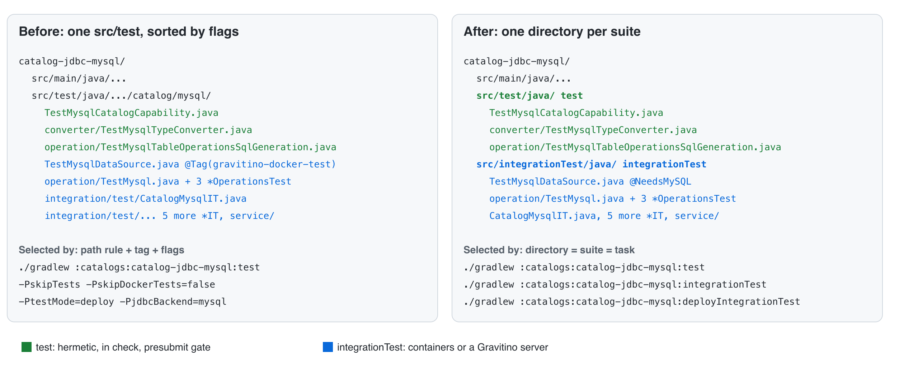

<!--
  Licensed to the Apache Software Foundation (ASF) under one
  or more contributor license agreements.  See the NOTICE file
  distributed with this work for additional information
  regarding copyright ownership.  The ASF licenses this file
  to you under the Apache License, Version 2.0 (the
  "License"); you may not use this file except in compliance
  with the License.  You may obtain a copy of the License at

   http://www.apache.org/licenses/LICENSE-2.0

  Unless required by applicable law or agreed to in writing,
  software distributed under the License is distributed on an
  "AS IS" BASIS, WITHOUT WARRANTIES OR CONDITIONS OF ANY
  KIND, either express or implied.  See the License for the
  specific language governing permissions and limitations
  under the License.
-->

# SPIP: Test Organization for Apache Gravitino

| Field          | Value                                        |
| -------------- | -------------------------------------------- |
| Status         | Draft                                        |
| Author         | Nevin Zheng                                  |
| Reviewers      | TBD                                          |
| Created        | 2026-10-21                                   |
| Updated        | 2026-10-21                                   |
| Tracking issue | [#14092][i14092]                             |
| Depends on     | Container framework stack ([#13900][i13900]) |
| Decide by      | `<date, two weeks after posting>`            |

[i14092]: https://github.com/apache/gravitino/issues/14092
[i13900]: https://github.com/apache/gravitino/issues/13900

---

## Q1. What are we trying to do

**Two test suites, one directory each, one task name each, and no flag that changes what runs.**

- `check` runs only cheap static checks: formatting, license headers and lints. It runs no tests.
- `test` holds hermetic tests. It is fast and the presubmit gate, always run by name.
- `integrationTest` holds every test that needs a container or a Gravitino server.
  `deployIntegrationTest` runs the same classes against the built package.

**Why it matters:** today a contributor cannot tell what a test needs by looking at it, cannot
run one kind of test without the right flags, and gets a green build with zero tests when the
flags are wrong. CI pays for the same confusion: backend IT cells on `main` take 82 to 105 minutes
([run 39604804463](https://github.com/apache/gravitino/actions/runs/39604804463)), each one
Gradle call with 28 `-x` exclusions, and
[#13495](https://github.com/apache/gravitino/pull/13495) reports the build and backend IT jobs
"approach or exceed their 120-minute timeout".

### The picture



```text
Before: one src/test, sorted by a path rule, a tag and flags
catalogs/catalog-jdbc-mysql/
  src/test/java/.../catalog/mysql/
    TestMysqlCatalogCapability.java          hermetic
    converter/TestMysqlTypeConverter.java    hermetic
    TestMysqlDataSource.java                 @Tag("gravitino-docker-test")
    operation/TestMysql.java                 @Tag("gravitino-docker-test")
    integration/test/CatalogMysqlIT.java     path rule **/integration/test/**

After: directory = suite = task
catalogs/catalog-jdbc-mysql/
  src/test/java/.../catalog/mysql/             test
    TestMysqlCatalogCapability.java
    converter/TestMysqlTypeConverter.java
  src/integrationTest/java/.../catalog/mysql/  integrationTest
    TestMysqlDataSource.java                   @NeedsMySQL (container-only)
    operation/TestMysql.java                   @NeedsMySQL (container-only)
    integration/test/CatalogMysqlIT.java       starts a Gravitino server
```

### Commands, before and after

| Goal              | Before                                        | After                      |
| ----------------- | --------------------------------------------- | -------------------------- |
| Fast module tests | `:m:test -PskipITs`                           | `:m:test`                  |
| Presubmit gate    | `build -PskipITs -PskipDockerTests=false`     | `check test`               |
| A module's ITs    | `:m:test -PskipTests -PskipDockerTests=false` | `:m:integrationTest`       |
| ITs, deployed     | the same, plus `-PtestMode=deploy`            | `:m:deployIntegrationTest` |
| Core MySQL lane   | `:core:coreMySQLTest -PskipDockerTests=false` | `:core:coreMySQLTest`      |
| One CI shard      | `test -PskipTests`, 28 `-x`                   | `backendITHive`            |
| Everything        | `build -PskipDockerTests=false`               | `test integrationTestAll`  |

Commands run with `./gradlew`. `:m` is any module path, for example
`:catalogs:catalog-jdbc-mysql`. Deploy mode also needs `compileDistribution` first today.

### The suites, defined once

The suites live in one convention plugin in a `build-logic` included build, so every module gets
the same names:

```kotlin
// build-logic/src/main/kotlin/gravitino.test-suites.gradle.kts
plugins { `jvm-test-suite` }

testing {
  suites {
    // Hermetic: no Docker, no network beyond localhost. The presubmit gate; not in `check`.
    val test by getting(JvmTestSuite::class) { useJUnitJupiter() }

    // Needs something outside the JVM: a container, a Gravitino server, or both.
    register<JvmTestSuite>("integrationTest") {
      useJUnitJupiter()
      dependencies {
        implementation(project())
        implementation(project(":integration-test-common"))
      }
      targets.all { testTask.configure { shouldRunAfter(test) } }
    }
  }
}

// Moves keep their dependency lines for now (Q2, item 3).
configurations["integrationTestImplementation"].extendsFrom(configurations["testImplementation"])

// `check` stays cheap: formatting, license headers and lints, no tests.
tasks.named("check") {
  setDependsOn(dependsOn.filterNot { it is TaskProvider<*> && it.name == "test" })
}

// Same classes as integrationTest, against the built package.
registerVariant(suite = "integrationTest", name = "deployIntegrationTest") {
  dependsOn(":compileDistribution")
  systemProperty("gravitino.test.mode", "deploy")
}
```

A module then says only what is its own:

```kotlin
// catalogs/catalog-jdbc-mysql/build.gradle.kts
plugins { id("gravitino.java-conventions") }

dependencies {
  testImplementation(libs.mockito.core)
  testImplementation(project(":catalogs:catalog-jdbc-common"))
}
// No flags to read. No shard line: the module falls into the computed `backendITOthers`.
```

### Terms

| Term           | Meaning in this SPIP                                                           |
| -------------- | ------------------------------------------------------------------------------ |
| Hermetic       | Runs in one JVM; starts no container; no network beyond localhost              |
| Suite          | A JVM Test Suite: its own source directory, dependencies and `Test` task       |
| Variant        | Another `Test` task over a suite's classes: another runtime or a tag filter    |
| Container-only | An integration test that starts a container but no Gravitino server            |
| Shard          | A root task that runs one task in a set of modules, for one CI job             |
| Lane           | One CI job that runs one task, for example `core-test` running `coreMySQLTest` |
| Cell           | One combination in a CI matrix: shard, mode (embedded or deploy) and store     |
| T0             | The day the container framework stack merges; S1 to S9 are the stages in Q7    |

## What this asks of reviewers

Agree or object to four decisions by `<date>`. Silence on the dev list thread by then is lazy
consensus. Rejected options and the reasons are in
[Appendix A](#appendix-a-options-considered).

1. **`check` runs only cheap static checks: formatting, license headers and lints. No tests.**
   Every test task, `test` included, is run by name, so `check` (and `build`, which depends on
   it) stays fast and the same on every machine. Today `build -PskipDockerTests=false` runs a
   different set of tests on each machine.
2. **Two suites, not three.** The 33 container-only tests (JDBC catalogs 18,
   `hive-metastore-common` 6, `idp-basic` 6, Iceberg REST, Paimon and maintenance 1 each) are
   integration tests. A curated tag lets CI run them once instead of once per backend matrix cell.
3. **One `integrationTest` suite per module; no suite per external system or per feature.** The
   module already names the system (`catalog-hive`, `catalog-jdbc-mysql`); a feature does not
   change a test's classpath. Inside a suite, organization comes from the code (Q4).
4. **Shards are declared in module build files, with `others` computed.** S6 keeps the shard names
   and job layout of [#13495](https://github.com/apache/gravitino/pull/13495) (`hive`,
   `lakehouse`, `others`) and moves its module lists from `dev/ci/test-shards.sh` into
   `gravitinoTests { shard = "hive" }`.

---

## Q2. Non-goals

1. **Changing what tests cover.** No test is removed, merged or rewritten. Files move in
   rename-only commits; packages do not change.
2. **Container classes and lifetimes.** `ContainerSuite`, Ryuk, images, JUnit 6 and
   Testcontainers 2.x belong to the container framework stack
   ([#13900](https://github.com/apache/gravitino/issues/13900), including
   [#13958](https://github.com/apache/gravitino/issues/13958)).
3. **Pruning dependencies.** `integrationTestImplementation` extends `testImplementation`, and
   moves keep dependency lines as `testImplementation` for now. Pruning is later, per module.
4. **Splitting one module's tests across CI jobs.** Shards are built from whole modules.
5. **Rewriting integration tests as unit tests.** This SPIP gives `test` the place and the gate,
   not the content.
6. **Functional and acceptance tests.** End-to-end journeys against the built package are worth
   a separate discussion, including where they live: a Gradle module here, a pytest suite, or a
   separate repository.

---

## Q3. Today and limits

**The build decides what a test is at run time.** Six Gradle properties, one environment variable,
four booleans computed by running `docker`, and a package path rule copied into 39 build files
decide which classes a `test` task runs.

| Part                            | What it does                                                      |
| ------------------------------- | ----------------------------------------------------------------- |
| `src/test`                      | Holds hermetic, container-backed and integration tests together   |
| `**/integration/test/**`        | Path rule that marks an integration test                          |
| `@Tag("gravitino-docker-test")` | Marks a test that needs a container (186 files, 31 modules)       |
| `-PskipITs`                     | Excludes the path rule                                            |
| `-PskipTests`                   | Includes only the path rule, so it runs integration tests only    |
| `-PskipDockerTests=false`       | Includes the Docker tag, if Docker is up; `SKIP_DOCKER_TESTS` too |
| `-PtestMode=embedded\|deploy`   | Tells `BaseIT` to start `MiniGravitino` or use the built package  |
| `-PdorisMultiVersionTest`       | Lets `catalog-jdbc-doris` run its multi-version tests             |
| `-PenableSparkSQLITs`           | Lets the Spark connector run its SQL integration tests            |
| `-PjdbcBackend=h2\|mysql\|pg`   | Chooses the store the Gravitino server uses                       |
| `testArtifacts`                 | Ad-hoc configuration that ships `tests` jars                      |

### Flag traps

| Trap                                                    | Effect                         |
| ------------------------------------------------------- | ------------------------------ |
| `-PskipTests` does not skip tests                       | Runs integration tests only    |
| `-PskipTests` on a module with no integration tests     | Passes green with 0 tests      |
| `-PskipTests -PskipITs`                                 | Include then exclude: 0 tests  |
| `-PskipDockerTests=false` with Docker stopped           | Silent skip outside core       |
| `SKIP_DOCKER_TESTS=true` with `-PskipDockerTests=false` | Docker tests still run         |
| `-PtestMode=deploy` without `compileDistribution`       | Nothing in Gradle declares it  |
| An integration test outside the package path            | Runs as a unit test, silently  |
| `./gradlew help`                                        | Runs `docker` three times      |

### Counts

Counted at `main` `b748d734` (2026-10-21); recounted at T0, when the container framework stack
adds files to `integration-test-common`.

| Item                                       | Count                                    |
| ------------------------------------------ | ---------------------------------------- |
| Test Java files under `src/test`           | 1,729                                    |
| Path rule files                            | 384 (343 tests in 38 modules, 41 shared) |
| Docker-tagged files outside the path rule  | 41 (33 container-only, 8 core lanes)     |
| `testArtifacts` producers / consumer lines | 7 / 57 in 40 build files                 |
| `skipITs` copy-paste blocks                | 39                                       |
| Workflows running Gradle / passing flags   | 25 / 13                                  |
| Backend IT `-x` exclusions                 | 28                                       |
| Backend IT wall time per cell              | 82 to 105 min                            |
| Core lanes, measured                       | H2 5m07s, MySQL 9m41s, PG 7m28s          |

The core database work ([#13515](https://github.com/apache/gravitino/issues/13515),
[#13517](https://github.com/apache/gravitino/pull/13517),
[#13518](https://github.com/apache/gravitino/pull/13518)) split core into four tasks,
`coreUnitTest`, `coreH2Test`, `coreMySQLTest` and `corePostgreSQLTest`, one CI lane each. They
still need `-PskipDockerTests=false` and still read the root script's Docker booleans.

---

## Q4. What we need to implement

### Guarantees

1. **Location is the declaration.** `src/test` is hermetic under the `test` task.
   `src/integrationTest` may start containers and a Gravitino server. One exception: core's
   backend lane classes stay in `src/test` and start a database only under the
   `coreMySQLTest` and `corePostgreSQLTest` variants.
2. **Same task names in every JVM module,** declared once in `build-logic`.
3. **No property changes which tests a task runs.** `skipTests`, `skipITs`, `skipDockerTests`,
   `SKIP_DOCKER_TESTS`, `testMode`, `dorisMultiVersionTest`, `enableSparkSQLITs` and the root
   `extra` booleans go. `jdbcBackend` stays: it chooses the store, not the tests.
4. **`check` is the same on every machine:** `test` plus static checks, with or without Docker.
5. **Docker tasks fail fast** with one message when `docker info` fails. Nothing skips silently.
6. **Shared test code is a library.** `integration-test-common` gets a `src/main`; other shared
   helpers use `java-test-fixtures`. No `tests` jars.
7. **CI selects by task name.** No `-x` lists.
8. **No stage loses a test.** Each CI job runs the same test classes before and after every stage
   PR, or the PR lists the difference (Q7).

### Suite contract

| Task                    | May start              | No Docker  | `check` | CI job          |
| ----------------------- | ---------------------- | ---------- | ------- | --------------- |
| `test`                  | Nothing (H2 in core)   | Runs       | No      | `build (17)`    |
| `integrationTest`       | Containers, server     | Fails fast | No      | Shards          |
| `deployIntegrationTest` | Containers, package    | Fails fast | No      | Deploy shards   |
| Core DB lanes           | One database container | Fails fast | No      | `core-test`     |
| Module opt-ins          | Module-specific        | Varies     | No      | Module workflow |

- **`check`** depends on no test task: it runs Spotless, the license header check (RAT) and
  lints only.
- **Sources.** `test` reads `src/test`; `integrationTest` and `deployIntegrationTest` read
  `src/integrationTest`; the core DB lanes (`coreMySQLTest`, `corePostgreSQLTest`) read core's
  `src/test`.
- **`test`** is one JVM, threads allowed, in-process servers on localhost allowed (H2, a Jetty on
  a free port, a mock HTTP server), no Docker, no sleeps for readiness. That is Google's "small"
  plus the single-machine part of "medium".
- **`integrationTest`** depends on main, the module jar, the catalog jars the module lists today
  and `integration-test-common`. `integrationTestAll` runs it in every module.
- **Module opt-ins** are today's custom tasks (`experimentalTest`, `lanceSpark*Test`,
  `shadedJarTest`) and the two flag-gated selections, which become named variants.
- **`clients/client-python`** already has `unitTests` and `integrationTest` tasks; its `test`
  runs `unitTests` only and its `integrationTest` joins `integrationTestAll`.

### What Gradle recommends

The JVM Test Suite plugin models "a group of tests that share a purpose, such as unit tests,
integration tests or functional tests" as a suite with its own source set, dependencies and
`Test` task, and by convention a suite is not wired into `check`
([JVM Test Suite plugin](https://docs.gradle.org/current/userguide/jvm_test_suite_plugin.html)).
The Java testing guide's integration-test recipe is the same shape
([Testing in Java](https://docs.gradle.org/current/userguide/java_testing.html)). Neither models
a suite per external system or per feature; those are selection, which JUnit tags and test
filters cover. This SPIP follows that: suites by kind, selection inside them. It departs from
Gradle's default in one place: the Java plugin makes `check` depend on `test`, and this SPIP
removes that link so `check` runs static checks only and every test task is run by name.

### Structure inside a suite

Suites are flat. The organization lives in the code, so any test or group is selectable with a
plain task call. In priority order:

1. **Module and package.** What a test covers is where it lives (`catalog-hive`,
   `authorizations/authorization-ranger`, `*.integration.test.authorization`). No build code.
2. **Curated tags.** A small registered set, each with a meta-annotation and a consumer:
   - `container-only`, carried by fixture annotations such as `@NeedsMySQL`: CI runs these once.
   - core's backend lane tags, which exist today.
   - Feature tags are deferred. One is added only for a feature whose tests span many modules and
     cannot share a package, and only in the PR that adds its consumer, a variant such as
     `registerVariant(suite = "integrationTest", name = "authorizationIntegrationTest")` with
     `includeTags("feature-authorization")`.
3. **JUnit grouping.** `@Nested` classes group cases in one class; a JUnit `@Suite` names a fixed
   set of classes that must run together.

**Rules for tags.** Tags are constants in registry classes. The build reads the registries from a
list, `gravitinoTests { tagRegistries }`, and a membership test per suite fails the build on an
unregistered tag. A tag never restates the module or the directory.

**Aggregate tasks are the last resort.** CI shards are thin root tasks computed from what modules
declare in code; `others` is the complement. No hand-kept list of modules or tests. Each shard
has an embedded and a deploy form (`backendITHive`, `backendITHiveDeploy`) and leaves out
`container-only` tests, which one `containerOnlyIT` job runs once.

### `test` as the presubmit gate

`test` is the gate the other jobs wait for. About 1,300 files in `src/test` are hermetic and 376
test files are not, close to the pyramid Google recommends; nothing enforces it.

**Proposed SLO,** set against a per-module baseline that S2 records:

| Measure                                   | Proposed target                        |
| ----------------------------------------- | -------------------------------------- |
| `./gradlew :m:test` per module, CI runner | 5 min; `core` 6 min                    |
| `./gradlew test` whole repo, CI runner    | 20 min                                 |
| `./gradlew check` (static checks only)    | 5 min                                  |
| Docker or network use in `test`           | Zero; the membership guard enforces it |
| Flaky rate of `test` over 30 days         | Under 0.5% of runs                     |
| Slowest `backendIT*` shard per cell       | 60 min                                 |

New logic is tested with fakes in `test`; the real-system check goes in `integrationTest` once.
Release verification is `./gradlew deployIntegrationTest -PjdbcBackend=mysql` against the
candidate package.

---

## Q5. Who cares

| Persona                     | Difference                                                           |
| --------------------------- | -------------------------------------------------------------------- |
| Contributor                 | One command per kind of test, no flags, no silent skips, fast `test` |
| Reviewer                    | The path says what a new test needs                                  |
| CI maintainers              | Task names in the matrix, no `-x`, shards that cover new modules     |
| Release manager             | One task runs the suite against the built package and a chosen store |
| Container framework authors | No overlap: they own container classes, this owns tasks and layout   |

---

## Q6. Risks

| Risk                               | Impact                     | Mitigation                    |
| ---------------------------------- | -------------------------- | ----------------------------- |
| JVM Test Suite API is incubating   | A DSL change breaks builds | Used in one plugin only       |
| 417 files move                     | Review load, rebases       | Rename-only batches (1)       |
| Backports cross the move           | Cherry-pick conflicts      | Land after a branch cut (2)   |
| A stage drops tests silently       | Lost coverage              | Executed-class counts (3)     |
| `check` stops running tests        | Contributors surprised     | Docs and a release note       |
| Container stack lands late         | Every stage shifts         | S1 and S2 start anyway (4)    |
| Configuration cache on Gradle 8.2  | S8 blocked                 | Upgrade with [#13642][i13642] |

1. One batch per workflow group; whole `integration/test` directories move, so git rename
   detection carries open PRs.
2. Batches land right after a release branch is cut; rename detection carries most picks; a
   conflict is fixed once per file.
3. Guarantee 8: every PR shows executed-class counts per CI job.
4. If T0 slips past `<date>`, S1 and S2 (Gradle files only) start anyway.

[i13642]: https://github.com/apache/gravitino/issues/13642

Every stage is one revertable PR. Until S7 the old flags and the path rule still work, so a
revert of S3 to S6 returns CI to today's behavior.

---

## Q7. Timeline

**Sequencing.** The container framework stack
([#13900](https://github.com/apache/gravitino/issues/13900), with
[#13958](https://github.com/apache/gravitino/issues/13958),
[#14006](https://github.com/apache/gravitino/pull/14006) and
[#14077](https://github.com/apache/gravitino/pull/14077)) lands first and in full (T0). No stage
runs in parallel with it.

**No test lost, per stage.** Each stage PR shows the executed test classes per CI job before and
after, read from the JUnit XML reports. From S3 to S7, `test` keeps excluding the Docker tag and
the path rule, and `-PskipTests` on a moved module runs its `integrationTest` (or
`deployIntegrationTest` under `-PtestMode=deploy`), so today's CI jobs keep running every moved
test until S6 switches them.

| Stage | Change                                                      | PRs | Revert            |
| ----- | ----------------------------------------------------------- | --- | ----------------- |
| S1    | `build-logic` seed; core lanes run with no Docker flag      | 1   | Revert PR         |
| S2    | Root `Test` defaults into conventions; per-module baseline  | 1   | Revert PR         |
| S3    | `integrationTest`, its deploy variant, tag registries, shim | 1   | Path rule remains |
| S4    | `integration-test-common` becomes a library                 | 1   | Revert PR         |
| S5    | Move `integration/test` dirs and container-only tests       | 8   | Revert one batch  |
| S6    | CI by task name: shards, container-only job, zero `-x`      | 1   | `-x` lists return |
| S7    | Delete flags, path rule and shim; opt-ins become variants   | 1-2 | Flags return      |
| S8    | S8a report aggregation; S8b configuration cache             | 2   | Turn off in CI    |
| S9    | Docs sweep                                                  | 1   | Docs only         |

Stage details:

- **S1:** `registerVariant`, the `DockerAvailable` value source and `DockerTestService`.
- **S2:** lazy task APIs; per-module `test` baseline for the SLO.
- **S3:** `integrationTest` suite, `deployIntegrationTest`, `integrationTestAll`, tag registries,
  Docker fail fast, and the transition shim.
- **S4:** a rename commit and a build-file commit; 39 consumers switch from `testArtifacts`.
- **S6:** `gravitinoTests { shard }`, `backendITHive`, `backendITLakehouse`, `backendITOthers`.
- **S7:** also root booleans, `printDockerCheckInfo`, the source scan, `client-python` tasks, and
  the remaining `testArtifacts` to `java-test-fixtures`.
- **S9:** `how-to-test.md`, `how-to-build.md`, connector pages.

S5 batches: S5a JDBC catalogs; S5b lakehouse catalogs; S5c clients; S5d Flink; S5e Spark; S5f
Iceberg and Lance; S5g authorizations, plugins and maintenance; S5h web and Trino.

- **T0 to T0 + 6 weeks:** S1 to S4.
- **T0 + 6 weeks to T0 + 3 months:** S5 batches, then S6.
- **T0 + 3 to 4 months:** S7, S8, S9.

[#13495](https://github.com/apache/gravitino/pull/13495) lands on its own schedule and is not
blocked by this SPIP; S6 builds on its shards.
[#13837](https://github.com/apache/gravitino/pull/13837) (draft) is superseded by this plan.

---

## Q8. Exams

Mid-term, after S5:

- `./gradlew :catalogs:catalog-jdbc-mysql:integrationTest` with Docker stopped fails in under 10 s
  with the one message.
- `git ls-files | grep -c '/src/test/.*/integration/test/'` prints `0`.
- Every S5 PR shows the same executed test classes per CI job before and after.
- `git diff -M --stat` on every move commit shows 100% renames.

Final, after S9:

- This returns nothing (Maven's `-DskipTests` in the Trino connector docs does not match):

  ```bash
  git grep -nE \
    -e '(-P|[^A-Za-z])(skipTests|skipITs|skipDockerTests|testMode)\b' \
    -e '(-P|[^A-Za-z])(dorisMultiVersionTest|enableSparkSQLITs)\b' \
    -e 'SKIP_DOCKER_TESTS' \
    -- '*.kts' '*.yml' '*.sh' 'docs/*.md' gradle.properties
  ```

- `./gradlew help --scan` shows no forked process.
- No file under `src/test`, outside core's backend lane classes, imports `org.testcontainers` or
  `ContainerSuite`; the membership guard fails the build otherwise.
- `build (17)` runs `check test`; backend IT runs shard task names with zero `-x`.
- Configuration cache is on in CI with zero problems reported.
- The proposed SLO is tracked in the tracking issue against the S2 baseline.

---

## Appendix A. Options considered

Each option was weighed against contributor UX, CI time, hermeticity, discoverability, migration
cost and Gradle support. The recommendation is Q4.

### A third suite, `dockerTest`, for container-only tests

`src/dockerTest` for the 33 tests that start a container but no server. Rejected: it adds a third
rule to learn and a third directory in 11 modules to save CI time that a tag saves as well. The
tag lets CI run the container-only tests once instead of per backend cell; the tests stay plain
integration tests.

### Suites per external dependency

`src/hiveIntegrationTest`, `src/mysqlIntegrationTest` in every module that touches the system.
Rejected: the module already names the system; a test that uses two systems has no obvious home;
tasks and fixture starts multiply. None of the nine projects surveyed (Appendix B) does it.

### Suites per feature

`src/authorizationTest`, or one test module per feature. Rejected: a feature does not change a
test's classpath, and authorization tests need the catalog they authorize, so one feature module
depends on every catalog. A package per module works and is already the layout in `client-java`.

### Namespacing by convention, no suites

One `src/test`; kind marked by `*IT` names or package segments, selected by patterns. Rejected:
this is today's path rule; a misnamed test runs in the gate, and the traps in Q3 stay.

### A critical-user-journey layer

A small module of end-to-end journeys run in deploy mode, nightly and on release candidates. Not
rejected: it is a non-goal here (Q2, item 6) and fits as one more module with its own suite.

## Appendix B. Precedent

| Project     | Non-unit kinds                        | External system carried by       |
| ----------- | ------------------------------------- | -------------------------------- |
| Spring Boot | `intTest`, `dockerTest` source sets   | The module (one per starter)     |
| Kafka       | `integration` tag in `src/test`       | Tags; CI by module               |
| Iceberg     | `integration` set in aws, gcp, azure  | The module                       |
| Trino       | Plugin tests; one product-test module | Plugin module; product groups    |
| Debezium    | Failsafe `*IT` per connector module   | The module                       |
| Hibernate   | One `src/test`                        | `RDBMS` matrix, same sources     |
| Flink       | `*ITCase` pattern in `src/test`       | Module stages; `misc` complement |
| Quarkus     | One module per scenario               | The module                       |
| Micronaut   | `functionalTest` source set           | The module                       |

None uses a source set per external system. Gradle's own build runs one `integTest` source set
under several executer modes, the variant pattern used here.

## Appendix C. References

Test pyramid and sizes:

- [Software Engineering at Google, ch. 11: Testing Overview](https://abseil.io/resources/swe-book/html/ch11.html)
- [Software Engineering at Google, ch. 14: Larger Testing](https://abseil.io/resources/swe-book/html/ch14.html)
- [The Practical Test Pyramid](https://martinfowler.com/articles/practical-test-pyramid.html)
- [Test Sizes](https://testing.googleblog.com/2010/12/test-sizes.html), Google Testing Blog

Presubmit and flakiness:

- [Software Engineering at Google, ch. 23: Continuous Integration](https://abseil.io/resources/swe-book/html/ch23.html)
- [Taming Google-Scale Continuous Testing](https://research.google/pubs/taming-google-scale-continuous-testing/)
- [Flaky Tests at Google and How We Mitigate Them](https://testing.googleblog.com/2016/05/flaky-tests-at-google-and-how-we.html)

Gradle:

- [JVM Test Suite plugin](https://docs.gradle.org/current/userguide/jvm_test_suite_plugin.html)
- [Testing in Java and JVM projects](https://docs.gradle.org/current/userguide/java_testing.html)
- [Sharing build logic between subprojects](https://docs.gradle.org/current/userguide/sharing_build_logic_between_subprojects.html)
- [Configuration cache requirements](https://docs.gradle.org/current/userguide/configuration_cache_requirements.html)
- [Gradle's integration test plugin](https://github.com/gradle/gradle/blob/master/build-logic/integration-testing/src/main/kotlin/gradlebuild.integration-tests.gradle.kts)
- [Develocity Predictive Test Selection](https://docs.gradle.com/develocity/predictive-test-selection/)

Precedent projects:

- [Spring Boot IntegrationTestPlugin](https://github.com/spring-projects/spring-boot/blob/main/buildSrc/src/main/java/org/springframework/boot/build/test/IntegrationTestPlugin.java)
  and
  [DockerTestPlugin](https://github.com/spring-projects/spring-boot/blob/main/buildSrc/src/main/java/org/springframework/boot/build/test/DockerTestPlugin.java)
- [Kafka build.gradle](https://github.com/apache/kafka/blob/trunk/build.gradle)
- [Iceberg build.gradle](https://github.com/apache/iceberg/blob/main/build.gradle)
- [Trino ci.yml](https://github.com/trinodb/trino/blob/master/.github/workflows/ci.yml) and
  [trino-product-tests](https://github.com/trinodb/trino/tree/master/testing/trino-product-tests)
- [Debezium connector-mysql-workflow.yml](https://github.com/debezium/debezium/blob/main/.github/workflows/connector-mysql-workflow.yml)
- [Hibernate ORM ci.yml](https://github.com/hibernate/hibernate-orm/blob/main/.github/workflows/ci.yml)
- [Flink stage.sh](https://github.com/apache/flink/blob/master/tools/ci/stage.sh)
- [Quarkus ci-actions-incremental.yml](https://github.com/quarkusio/quarkus/blob/main/.github/workflows/ci-actions-incremental.yml)
- [Micronaut functional-test plugin](https://github.com/micronaut-projects/micronaut-core/blob/4.10.x/buildSrc/src/main/groovy/io.micronaut.build.internal.functional-test.gradle)
