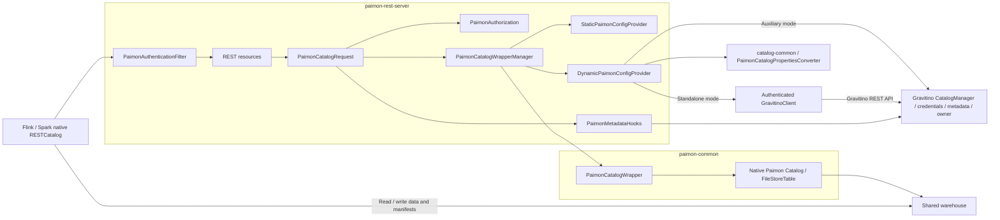

## Overview

The Apache Gravitino Paimon REST server implements the [Apache Paimon REST catalog
protocol](https://paimon.apache.org/docs/2.1/concepts/rest/rest-api/). Engines connect with
Paimon's native `RESTCatalog` client using their Paimon connector.

```properties
metastore = rest
uri = http://$ip:$port/paimon/
warehouse = default_catalog
token.provider = bear
token = <token>
```

Access the Paimon REST endpoint at `http://$ip:$port/paimon/`.

The server is built on Paimon **2.1.0**. Client compatibility tests cover Paimon 1.4.2, 2.0.0 and 2.1.0.

The client sends the supplied token as an `Authorization: Bearer` header. With OAuth
enabled, obtain an access token from the configured identity provider and give it to the
engine. Gravitino validates it and associates the caller with audit events. Paimon's
`bear` provider uses the supplied token for each request, so the deployment must arrange
token renewal for jobs that outlive that token.

The client-side `warehouse` selects a logical catalog. Static configuration provides
`default_catalog` and configured named catalogs. Dynamic configuration serves registered
Gravitino catalog names. Set the storage location on the server with the catalog's `warehouse` property.

### Client compatibility

The server uses Paimon 2.1.0. The automated verification covers the following clients.

| Client | Verified operations |
| --- | --- |
| Paimon 1.2.0 | REST create/write, plus read and append to an existing 1.2.0 filesystem table in an isolated JVM |
| Paimon 1.4.2, 2.0.0 and 2.1.0 | Official connector artifacts with Flink 1.20 checkpoint commits, Spark 3.5 reads/appends and a Flink batch read |
| Paimon 2.1.0 with dynamic configuration | Flink/Spark writes, reads and Spark DDL through an authenticated Gravitino HTTP catalog fixture |
| Paimon 2.1.0 with upgraded Zstd | Separate Flink/Spark read/write verification with zstd-jni 1.5.7-14 |

### Architecture



At a Flink checkpoint or the end of a Spark write, the engine prepares its data and manifest
files and submits the snapshot over REST. The service routes the request to the native
catalog. With a backend lock configured, the commit reloads the table, validates the
writer's table UUID, checks for a conflicting snapshot and publishes the snapshot under that
lock. The engine can regenerate its snapshot and retry a conflict.

### Capabilities

The Paimon REST server provides the following operations.

- Database and table CRUD, rename, and schema evolution.
- Data commits through the REST protocol: snapshot files are persisted atomically server
  side, and conflicting commits return `{"success": false}` so writers regenerate and retry.
- Snapshot loading and listing (latest, earliest, by id, or by tag name).
- Latest-snapshot statistics include the live data-file count, total size and latest file creation
  time from that snapshot's manifests. A missing snapshot returns HTTP 404.
- Branches (create, rename, delete, fast-forward) and tags (create, load, list, delete).
- Rollback to a snapshot or a tag.
- External table registration (`POST .../databases/{db}/register`).
- Optional table storage credential forwarding with `data-token.enabled`.
- Bearer token authentication backed by the Gravitino authentication framework.
- Health endpoints at `/paimon/health`, `/paimon/health/live` and `/paimon/health/ready`.

The server returns HTTP 501 for the following operations.

- Partition endpoints. Paimon clients transparently fall back to filesystem partition
  listing when they receive 501.
- Views, functions, consumers, policies and permissions endpoints.
- Schema rollback.

## Deployment

Like the Iceberg REST server, the Paimon REST server can run in two modes.

### Auxiliary mode (embedded in the Gravitino server)

Enable the service in `conf/gravitino.conf`.

```properties
gravitino.auxService.names = paimon-rest
gravitino.paimon-rest.classpath = paimon-rest-server/libs, paimon-rest-server/conf
gravitino.paimon-rest.httpPort = 9002
```

### Standalone mode

Build the standalone archive and its SHA-256 checksum with Java 17.

```sh
./gradlew assemblePaimonRESTServer
```

Extract `distribution/gravitino-paimon-rest-server-<version>-bin.tar.gz`. Edit
`conf/gravitino-paimon-rest-server.conf` in the extracted directory and run
`bin/gravitino-paimon-rest-server.sh run`. The script also supports `start`, `status`,
and `stop`. Use `./gradlew assembleDistribution` to build the full Gravitino distribution.

### Authentication

Configure the Gravitino OAuth authenticator in `conf/gravitino.conf` in auxiliary mode
or in `conf/gravitino-paimon-rest-server.conf` in standalone mode. The following settings
validate a JWT access token against the identity provider's JWKS endpoint.

```properties
gravitino.authenticators = oauth
gravitino.authenticator.oauth.tokenValidatorClass = org.apache.gravitino.server.authentication.JwksTokenValidator
gravitino.authenticator.oauth.authority = <issuer-url>
gravitino.authenticator.oauth.jwksUri = <jwks-url>
gravitino.authenticator.oauth.serviceAudience = <token-audience>
```

Set `authority` to the value of the token's `iss` claim and `serviceAudience` to one of
its `aud` values. Leave both `gravitino.paimon-rest.token` and
`gravitino.paimon-rest.token.<principal>` unset so requests reach the OAuth authenticator.
See [Gravitino OAuth configuration](./security/how-to-authenticate.md#oauth-mode).

To connect from Gravitino's existing `lakehouse-paimon` catalog, set these catalog properties.

```properties
catalog-backend = rest
uri = https://<paimon-rest-host>/paimon/
warehouse = default_catalog
token-provider = bear
token = <access_token>
```

Fill `token` with the identity provider's JWT access token. The Paimon client adds the
HTTP `Bearer` prefix and continues to use that token until it is reconfigured.

For local testing with static tokens, set `gravitino.paimon-rest.token` and use the same
value in the client. The service also accepts explicitly configured per-principal static tokens.

### Registered Gravitino catalogs

Select the dynamic provider to serve existing `lakehouse-paimon` catalogs in one metalake.
Set the engine's `warehouse` to the registered catalog name, such as `sales`.
The registered catalog supplies its backend warehouse, URI, credentials and backend options.

In auxiliary mode, configure the following entries in `conf/gravitino.conf`.

```properties
gravitino.auxService.names = paimon-rest
gravitino.paimon-rest.classpath = paimon-rest-server/libs, paimon-rest-server/conf
gravitino.paimon-rest.catalog-config-provider = dynamic-config-provider
gravitino.paimon-rest.gravitino-metalake = production
gravitino.paimon-rest.catalog-cache-ttl-ms = 30000
```

The provider resolves catalogs through `CatalogManager.doWithCatalog` in the same process.
Catalog changes and drops invalidate the REST cache. The fixed cache lifetime is measured
from load time, so continued traffic also observes refreshed configuration.
Active requests retain their leased backend until they complete.

Auxiliary metadata mutations validate schema and table names before changing the backend.
Names containing `.` are rejected because Gravitino reserves it as a qualified-name separator.
New schema and table names, including table rename destinations, are limited to 128 characters. Top-level
column names are limited to 300 characters. Creation, column additions, column renames and
column-comment changes validate Gravitino's storage limits before applying native changes.
An invalid change in a batch rejects the batch before any change is applied.
Cross-schema renames import the destination schema before moving the table. If a destination
table registration remains after an out-of-band move or drop, the service returns HTTP 409
and leaves the source table in place. Creating a table with an existing registration also
returns HTTP 409 before writing a new table, preserving the registered identity, ownership,
tags and privileges. Schema creation applies the same check to existing schema registrations,
including registrations left behind by an out-of-band move or drop. It returns HTTP 409
before creating a directory, preserving the old schema's ownership, tags and child registrations. A missing source or destination database returns HTTP 404.
Successful renames preserve the registered table ID and ownership and notify the authorization
hooks. Column renames on the main branch preserve column IDs and their associated tags in
Gravitino. The service omits `gravitino.identifier` from loaded table options so clients can
copy a returned schema when creating another table. Requests to create, set or remove the
internal identity options `gravitino.identifier` and `rest.uuid` return HTTP 400.
Deletes also notify the authorization hooks. Table listings follow the main API's visibility rules, including
creation and probe privileges, with authorization filtering applied before pagination.

Standalone upstream availability failures return a sanitized HTTP 503 response.

When `gravitino.authorization.enable = true`, REST requests use the caller's Gravitino
Catalog, Schema and Table permissions. List responses filter unauthorized objects before
pagination. Branch requests use the base table's privileges. Successful metadata mutations
import Gravitino entities and assign creation ownership to the caller. Rename preserves the
registered table ID and ownership. Per-principal static tokens must name registered
Gravitino users, or OAuth can supply the authenticated identity.

Storage credential requests additionally require `USE_SECRETS` and
`INCLUDE_CREDENTIAL_SECRETS`, or metalake ownership, because the returned credentials
cover the catalog. The same check applies to forwarding sensitive `client.*` properties.

For a standalone deployment, configure an authenticated connection to the Gravitino server.

```properties
gravitino.paimon-rest.catalog-config-provider = dynamic-config-provider
gravitino.paimon-rest.gravitino-uri = http://127.0.0.1:8090
gravitino.paimon-rest.gravitino-metalake = production
gravitino.paimon-rest.gravitino-auth-type = simple
gravitino.paimon-rest.gravitino-simple.user-name = paimon-rest-server
```

For OAuth client credentials, use the following configuration.

```properties
gravitino.paimon-rest.gravitino-auth-type = oauth2
gravitino.paimon-rest.gravitino-oauth2.server-uri = https://identity.example.com
gravitino.paimon-rest.gravitino-oauth2.credential = <client-id>:<client-secret>
gravitino.paimon-rest.gravitino-oauth2.token-path = oauth/token
gravitino.paimon-rest.gravitino-oauth2.scope = <scope>
```

These settings authenticate the service's outgoing Gravitino client. Configure engine-facing
authentication using the authentication section above. In standalone mode, Gravitino evaluates
the configured service account when resolving catalog properties, secrets and credentials.
Auxiliary mode evaluates per-request metadata permissions using the in-process authorizer.
Standalone lookups observe catalog edits and drops when their fixed cache lifetime expires.

The provider reuses the catalog's property conversion, including `gravitino.bypass.*`,
`token-provider` and DLF options. Kerberos catalogs return a clear unsupported-operation
error because the REST service currently has no catalog Kerberos login lifecycle.

## Configuration

The default static backend catalog uses the top-level `gravitino.paimon-rest.*` keys.
The following example configures the filesystem metastore.

```properties
gravitino.paimon-rest.catalog-backend = filesystem
gravitino.paimon-rest.warehouse = /tmp/paimon-warehouse
```

JDBC and Hive metastore backends are supported by setting
`gravitino.paimon-rest.catalog-backend` accordingly. The following example uses JDBC.

```properties
gravitino.paimon-rest.catalog-backend = jdbc
gravitino.paimon-rest.uri = jdbc:postgresql://127.0.0.1:5432/postgres
gravitino.paimon-rest.jdbc-driver = org.postgresql.Driver
gravitino.paimon-rest.jdbc-user = postgres
gravitino.paimon-rest.jdbc-password = secret
gravitino.paimon-rest.warehouse = s3://bucket/prefix
```

Additional properties are listed below.

| Key | Description | Default |
| --- | --- | --- |
| `gravitino.paimon-rest.host` | Bind host of the REST server | `0.0.0.0` |
| `gravitino.paimon-rest.httpPort` | HTTP port of the REST server | `9002` |
| `gravitino.paimon-rest.token` | Requests must carry a matching `Authorization: Bearer` header when this token is configured. Validation failures return 401. The request is attributed to the `shared` principal. When unset and no per-principal tokens are declared, validation is delegated to the Gravitino authenticator framework | (empty) |
| `gravitino.paimon-rest.token.<principal>` | Per-principal bearer token; requests carrying this token are authenticated as `<principal>` (visible in audit logs), so individual tokens can be revoked without affecting others | (none) |
| `gravitino.paimon-rest.catalog-config-provider` | `static-config-provider` or `dynamic-config-provider` | `static-config-provider` |
| `gravitino.paimon-rest.catalog-cache-ttl-ms` | Fixed lifetime of a dynamic catalog configuration in milliseconds | `30000` |
| `gravitino.paimon-rest.gravitino-metalake` | Metalake containing dynamically served catalogs | `default_metalake` |
| `gravitino.paimon-rest.gravitino-uri` | Gravitino server URI for standalone dynamic lookup | (required in standalone dynamic mode) |
| `gravitino.paimon-rest.catalog.<name>.<key>` | Declares an additional named catalog | (none) |
| `gravitino.paimon-rest.client.<key>` | Forwarded to clients in the `/v1/config` response as `<key>` | (none) |
| `gravitino.paimon-rest.extension-packages` | Comma separated JAX-RS extension packages | (empty) |

Backend properties are translated to native Paimon options: `catalog-backend` becomes
`metastore`, and `jdbc-user`/`jdbc-password` become `jdbc.user`/`jdbc.password`.
`jdbc-driver` explicitly loads the driver class. Both server distributions include the PostgreSQL
driver, Paimon Hive catalog, and Paimon S3 and OSS FileIO plugins. Configure `oss-endpoint`
for the registered OSS catalog and supply matching FileIO dependencies to the engines
that access the warehouse. Add other JDBC drivers to the
service's `libs` directory. All remaining `gravitino.paimon-rest.*` keys are passed through
to the static backend Paimon catalog. Prefer native S3 options such as `s3.access-key`.
The `fs.s3a.*` credential aliases and their `client.` equivalents are also translated.

### Table data tokens (storage credential vending)

Static data tokens require long-lived storage keys. The static provider rejects temporary
S3/OSS session credentials when data tokens are enabled because their actual expiry is unknown.

When a catalog enables `data-token.enabled`, the `/v1/config` response advertises it and
clients fetch storage credentials through `GET .../tables/{t}/token`. The server returns every catalog configuration
key that starts with a storage credential prefix (`s3.`, `fs.s3a.`, `fs.oss.`, `fs.obs.`,
`fs.cos.`, `fs.gs.`, `fs.adl.`, `fs.azure.`). Clients refresh the returned options
according to the response's expiry. For long-lived keys, the service uses a synthetic two-hour
expiry to schedule client refreshes.
Configured storage keys retain their original permissions and are returned unchanged for every
table in the catalog.

```properties
gravitino.paimon-rest.catalog-backend = filesystem
gravitino.paimon-rest.warehouse = s3://bucket/prefix
gravitino.paimon-rest.s3.endpoint = s3.eu-west-1.amazonaws.com
gravitino.paimon-rest.s3.access-key = key
gravitino.paimon-rest.s3.secret-key = secret
gravitino.paimon-rest.data-token.enabled = true
```

### Temporary storage credentials

Register a `lakehouse-paimon` catalog through the Gravitino API with `credential-providers`
set to `s3-token` for an S3 warehouse or `oss-token` for an OSS warehouse. For example,
use these catalog properties to serve a warehouse with an S3 role.

```properties
catalog-backend = filesystem
warehouse = s3://bucket/warehouse
credential-providers = s3-token
s3-region = us-east-1
s3-role-arn = arn:aws:iam::<account-id>:role/<role-name>
s3-token-expire-in-secs = 7200
gravitino.bypass.data-token.enabled = true
```

For OSS, use an `oss://` warehouse and set `oss-endpoint`, `oss-region`, `oss-role-arn`,
`oss-access-key-id`, `oss-secret-access-key`, and `oss-token-expire-in-secs` on the catalog.
The Paimon REST service supplies these providers with a path-based credential context for
the configured warehouse URI. The resulting STS policy
permits reads and writes under that warehouse prefix. Configure each table's data location
within that prefix. A separate catalog can serve another storage prefix.
A bucket-root warehouse such as `s3://bucket` or `s3://bucket/` grants listing of all
prefixes in that bucket. A warehouse with a nonempty prefix keeps its scoped list conditions.

Paimon's Hadoop FileIO probes the warehouse root before accessing its directory marker.
S3 credentials therefore include read access to the exact warehouse-root object and allow
listing with the bare warehouse prefix. The latter can enumerate sibling key names that
share that string prefix. Object reads and writes remain restricted to the configured
warehouse location, and the root object receives read access.

Auxiliary mode reuses the registered catalog's credential manager. Standalone mode resolves
the catalog's secrets through its authenticated service account and runs the built-in
provider locally. Both distributions include the S3/OSS credential providers, SDK dependencies,
and FileIO plugins.
The standalone service account needs access to the catalog's secrets and credentials.
For S3, the provider can also use the service process's AWS default credential chain.

A failed STS request, an empty token response or an incompatible warehouse URI fails catalog
resolution. Generated session credentials replace the STS caller's source keys in the resolved
storage configuration. The `/token` endpoint requires the catalog's existing secret-access
privileges in auxiliary mode and returns warehouse-wide credentials with their real expiry.

Dynamic catalogs can use credential providers that return the real S3/OSS credential expiry.
Enable `gravitino.paimon-rest.data-token.enabled = true` for service defaults, or set
`gravitino.bypass.data-token.enabled = true` on an individual Gravitino catalog.

Configure the Gravitino catalog's `s3-token-expire-in-secs` or `oss-token-expire-in-secs`
well above one hour. A value of `7200` seconds leaves room for Paimon's one-hour refresh
window, the service's one-minute margin and Gravitino's credential cache. That cache may
return a credential with part of its lifetime already consumed. For a 7200-second S3 session,
the target role's maximum session duration must be at least two hours.

AWS limits role chaining to one hour. If the service calls `AssumeRole` using an existing
assumed-role session, requesting 7200 seconds fails. A 3600-second session also fails this
service's data-token lifetime check. Use an STS caller identity that can request sessions
longer than one hour for this mode. For jobs with engine-managed credentials, disable
`data-token.enabled` and configure credential refresh on the engines. See the
[AWS AssumeRole duration rules](https://docs.aws.amazon.com/STS/latest/APIReference/API_AssumeRole.html).

The service refreshes before `expiry - (one hour + one minute)` for data-token catalogs,
and returns the actual credential expiry from `/token`. Credentials with insufficient
remaining lifetime produce an actionable error naming both duration settings. Tests use
a controlled clock to verify refresh boundaries and rejection of short-lived cached credentials.
Catalog cache entries are scoped to the caller, and ongoing requests retain their original lease.

### Client storage configuration

Engines resolve data file credentials themselves. For object storage, forward the
needed keys to clients with `client.` prefixed entries as shown below, or configure them
on the engine side next to the catalog `uri`.

```properties
gravitino.paimon-rest.client.s3.endpoint = s3.eu-west-1.amazonaws.com
gravitino.paimon-rest.client.s3.access-key = key
gravitino.paimon-rest.client.s3.secret-key = secret
```


## Engine integration

### Spark

Use `org.apache.paimon:paimon-spark-3.5_2.12:2.1.0` with Spark 3.5.

```properties
spark.sql.extensions = org.apache.paimon.spark.extensions.PaimonSparkSessionExtensions
spark.sql.catalog.paimon_rest = org.apache.paimon.spark.SparkCatalog
spark.sql.catalog.paimon_rest.metastore = rest
spark.sql.catalog.paimon_rest.uri = http://$ip:9002/paimon/
spark.sql.catalog.paimon_rest.warehouse = default_catalog
spark.sql.catalog.paimon_rest.token.provider = bear
spark.sql.catalog.paimon_rest.token = <token>
```

Paimon requires the `spark.sql.extensions` setting above for tag and rollback SQL support.

```sql
CREATE DATABASE paimon_rest.db1;
CREATE TABLE paimon_rest.db1.t1 (id INT, name STRING);
INSERT INTO paimon_rest.db1.t1 VALUES (1, 'alice');
ALTER TABLE paimon_rest.db1.t1 CREATE TAG `tag-1`;
```

### Flink

Install `paimon-flink-1.20-2.1.0.jar` in Flink 1.20 and execute the following SQL.
For streaming inserts, configure checkpointing to publish snapshots. Use a warehouse
that the server and all engine workers can access.

```sql
SET 'execution.checkpointing.interval' = '10s';
CREATE CATALOG paimon_rest WITH (
  'type' = 'paimon',
  'metastore' = 'rest',
  'uri' = 'http://127.0.0.1:9002/paimon/',
  'warehouse' = 'default_catalog',
  'token.provider' = 'bear',
  'token' = '<token>'
);
CREATE DATABASE IF NOT EXISTS paimon_rest.db1;
CREATE TABLE IF NOT EXISTS paimon_rest.db1.t1 (id INT, name STRING);
INSERT INTO paimon_rest.db1.t1 VALUES (2, 'bob');
```

### Flink CDC Pipeline

The following configuration example uses Flink CDC 3.7.0 with Flink 1.20 and MySQL 8.0. Install the MySQL and
Paimon Pipeline connector JARs for `3.7.0-1.20` and make the MySQL JDBC driver and Hadoop
libraries available as described in the [Flink CDC setup guide](https://nightlies.apache.org/flink/flink-cdc-docs-release-3.7/docs/examples-and-best-practices/mysql-to-paimon/).
Enable checkpointing in the Flink cluster with `execution.checkpointing.interval`. The
REST service and Flink workers must be able to access the same warehouse storage.

Set up a test table in MySQL with row-format binary logging enabled. Use a CDC account
that can read the table and consume the binlog.

```sql
CREATE DATABASE cdc_demo;
CREATE TABLE cdc_demo.orders (
  id INT NOT NULL PRIMARY KEY,
  amount DECIMAL(10, 2) NOT NULL,
  status VARCHAR(24) NOT NULL
);
INSERT INTO cdc_demo.orders VALUES (101, 19.90, 'NEW'), (102, 42.50, 'NEW');
```

Save this pipeline as `pipeline.yaml` and replace the connection settings with values for
your environment.

```yaml
source:
  type: mysql
  hostname: 127.0.0.1
  port: 3306
  username: cdc
  password: '<mysql-cdc-password>'
  tables: 'cdc_demo.orders'
  server-id: '20600-20604'
  scan.startup.mode: initial
  server-time-zone: UTC
  jdbc.properties.allowPublicKeyRetrieval: 'true'
sink:
  type: paimon
  catalog.properties.metastore: rest
  catalog.properties.uri: http://127.0.0.1:9002/paimon/
  catalog.properties.warehouse: default_catalog
  catalog.properties.token.provider: bear
  catalog.properties.token: '<paimon-rest-access-token>'
  table.properties.bucket: '1'
pipeline:
  name: MySQL CDC to Gravitino Paimon REST
  parallelism: 1
```

For shared-token authentication, use the value of `gravitino.paimon-rest.token` as
`catalog.properties.token`. For OAuth, use an access token issued by the configured identity
provider. The verified Paimon 1.4.2, 2.0.0 and 2.1.0 clients require `token.provider`
during catalog initialization. For local testing, configure a shared token on the service and
keep both token options in the YAML.
Use the JDBC public key retrieval option for the local MySQL setup shown here. For a
different MySQL deployment, use its JDBC TLS settings.

The pipeline writes to `cdc_demo.orders` in the REST catalog `default_catalog`. To write to a
different database or table, add a top-level [`route`](https://nightlies.apache.org/flink/flink-cdc-docs-release-3.7/docs/core-concept/route/).

Submit the job to the running Flink cluster. This example passes the Hadoop JAR as a
job dependency. Use the path from your Flink installation.

```sh
"$FLINK_CDC_HOME/bin/flink-cdc.sh" pipeline.yaml \
  --jar "$FLINK_HOME/opt/flink-shaded-hadoop.jar"
```

After a completed checkpoint, query the target with a Paimon reader and verify both rows.
Then run the following statements in MySQL and wait for another completed checkpoint.

```sql
UPDATE cdc_demo.orders SET status = 'PAID' WHERE id = 101;
INSERT INTO cdc_demo.orders VALUES (103, 8.75, 'NEW');
```

Verify that the latest Paimon snapshot contains `101` with status `PAID` and a new row for `103`.

## Verification

```sh
./gradlew :paimon:paimon-common:check :paimon:paimon-rest-server:check
```

The engine integration tests cover official Paimon 1.4.2, 2.0.0 and 2.1.0 connectors.
They create a table in Flink, wait for a streaming checkpoint, append from Spark and read
both batches from Flink. A separate test exercises dynamic catalog lookup through an
authenticated HTTP fixture. Upgraded Zstd verification runs independently from the official
connector matrix. Auxiliary lookup, authorization, ownership, invalidation and STS expiry
have targeted regression tests.

```sh
./gradlew :paimon:paimon-rest-server:test --tests '*PaimonRESTServiceSparkIT'
```

## Notes

- Paimon drop semantics apply: dropping a table deletes its data (drop equals purge).
- The table uuid exposed over REST is persisted as the `rest.uuid` table option. Tables
  created outside REST receive a random uuid persisted in `.rest-uuid` at their table
  location on first load, which requires write access to that location. The identity stays
  stable across restarts and renames, but changes when the table's data is deleted and
  recreated. Writers holding an old identity cannot commit to a recreated table.
- Concurrent commits rely on atomic snapshot-file creation on the storage. On object
  storage without atomic rename support, enable an external lock via the backend catalog
  configuration. The REST service acquires that lock around both identity validation and
  snapshot-file creation, and closes it after each operation.
