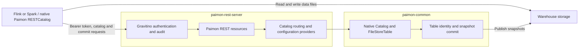

## Overview

The Apache Gravitino Paimon REST server implements the [Apache Paimon REST catalog
protocol](https://paimon.apache.org/docs/2.1/concepts/rest/rest-api/). Engines connect with
Paimon's native `RESTCatalog` client — no Gravitino connector is required:

```properties
metastore = rest
uri = http://$ip:$port/paimon/
warehouse = default_catalog
token.provider = bear
token = <token>
```

Access the Paimon REST endpoint at `http://$ip:$port/paimon/`.

The server is built on Paimon **2.1.0**. Client compatibility tests cover Paimon 1.4.2, 2.0.0 and 2.1.0.

The client sends the supplied token as an `Authorization: Bearer` header. With OAuth
enabled, obtain an access token from the configured identity provider and give it to the
engine. Gravitino validates it and associates the caller with audit events. Paimon's
`bear` provider uses the supplied token for each request, so the deployment must arrange
token renewal for jobs that outlive that token.

The client-side `warehouse` selects a logical catalog (`default_catalog` or a configured
catalog name). Set the storage location on the server with the catalog's `warehouse` property.

### Architecture



At a Flink checkpoint or the end of a Spark write, the engine prepares its data and manifest
files and submits the snapshot over REST. The service routes the request to the native
catalog. With a backend lock configured, the commit reloads the table, validates the
writer's table UUID, checks for a conflicting snapshot and publishes the snapshot under that
lock. The engine can regenerate its snapshot and retry a conflict.

### Capabilities

The Paimon REST server provides:

- Database and table CRUD, rename, and schema evolution.
- Data commits through the REST protocol: snapshot files are persisted atomically server
  side, and conflicting commits return `{"success": false}` so writers regenerate and retry.
- Snapshot loading and listing (latest, earliest, by id).
- Branches (create, rename, delete, fast-forward) and tags (create, load, list, delete).
- Rollback to a snapshot or a tag.
- External table registration (`POST .../databases/{db}/register`).
- Optional table storage credential forwarding with `data-token.enabled`.
- Bearer token authentication backed by the Gravitino authentication framework.
- Health endpoints at `/paimon/health`, `/paimon/health/live` and `/paimon/health/ready`.

The following features are not implemented yet; the server answers them with HTTP 501:

- Partition endpoints. Paimon clients transparently fall back to filesystem partition
  listing when they receive 501.
- Views, functions, consumers, policies and permissions endpoints.
- Schema rollback.

## Deployment

Like the Iceberg REST server, the Paimon REST server can run in two modes.

### Auxiliary mode (embedded in the Gravitino server)

Enable the service in `conf/gravitino.conf`:

```properties
gravitino.auxService.names = paimon-rest
gravitino.paimon-rest.classpath = paimon-rest-server/libs, paimon-rest-server/conf
gravitino.paimon-rest.httpPort = 9002
```

### Standalone mode

Build the standalone archive and its SHA-256 checksum with Java 17.

```sh
./gradlew assemblePaimonRESTServer
```

Extract `distribution/gravitino-paimon-rest-server-<version>-bin.tar.gz`. Edit
`conf/gravitino-paimon-rest-server.conf` in the extracted directory and run
`bin/gravitino-paimon-rest-server.sh run`. The script also supports `start`, `status`,
and `stop`. Use `./gradlew assembleDistribution` to build the full Gravitino distribution.

### Authentication

Configure `gravitino.authenticators=oauth` and the OAuth settings in the Gravitino
configuration for auxiliary mode or in `conf/gravitino-paimon-rest-server.conf` for
standalone mode. See [Authenticate with OAuth](./security/how-to-authenticate.md).
For local testing, set `gravitino.paimon-rest.token` and use the same value as the engine's
`token`. The service also accepts explicitly configured per-principal static tokens.

## Configuration

The default backend catalog is built from the top-level `gravitino.paimon-rest.*` keys; the
following example configures the filesystem metastore:

```properties
gravitino.paimon-rest.catalog-backend = filesystem
gravitino.paimon-rest.warehouse = /tmp/paimon-warehouse
```

JDBC and Hive metastore backends are supported by setting
`gravitino.paimon-rest.catalog-backend` accordingly, for example:

```properties
gravitino.paimon-rest.catalog-backend = jdbc
gravitino.paimon-rest.uri = jdbc:postgresql://127.0.0.1:5432/postgres
gravitino.paimon-rest.jdbc-driver = org.postgresql.Driver
gravitino.paimon-rest.jdbc-user = postgres
gravitino.paimon-rest.jdbc-password = secret
gravitino.paimon-rest.warehouse = s3://bucket/prefix
```

Additional properties:

| Key | Description | Default |
| --- | --- | --- |
| `gravitino.paimon-rest.host` | Bind host of the REST server | `0.0.0.0` |
| `gravitino.paimon-rest.httpPort` | HTTP port of the REST server | `9002` |
| `gravitino.paimon-rest.token` | Shared bearer token; when set, requests must carry a matching `Authorization: Bearer` header or receive 401. The request is attributed to the `shared` principal. When unset and no per-principal tokens are declared, validation is delegated to the Gravitino authenticator framework | (empty) |
| `gravitino.paimon-rest.token.<principal>` | Per-principal bearer token; requests carrying this token are authenticated as `<principal>` (visible in audit logs), so individual tokens can be revoked without affecting others | (none) |
| `gravitino.paimon-rest.catalog.<name>.<key>` | Declares an additional named catalog | (none) |
| `gravitino.paimon-rest.client.<key>` | Forwarded to clients in the `/v1/config` response as `<key>` | (none) |
| `gravitino.paimon-rest.extension-packages` | Comma separated JAX-RS extension packages | (empty) |

Backend properties are translated to native Paimon options: `catalog-backend` becomes
`metastore`, and `jdbc-user`/`jdbc-password` become `jdbc.user`/`jdbc.password`.
`jdbc-driver` explicitly loads the driver class. The distribution includes the PostgreSQL
driver, Paimon Hive catalog and Paimon S3 file IO; other JDBC drivers must be added to the
service's `libs` directory. All remaining `gravitino.paimon-rest.*` keys are passed through
to the backend Paimon catalog. Prefer native S3 options such as `s3.access-key`; the
`fs.s3a.*` credential aliases and their `client.` equivalents are also translated.

### Table data tokens (storage credential vending)

Static data tokens require long-lived storage keys. The static provider rejects temporary
S3/OSS session credentials when data tokens are enabled because their actual expiry is unknown.

When a catalog enables `data-token.enabled`, the `/v1/config` response advertises it and
clients fetch storage credentials per table from `GET .../tables/{t}/token` instead of
reading them from their own configuration. The server returns every catalog configuration
key that starts with a storage credential prefix (`s3.`, `fs.s3a.`, `fs.oss.`, `fs.obs.`,
`fs.cos.`, `fs.gs.`, `fs.adl.`, `fs.azure.`). Clients refresh the returned options
according to the response's synthetic two-hour expiry. This timestamp schedules client refreshes.
Configured storage keys retain their original permissions and are returned unchanged for every
table in the catalog.

```properties
gravitino.paimon-rest.catalog-backend = filesystem
gravitino.paimon-rest.warehouse = s3://bucket/prefix
gravitino.paimon-rest.s3.endpoint = s3.eu-west-1.amazonaws.com
gravitino.paimon-rest.s3.access-key = key
gravitino.paimon-rest.s3.secret-key = secret
gravitino.paimon-rest.data-token.enabled = true
```

### Client storage configuration

Engines resolve data file credentials themselves. For object storage, either forward the
needed keys to clients with `client.` prefixed entries:

```properties
gravitino.paimon-rest.client.s3.endpoint = s3.eu-west-1.amazonaws.com
gravitino.paimon-rest.client.s3.access-key = key
gravitino.paimon-rest.client.s3.secret-key = secret
```

or configure the storage settings on the engine side next to the catalog `uri`.

## Engine integration

### Spark

Use `org.apache.paimon:paimon-spark-3.5_2.12:2.1.0` with Spark 3.5.

```properties
spark.sql.extensions = org.apache.paimon.spark.extensions.PaimonSparkSessionExtensions
spark.sql.catalog.paimon_rest = org.apache.paimon.spark.SparkCatalog
spark.sql.catalog.paimon_rest.metastore = rest
spark.sql.catalog.paimon_rest.uri = http://$ip:9002/paimon/
spark.sql.catalog.paimon_rest.warehouse = default_catalog
spark.sql.catalog.paimon_rest.token.provider = bear
spark.sql.catalog.paimon_rest.token = <token>
```

Paimon requires the `spark.sql.extensions` setting above for tag and rollback SQL support.

```sql
CREATE DATABASE paimon_rest.db1;
CREATE TABLE paimon_rest.db1.t1 (id INT, name STRING);
INSERT INTO paimon_rest.db1.t1 VALUES (1, 'alice');
ALTER TABLE paimon_rest.db1.t1 CREATE TAG `tag-1`;
```

### Flink

Install `paimon-flink-1.20-2.1.0.jar` in Flink 1.20 and execute the following SQL.
For streaming inserts, configure checkpointing to publish snapshots. Use a warehouse
that the server and all engine workers can access.

```sql
SET 'execution.checkpointing.interval' = '10s';
CREATE CATALOG paimon_rest WITH (
  'type' = 'paimon',
  'metastore' = 'rest',
  'uri' = 'http://127.0.0.1:9002/paimon/',
  'warehouse' = 'default_catalog',
  'token.provider' = 'bear',
  'token' = '<token>'
);
CREATE DATABASE IF NOT EXISTS paimon_rest.db1;
CREATE TABLE IF NOT EXISTS paimon_rest.db1.t1 (id INT, name STRING);
INSERT INTO paimon_rest.db1.t1 VALUES (2, 'bob');
```

## Verification

```sh
./gradlew :paimon:paimon-common:check :paimon:paimon-rest-server:check
```

The engine integration test creates a table in Flink, waits for a streaming checkpoint to
commit, appends from Spark, and checks both batches from a Flink batch query.

```sh
./gradlew :paimon:paimon-rest-server:test --tests '*PaimonRESTServiceSparkIT'
```

## Notes

- Paimon drop semantics apply: dropping a table deletes its data (drop equals purge).
- The table uuid exposed over REST is persisted as the `rest.uuid` table option. Tables
  created outside REST receive a random uuid persisted in `.rest-uuid` at their table
  location on first load, which requires write access to that location. The identity stays
  stable across restarts and renames, but changes when the table's data is deleted and
  recreated. Writers holding an old identity cannot commit to a recreated table.
- Concurrent commits rely on atomic snapshot-file creation on the storage. On object
  storage without atomic rename support, enable an external lock via the backend catalog
  configuration. The REST service acquires that lock around both identity validation and
  snapshot-file creation, and closes it after each operation.
